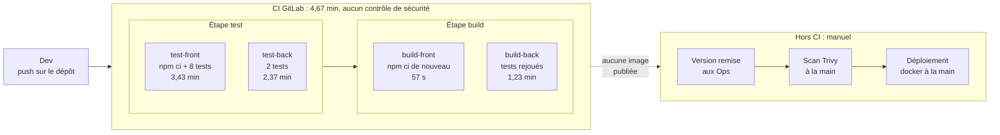
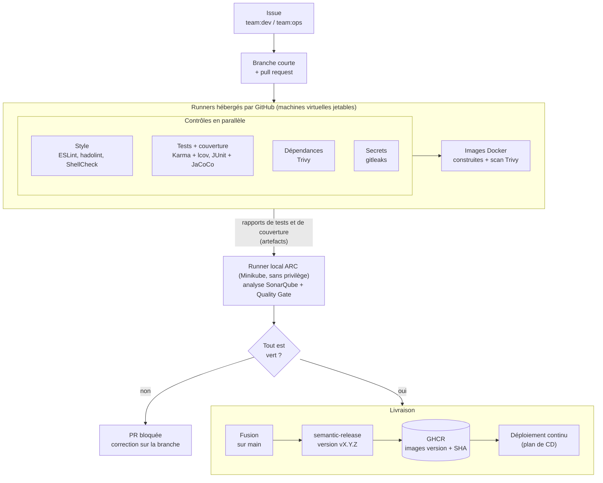

# Normalisation du développement et plan de mise en œuvre de la CI — MicroCRM

| Élément   | Valeur                                           |
| --------- | ------------------------------------------------ |
| Projet    | Démarche DevOps pour l'application MicroCRM      |
| Client    | Orion (destinataire : Maria, CTO)                |
| Auteur    | Yohan Bouchet                                    |
| Version   | 1.0 (à valider) |
| Date      | 29/10/2026                                       |

## 1. Introduction

### 1.1 Objectifs

Ce document fixe les **règles communes** que les équipes Dev et Ops
appliqueront à MicroCRM : écriture du code, gestion des versions, revue,
intégration continue, tests, sécurité et documentation. Ces règles sont
ensuite **appliquées automatiquement** par la chaîne d'intégration continue
(CI) : une règle qui n'est pas vérifiée par un outil finit par être oubliée.

Il décrit aussi le **plan de mise en œuvre** de cette CI : étapes,
responsables, ressources, calendrier et risques.

### 1.2 Contexte

L'audit (document « Veille, audit et recommandations », section 3) a montré
que rien n'est aujourd'hui normalisé : aucune stratégie de branches ni de
revue, aucune version publiée, aucun outil de style, une CI qui ne contrôle
ni la qualité ni la sécurité, et des échanges Dev/Ops par e-mail, sans trace.

Les deux équipes demandent elles-mêmes ce cadre : analyse statique du code
pour les Dev, contrôles de sécurité en amont pour les Ops. Ce document met en
œuvre les recommandations R1, R2, R3 et R7.

### 1.3 État initial du pipeline

Le pipeline actuel (GitLab CI, 2 étapes, 4 tâches) a été mesuré à froid le
27/10/2026 : **4,67 min**, 4 tâches sur 4 réussies. Il ne contrôle ni la
qualité ni la sécurité, ne publie aucune image, et la livraison reste
entièrement manuelle :

Ses principaux défauts (détail dans l'audit, 3.3.2) : images d'outils non
figées, aucun cache (dépendances retéléchargées à chaque tâche), tests
rejoués à l'étape `build`, aucun rapport ni analyse, aucune image publiée.

## 2. Normes et bonnes pratiques

### 2.1 Principes de base

| Principe | Ce qu'il signifie chez Orion |
| --- | --- |
| **Automatisation** | Tout contrôle répétable est fait par la CI, pas à la main. |
| **Répétabilité** | Outils et images figés par version et empreinte : le même commit donne toujours le même résultat. |
| **Sécurité dès la conception** | Les contrôles de sécurité ont lieu à chaque PR, avant la livraison et non après. |
| **Qualité mesurée** | Un Quality Gate décide, pas une impression. |
| **Traçabilité** | Chaque déploiement remonte à une image, une version, un commit, une PR et un ticket. |
| **Moindre privilège** | Conteneurs sans root, jetons aux droits minimaux, accès limités. |
| **Petits changements fréquents** | Branches courtes et PR ciblées : plus faciles à relire, à tester et à annuler. |

### 2.2 Conventions d'écriture de code et règles de style

**Règles communes**

- **Langue** : le code (noms, messages, journaux) est en **anglais** ; les
  commentaires et la documentation sont en **français**, langue des équipes.
- **Mise en forme** : un fichier `.editorconfig` à la racine du dépôt fixe
  l'encodage (UTF-8), les fins de ligne (LF), l'indentation (2 espaces pour
  TypeScript, HTML et YAML, 4 pour Java) et le retour à la ligne final. Il
  est lu automatiquement par les éditeurs.
- **En-tête** : chaque fichier d'infrastructure et chaque script commence par
  un commentaire `Fichier / Rôle / Utilise / Utilisé par`.

**Par technologie**

| Code | Conventions | Outil de contrôle |
| --- | --- | --- |
| Front (TypeScript, Angular) | Guide de style Angular : fichiers en `kebab-case` (`person-details.component.ts`), classes en `PascalCase` | **ESLint** (angular-eslint) |
| Back (Java, Spring Boot) | Conventions Java : classes en `PascalCase`, méthodes et variables en `camelCase`, paquets en minuscules ; injection par constructeur | **SonarQube** (règles Java « Sonar way ») |
| Dockerfile | Image de base figée, utilisateur non root, une sonde de santé (`HEALTHCHECK` ; dans Kubernetes, qui l'ignore, sondes du pod) | **hadolint** |
| Scripts Bash | `set -euo pipefail`, variables entre guillemets | **ShellCheck** |

Côté Java, SonarQube suffit au départ : les Dev débutent en Java, et un
outil de style supplémentaire (Checkstyle) ne serait ajouté que si le besoin
apparaît.

### 2.3 Gestion des versions

**Stratégie de branches : GitHub Flow**

- La branche `main` est **protégée** et toujours livrable : pas de poussée
  directe, passage obligatoire par une PR dont tous les contrôles sont verts
  et **à jour avec `main`** : après chaque fusion, les autres PR intègrent le
  nouveau `main` et repassent la CI, pour tester le code combiné.
- Chaque changement se fait sur une **branche courte** (quelques jours au
  plus), nommée `<type>/<description>` : `feat/configurable-api-url`,
  `fix/null-organization`, `docs/veille-audit`.
- La branche est supprimée après sa fusion.

GitFlow (branches `develop`, `release`, `hotfix`) a été écarté : trop lourd
pour six personnes. Le développement directement sur `main` (trunk-based) a
été écarté : il suppose des tests solides, que l'audit n'a pas trouvés.

**Messages de commit : Conventional Commits 1.0.0**

Format : `type(portée): description`, avec le type et la portée en anglais et
la description en français. Exemple :
`fix(back): corrige l'erreur quand l'organisation est absente`.

| Type | Usage | Effet sur la version |
| --- | --- | --- |
| `feat` | Nouvelle fonctionnalité | mineure (1.**2**.0) |
| `fix` | Correction | correctif (1.2.**1**) |
| `feat!` ou `BREAKING CHANGE:` | Changement incompatible | majeure (**2**.0.0) |
| `docs`, `test`, `ci`, `build`, `refactor`, `chore` | Le reste | aucune |

**Numéros de version : SemVer 2.0.0, calculés par semantic-release**

À chaque fusion sur `main`, semantic-release lit les messages de commit,
calcule la version (`MAJEUR.MINEUR.CORRECTIF`), crée le tag Git `vX.Y.Z` et
la release GitHub avec ses notes. Les images Docker portent ce numéro de
version et l'empreinte du commit ; l'étiquette `latest` n'est jamais utilisée
pour un déploiement.

Mise en œuvre (ticket #31) :

- configuration dans `.github/release/` (`.releaserc.yml`, versions figées
  par `package-lock.json`) ; job `release` du pipeline, seulement après une
  fusion sur `main` et si tous les contrôles sont verts ;
- **aucun commit poussé sur `main`** : seuls l'étiquette et la release sont
  créées, avec le jeton automatique limité à `contents: write` pour ce seul
  job ; l'historique des versions se lit dans les releases GitHub (pas de
  fichier CHANGELOG) ;
- le **type le plus fort** parmi les commits depuis la dernière version
  décide du numéro, avec un seul saut par version (deux `feat!` → une seule
  version majeure) ;
- **fusions rapprochées** : les pipelines de `main` passent l'un après
  l'autre (jamais d'annulation en cours de version ou de publication), et
  semantic-release refuse de publier depuis un commit qui n'est plus le
  dernier de `main` : le pipeline suivant produit une seule version pour
  l'ensemble des commits.

**Tickets : GitHub Issues**

Toute demande de changement commence par une issue : étiquette d'équipe
(`team:dev`, `team:ops`) et de type (`bug`, `enhancement`, `security`). La PR
qui la traite contient `Closes #<numéro>` : la fusion ferme le ticket, et le
chemin de la demande à la livraison reste tracé.

### 2.4 Revue de code

- **Outil** : les pull requests GitHub, avec un modèle de description (lien
  vers l'issue, changement réalisé, comment le tester, points de sécurité).
- **Relecteurs** : un fichier `CODEOWNERS` désigne les relecteurs
  obligatoires : l'équipe Dev pour `front/` et `back/`, l'équipe Ops pour
  `infra/` et `.github/`.
- **Critères d'acceptation** :
  1. tous les contrôles de la CI sont verts ;
  2. au moins **une approbation** d'un relecteur désigné ;
  3. toutes les discussions sont résolues ;
  4. la documentation est mise à jour dans la même PR ;
  5. aucun secret, aucun fichier généré.
- **Taille** : une PR ne porte qu'une seule intention, pour rester relisible.

### 2.5 Intégration continue

- **Outils** : GitHub Actions. Les tâches qui construisent, installent des
  dépendances ou lancent des tests tournent sur les **runners hébergés par
  GitHub** (machines virtuelles jetables) ; seule l'analyse SonarQube (puis le
  déploiement) tourne sur le **runner local ARC**, sans Docker, sans sudo et
  sans conteneur privilégié. Les rapports passent de l'un à l'autre par des
  artefacts.
- **Pipeline cible** :

- **Fréquence** : à chaque poussée sur une branche ouverte en PR et à chaque
  fusion sur `main`. Chaque développeur intègre son travail au moins une fois
  par jour.
- **Critères de réussite** : la PR n'est fusionnable que si tous ces contrôles
  passent :

| Contrôle | Outil | Bloquant |
| --- | --- | --- |
| Style et erreurs courantes | ESLint, hadolint, ShellCheck | oui |
| Tests et couverture | Karma, JUnit, JaCoCo | oui |
| Quality Gate | SonarQube | oui |
| Failles des dépendances et des images | Trivy | oui (critiques et hautes corrigeables) |
| Secrets | gitleaks | oui |
| Construction des images | Docker | oui |

- **Règles du pipeline** : actions figées par empreinte de commit (SHA),
  cache des dépendances npm et Gradle, rapports conservés comme artefacts,
  jeton `GITHUB_TOKEN` limité aux droits nécessaires à chaque tâche.
- **Protection du runner** (risque OWASP CICD-SEC-4, « Poisoned Pipeline
  Execution ») : une PR venant d'une copie extérieure du dépôt (fork) ne
  s'exécute jamais sur le runner local, et le pipeline d'un contributeur
  extérieur demande une approbation. Le runner local tourne dans un espace de
  noms soumis aux Pod Security Standards « restricted ».

### 2.6 Tests

| Test | Outil | Quand | Bloquant |
| --- | --- | --- | --- |
| Unitaires front | Karma + Jasmine (existant) | chaque PR | oui |
| Unitaires et d'intégration back | JUnit 5 + Spring Boot Test (existant) | chaque PR | oui |
| Couverture | JaCoCo (back), lcov (front), envoyés à SonarQube | chaque PR | oui, via le Quality Gate |
| Scripts | bashunit (Bash), pytest (Python) | chaque PR qui touche un script | oui |
| Fumée après déploiement | Appel du point de santé de l'API | chaque déploiement | oui (retour arrière) |

Règles :

- tout nouveau code est livré avec ses tests ; toute correction de bug ajoute
  le test qui l'aurait détecté ;
- le Quality Gate exige au moins **80 % de couverture sur le code nouveau**
  (valeur de « Sonar way »), ce qui fait progresser la couverture sans
  bloquer l'équipe sur l'existant. Point de départ, mesuré par la première
  analyse de la CI (PR #19, 30/10/2026) : **37,4 %** de couverture (lignes
  41,1 %, branches 13,8 %), contre 0 % affiché avant (non mesurée) ;
- le détail (cas testés, tests de charge et de sécurité) figure dans le plan
  de tests.

### 2.7 Sécurité

- **Contrôles automatiques** à chaque PR : analyse du code (SonarQube),
  dépendances et images (Trivy), Dockerfiles (hadolint), secrets (gitleaks).
  Dependabot propose les mises à jour des dépendances.
- **Exceptions** : une faille non corrigeable est acceptée seulement dans un
  fichier `.trivyignore`, avec sa justification et une **date d'expiration**.
- **Secrets** : jamais dans Git (`.gitignore`, modèles `.env.example` sans
  valeur) ; stockés dans les secrets GitHub Actions (pipeline), rangés dans
  un **environnement** quand seul un job en a besoin (le jeton SonarQube,
  limité au projet, n'est visible que du job d'analyse), ou dans des
  Secrets Kubernetes générés aléatoirement par les scripts de déploiement,
  jamais affichés (infrastructure) ; un secret exposé est **révoqué et
  remplacé immédiatement**.
- **Chaîne d'approvisionnement** : images officielles figées par empreinte
  (`@sha256`), actions figées par SHA, suivi des fins de support sur
  endoflife.date. L'attaque subie par Trivy en mars 2026 a montré le risque
  d'une étiquette mobile.
- **Moindre privilège** : conteneurs sans root et sans capacités Linux
  inutiles ; pods conformes aux **Pod Security Standards** de Kubernetes.
- **Comptes** : double authentification obligatoire sur GitHub ; branche
  `main` protégée.
- **Référentiels** : OWASP Top 10:2025 (application) et OWASP Top 10 CI/CD
  Security Risks (pipeline). Le traitement des failles (délais selon la
  gravité) est détaillé dans le plan de sécurité.

### 2.8 Documentation

| Documentation | Contenu | Où |
| --- | --- | --- |
| README racine | Présentation, démarrage, architecture, et pour **chaque script** : but, fonctionnement, paramètres, conditions d'exécution | `README.md` |
| Documents de projet | Audit, normes, plans, documentation CI/CD | `docs/` (Markdown, exportés en PDF) |
| Code | En-tête de fichier ; commentaire au-dessus des instructions importantes | dans les fichiers |
| Historique des versions | Notes de version générées par semantic-release | releases GitHub |
| Décisions | Discussion et choix retenus | issues et PR |

La documentation est versionnée avec le code et **mise à jour dans la même
PR** que le changement qu'elle décrit : une PR qui change un comportement
sans mettre à jour sa documentation n'est pas acceptée.

## 3. Plan de mise en œuvre

### 3.1 Objectifs

Mettre en place une chaîne d'intégration continue qui **applique
automatiquement** les normes de la section 2 sur chaque PR. Résultats
attendus, comparés aux mesures de départ du document 1 :

| Résultat attendu | Départ | Cible |
| --- | --- | --- |
| Contrôles automatiques par PR | tests seulement | style, tests, couverture, Quality Gate, failles, secrets |
| Couverture des tests | non mesurée (0 % affiché par SonarQube) | mesurée et publiée à chaque PR |
| Failles critiques ou hautes corrigeables dans une image publiée | 8 critiques et 33 hautes (image back) | 0 |
| Images livrées | aucune | versionnées (SemVer) et publiées dans un registre |
| Durée du pipeline | 4,67 min, sans contrôle de sécurité | suivie à chaque exécution, gain mesuré |

### 3.2 Étapes

#### Étape 1 — Cadrage et configuration du dépôt

- **Description** : valider ce document avec les deux équipes ; configurer le
  dépôt : protection de `main`, suppression automatique des branches
  fusionnées, `CODEOWNERS`, modèles d'issue et de PR, étiquettes
  (`team:dev`, `team:ops`), `.editorconfig`.
- **Responsables** : ingénieur DevOps (pilote), Roubina (Dev), Nico (Ops).
- **Livrables** : normes validées ; dépôt configuré.

#### Étape 2 — Runner et outils de la chaîne

- **Description** : installer le runner auto-hébergé ARC (jetable, non
  privilégié, protégé contre les forks) ; rendre SonarQube joignable depuis
  ce runner ; créer
  les secrets du pipeline dans GitHub.
- **Responsables** : équipe Ops (pilote : Nico), ingénieur DevOps.
- **Livrables** : runner opérationnel (test de fumée réussi) ; SonarQube
  accessible depuis la CI ; secrets enregistrés hors du dépôt.

#### Étape 3 — Pipeline de base : style, tests et couverture

- **Description** : premier workflow GitHub Actions : ESLint, tests front et
  back lancés une seule fois, rapports JUnit, couverture JaCoCo et lcov,
  cache npm et Gradle. Les ajouts au code (ESLint, JaCoCo) passent par des
  tickets à l'équipe Dev.
- **Responsables** : équipe Dev (pilote : Roubina), ingénieur DevOps.
- **Livrables** : workflow de CI ; rapports de tests et de couverture
  visibles dans chaque PR.

#### Étape 4 — Contrôles qualité et sécurité bloquants

- **Description** : ajouter le Quality Gate SonarQube, Trivy sur les
  dépendances, hadolint et gitleaks ; configurer Dependabot ; rendre ces
  contrôles obligatoires dans la protection de `main` ; définir la procédure
  d'exception (`.trivyignore` daté).
- **Responsables** : équipe Ops (pilote : Maïa), équipe Dev.
- **Livrables** : PR bloquée en cas d'échec ; procédure d'exception écrite.

#### Étape 5 — Images durcies, versionnées et publiées

- **Description** : un Dockerfile par composant, `front/` et `back/`
  (versions maintenues, non root, sonde de santé, bon port ; image « tout en
  un » abandonnée) ; construire les images dans la CI, les scanner avec Trivy
  sans accès à Docker, publier sur `main` l'image analysée, et elle seule ;
  publier la première version avec semantic-release.
- **Responsables** : équipe Ops (pilote : Nico), équipe Dev.
- **Livrables** : images publiées et traçables ; première release
  (`v1.0.0`) et ses notes.

#### Étape 6 — Mesure et transfert aux équipes

- **Description** : mesurer le pipeline et comparer aux mesures de départ ;
  compléter le README (chaque script : but, fonctionnement, paramètres) ;
  animer un atelier Dev/Ops sur l'utilisation de la chaîne.
- **Responsables** : ingénieur DevOps, Roubina, Nico.
- **Livrables** : mesures avant/après ; README à jour ; atelier réalisé.

### 3.3 Ressources nécessaires

| Ressource | Détail |
| --- | --- |
| Personnes | Équipe Dev (4), équipe Ops (2), ingénieur DevOps ; Maria (CTO) pour les arbitrages |
| Serveur | Machine Ubuntu de l'équipe (8 cœurs, 14 Gio de RAM) : Minikube (4 cœurs et 7 Go alloués) avec le runner local et SonarQube (environ 2 Gio mesurés) ; runners hébergés par GitHub, gratuits pour un dépôt public |
| Services | Dépôt GitHub public : GitHub Actions, Dependabot et registre d'images gratuits pour un dépôt public |
| Logiciels | SonarQube Community Build, Trivy, hadolint, gitleaks, ESLint, semantic-release : gratuits et open source |
| Budget | 0 € de licence ; le coût est le temps des équipes et la machine existante |
| Formation | Atelier de prise en main (étape 6) ; accompagnement des Dev sur Java et JUnit |

### 3.4 Calendrier prévisionnel

Estimation dans un cadre normal (équipes disponibles, sans difficulté
majeure), en semaines à partir de la validation de ce document :

| Étape | S1 | S2 | S3 | S4 |
| --- | --- | --- | --- | --- |
| 1. Cadrage et configuration du dépôt | ■ | | | |
| 2. Runner et outils de la chaîne | ■ | | | |
| 3. Pipeline de base | | ■ | | |
| 4. Contrôles bloquants | | | ■ | |
| 5. Images et publication | | | ■ | ■ |
| 6. Mesure et transfert | | | | ■ |

Jalons : fin S2, chaque PR est testée avec sa couverture ; fin S3, une PR
non conforme ne peut plus être fusionnée ; fin S4, première version publiée
et équipes formées.

### 3.5 Gestion des risques

| Risque | Probabilité | Impact | Atténuation |
| --- | --- | --- | --- |
| Les nombreuses failles existantes bloquent toutes les livraisons | forte | fort | Corriger d'abord les critiques ; exceptions datées et justifiées ; montée de version du socle (recommandation R4) |
| Le Quality Gate bloque l'équipe dès le départ | moyenne | moyen | Conditions sur le code nouveau seulement, durcies ensuite |
| Les Dev, débutants en Java, peinent à écrire les tests back | forte | moyen | Petits tickets, travail en binôme, exemples fournis |
| Le pipeline s'allonge avec les contrôles | moyenne | moyen | Cache, tâches en parallèle, durée suivie à chaque exécution |
| Le runner local est indisponible (machine arrêtée) : plus d'analyse SonarQube ni de déploiement | moyenne | moyen | Service systemd qui démarre le cluster après Docker et l'arrête proprement (en place depuis le 31/10, ticket #29) ; procédure de relance : [infra/systemd/README.md](../infra/systemd/README.md) |
| Code malveillant exécuté sur le runner local | faible | fort | Runner sans Docker, sans sudo ni privilège (PSS restricted) ; aucune PR de fork sur ce runner, approbation, 2FA ; le code non maîtrisé (dépendances, tests) tourne sur les runners hébergés |
| Outil de la chaîne compromis (cas de Trivy en mars 2026) | faible | fort | Outils figés par empreinte ; veille sur les avis de sécurité |
| Retour aux habitudes (e-mail, déploiement manuel) | moyenne | moyen | Atelier, documentation, tickets obligatoires |

**Limite connue** : la règle « une approbation obligatoire » (2.4) suppose
au moins deux contributeurs ; GitHub n'autorise pas l'auteur d'une PR à
l'approuver. Sur le dépôt de démonstration, à un seul contributeur, seules
la PR et les contrôles de la CI sont donc imposés.

**Limite connue (SonarQube Community Build)** : l'édition gratuite n'analyse
que la branche principale ; l'analyse de branche et le commentaire des PR
sont réservés à la Developer Edition, payante. Chaque PR est tout de même
analysée et son Quality Gate la bloque, mais cette analyse remplace les
résultats de `main` dans le tableau de bord jusqu'à la fusion suivante, dont
l'analyse les rétablit. Évolutions possibles : Developer Edition, ou plugin
communautaire non supporté par SonarSource (écarté pour cette raison).

**Limite connue (rapport JUnit du front)** : Karma, abandonné par ses
auteurs, n'a plus de module JUnit maintenu ; SonarQube voit donc la
couverture du front, mais pas le détail de ses 8 tests. Le passage à Vitest,
lanceur de tests par défaut d'Angular, est prévu avec la montée de version
du socle (recommandation R4).

## 4. Conclusion

### 4.1 Synthèse

Ces normes donnent aux équipes Dev et Ops un **langage commun** : même
stratégie de branches, mêmes messages de commit, mêmes critères de revue et
mêmes contrôles. En les confiant à la CI, Orion passe d'une qualité et d'une
sécurité vérifiées **à la main et après coup** à des contrôles
**automatiques, à chaque PR et avant la livraison**, ce que demandaient les
deux équipes.

### 4.2 Prochaines étapes

Après la mise en œuvre, pour que la démarche dure :

- **revue mensuelle** des alertes Dependabot et des fins de support ;
- **durcissement progressif** du Quality Gate, du code nouveau vers
  l'ensemble du code ;
- **rétrospective** Dev/Ops après chaque release, pour ajuster les normes ;
- **déploiement continu** et **supervision**, décrits dans le plan de CD ;
- évolutions étudiées : analyse CodeQL, contrôles CIS Benchmark, registre
  interne Harbor, commitlint (vérifier en CI le format des messages de
  commit, puisque leur type décide de la version).
