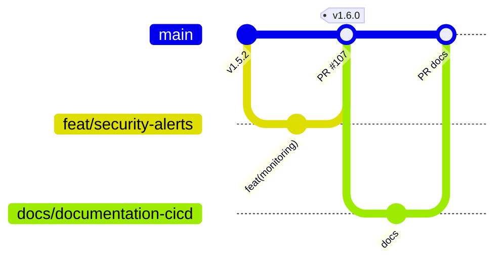
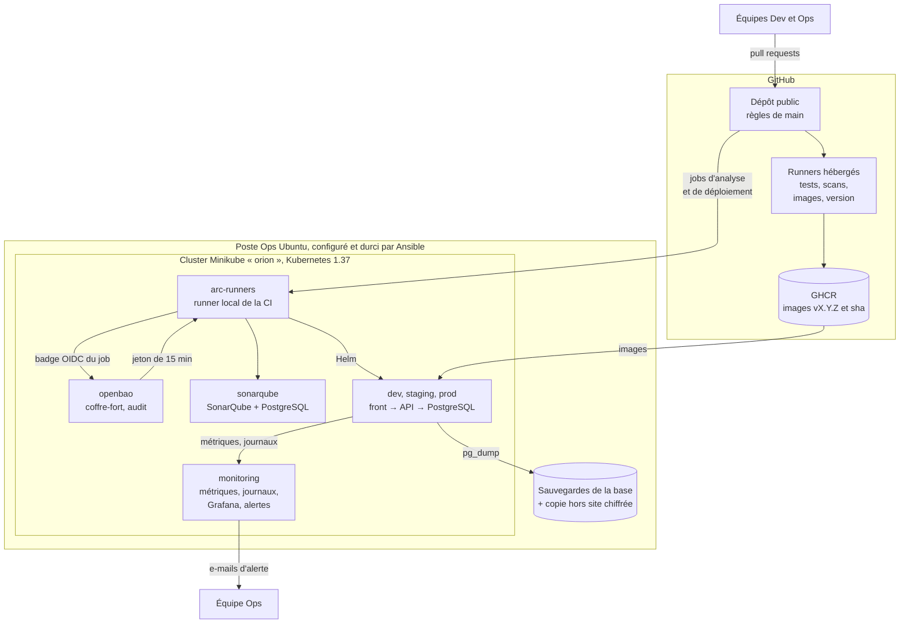
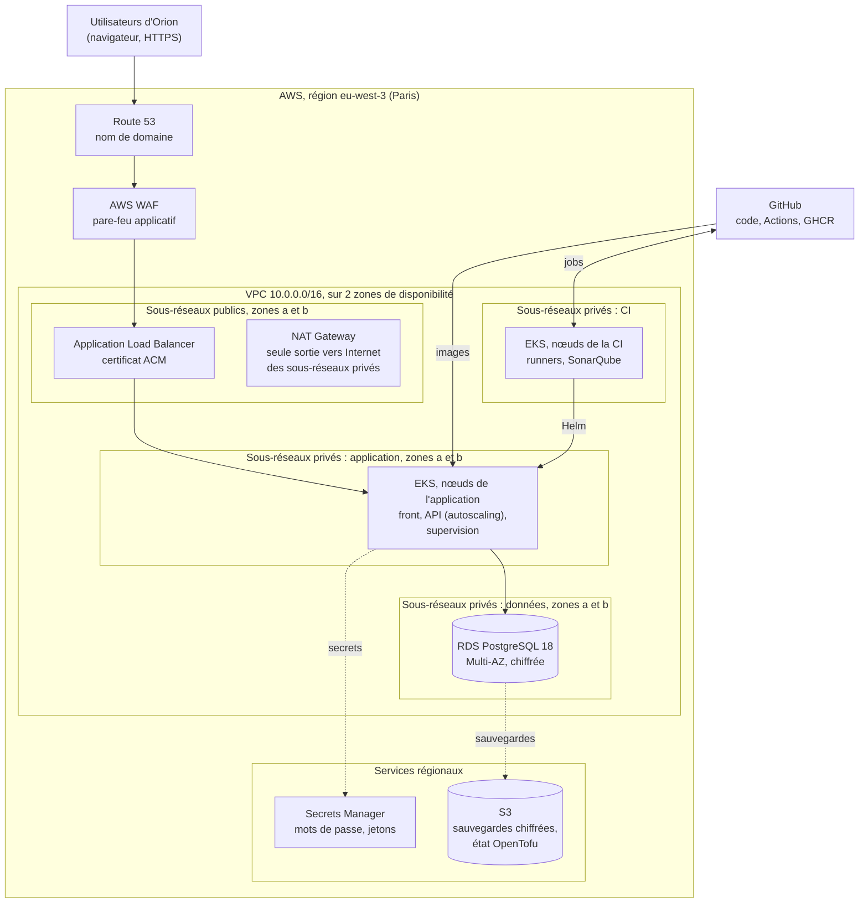
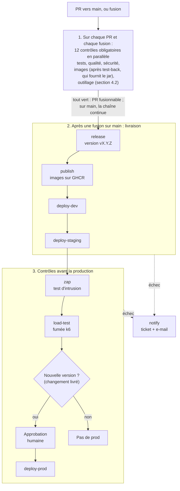
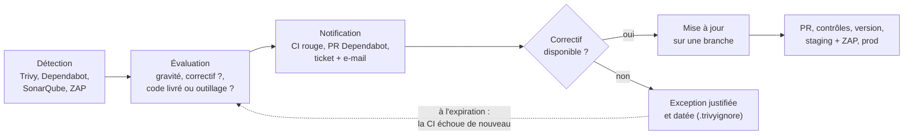

# Documentation CI/CD complète — MicroCRM

| Élément | Valeur |
| --- | --- |
| Projet | Démarche DevOps pour l'application MicroCRM |
| Client | Orion (destinataire : Maria, CTO) |
| Auteur | Yohan Bouchet, ingénieur DevOps |
| Version | 1.1 (11/11 : coffre-fort OpenBao et accès courts de la CI, OpenTofu, Molecule ; chiffres du 10/11) |
| Date | 07/11/2026, mis à jour le 11/11/2026 (configuration vérifiée ce jour) |
| Dépôt | [github.com/yohanbouchet/orion](https://github.com/yohanbouchet/orion) (public) |

## Sommaire

1. [Introduction](#1-introduction)
2. [Contexte et objectifs du projet](#2-contexte-et-objectifs-du-projet)
3. [Workflow de branches](#3-workflow-de-branches)
4. [Stratégie de tests automatisés](#4-stratégie-de-tests-automatisés)
   (plan de tests)
5. [Architecture IaC et Cloud](#5-architecture-iac-et-cloud) (plan de
   conteneurs et de déploiement)
6. [Sécurité et qualité du code](#6-sécurité-et-qualité-du-code) (plan
   de sécurité)
7. [Automatisation des releases et rollback](#7-automatisation-des-releases-et-rollback)
   (plan de release, de retour arrière et de sauvegarde)
8. [Annexes](#8-annexes)

## 1. Introduction

### 1.1 Présentation du document

MicroCRM est l'application de gestion de la relation client d'Orion :
des **personnes** liées à des **organisations**, avec un front Angular,
une API Spring Boot et une base PostgreSQL. Ce document décrit la chaîne
d'intégration et de déploiement continus (**CI/CD**) mise en place pour
elle : comment le code est testé, analysé, versionné, déployé, surveillé,
et comment revenir en arrière.

Il décrit la configuration **réelle**, vérifiée le 11/11/2026, et renvoie
aux fichiers du dépôt pour le détail. Rédigé avec l'assistance de l'IA
(Claude, Anthropic) à partir de la configuration vérifiée, puis relu et
validé par l'ingénieur DevOps. Il suit le modèle de documentation
CI/CD fourni et intègre le **plan de tests et de sécurité** (sections 4
et 6) et le **plan de CD** (sections 5 et 7). Documents liés :

| Document | Rôle |
| --- | --- |
| [1. Veille, audit et recommandations](01-veille-audit-recommandations.md) | état de départ, choix des outils |
| [2. Normalisation et plan CI](02-normalisation-plan-ci.md) | règles communes aux deux équipes |
| [4. Rapport de performance](04-rapport-performance.md) | résultats mesurés, gains, recommandations |
| [README du dépôt](../README.md) | instructions d'installation et de déploiement |

**Accessibilité** : titres hiérarchisés, tableaux avec ligne d'en-tête,
chaque schéma suivi de sa description en texte, aucune information
portée par la couleur seule, sigles développés à leur première
apparition et dans le glossaire ([annexe A](#annexe-a-glossaire)).

### 1.2 Technologies principales

| Catégorie | Outil | Rôle |
| --- | --- | --- |
| CI/CD | **GitHub Actions** (à la place de GitLab CI, avec l'accord du mentor) | exécute le pipeline : contrôles sur des machines jetables de GitHub ; analyse et déploiements par un runner local dans le cluster (ARC 0.15.1) |
| Versions | **semantic-release** | calcule le numéro de version (SemVer) à partir des messages de commit, crée l'étiquette et la release |
| Qualité | **SonarQube** Community Build 26.10 | analyse statique, couverture, Quality Gate bloquant |
| Sécurité | **Trivy** 0.76.2, **gitleaks** 8.30.1, **hadolint** 2.15.1, **ShellCheck** 0.11.0, **OWASP ZAP** 2.17.0, **Dependabot** | failles des dépendances et des images, secrets, bonnes pratiques, test d'intrusion, mises à jour |
| Secrets | **OpenBao** 2.7.2 (coffre-fort, MPL-2.0 ; chart 0.30.7) | délivre à chaque job de la CI un accès court au cluster contre son badge OIDC de GitHub, garde le jeton SonarQube, trace chaque demande : **aucun secret dans GitHub** |
| Tests | **Vitest** 5 (front), JUnit 5 + JaCoCo, bashunit, pytest, `tofu test`, **Molecule** 26.11, **k6** 2.3.0 | tests du front, du back, des scripts, de l'infrastructure et du poste Ops ; tests de charge |
| Conteneurs | **Docker** (images durcies ; celle du back emballe le jar testé par la CI), **GHCR** (registre de GitHub) | images de l'application, versionnées et publiées |
| Orchestration | **Kubernetes** 1.37 (Minikube 1.39.0), **Helm** 4 | trois environnements, déploiement progressif, autoscaling |
| IaC | **OpenTofu** 1.13 (fichiers Terraform), **Ansible** 2.21 | socle du cluster, supervision, OpenBao et identité de la CI ; configuration du poste Ops |
| Supervision | **VictoriaMetrics** 1.155, **VictoriaLogs** 1.53, **Grafana** 13.2.5, **Alertmanager** 0.34.2 | métriques, journaux, tableaux de bord, alertes par e-mail |
| Cloud | **AWS** (cible proposée, [section 5.2.1](#521-schéma-dinfrastructure-cloud)) | aujourd'hui, tout tourne en local sur le poste Ops : l'offre gratuite d'AWS ne suffit pas à faire tourner la chaîne en continu (section 5.1) ; choix validé avec le mentor |
| Application | Angular 22.2, Spring Boot 4.1.2 (Java 17), PostgreSQL 18.6 | code de l'équipe Dev |

Ces outils sont **open source**, sauf les services de GitHub (Actions,
GHCR, Dependabot) et AWS. Terraform, passé en 2023 sous une licence à
source disponible (BUSL), a été remplacé le 09/11 par son successeur
open source, **OpenTofu** (MPL-2.0), qui exécute les mêmes fichiers et
a repris l'état sans rien recréer. Les versions sont figées et
vérifiées (dernière version, fin de support) : liste à jour dans le
[README](../README.md#versions-des-outils).

## 2. Contexte et objectifs du projet

### 2.1 Contexte

Deux équipes travaillent sur MicroCRM : **Dev** (4 personnes,
responsable : Roubina), à l'aise en Angular et Docker mais débutante en
Java et Gradle ; **Ops** (2 personnes, responsable : Nico), à l'aise en
Bash, Ansible et Docker. Leurs sondages et l'audit du 29/10 ont relevé :

- **aucune règle commune** : pas de stratégie de branches, pas de revue,
  pas de version (`0.0.1-SNAPSHOT`), échanges Dev/Ops par e-mail ;
- **une CI minimale** : 4 tâches (tests et construction) en 4,67 min,
  sans contrôle de qualité ni de sécurité, aucune image publiée ;
- **une livraison manuelle** : la version est remise aux Ops, qui la
  scannent avec Trivy puis la déploient à la main ;
- **des failles découvertes trop tard**, qui ont retardé une
  démonstration ; l'audit en a compté 95 dans l'image du back, dont 8
  critiques ;
- **des besoins exprimés** : analyse statique du code (Dev) ; contrôles
  de sécurité en amont et registre d'images (Ops) ; un écart sur la base
  de données (HyperSQL côté Dev, PostgreSQL souhaité par les Ops).

### 2.2 Objectifs du projet

Fixés par le plan de mise en œuvre (document 2), mesurés par le rapport
de performance (document 4) :

| Objectif | Avant | Cible | Résultat au 10/11 |
| --- | --- | --- | --- |
| 1. Aucune faille connue livrée sans décision | 95 failles dans l'image back, dont 8 critiques | 0 critique ou haute corrigeable dans une image publiée | **0**, toutes gravités confondues (images v1.9.0, Trivy 0.76.2) |
| 2. Qualité contrôlée à chaque modification | Quality Gate sans condition, couverture non mesurée | Quality Gate bloquant ; nouveau code couvert à 80 % | **3 conditions bloquantes** ; couverture 82,9 % |
| 3. Livrer plus vite et de façon traçable | déploiement manuel, non tracé | chaque déploiement lié à une version, une image et un commit | **5,1 mises en prod par semaine**, 2,9 h entre un commit et la prod (médiane), 0 % d'échec |
| 4. Revenir en arrière sans coupure | aucun retour arrière ni sauvegarde | retour arrière automatique ; sauvegarde restaurable | **testés** : retour arrière sans coupure ; restauration vérifiée chaque semaine |
| 5. Voir et être prévenu | aucune supervision | disponibilité, performance et sécurité suivies | **3 tableaux de bord, 9 alertes**, indicateurs DORA chaque semaine |

## 3. Workflow de branches

### 3.1 Modèle de branching choisi

**GitHub Flow** : une branche `main` toujours livrable, et une branche
courte par changement, fusionnée par pull request (PR). Raisons : équipe
de six personnes, livraisons plusieurs fois par semaine, une seule
version en production. **Git Flow** (branches `develop`, `release`,
`hotfix`) a été écarté, trop lourd pour cette taille d'équipe ; le
**trunk-based** pur aussi : il suppose des tests solides, absents au
départ (couverture non mesurée).

### 3.2 Structure des branches



*Description du schéma* : chaque changement part de `main` sur une
branche courte (ici `feat/security-alerts`), revient dans `main` par une
PR ; une PR `feat` ou `fix` publie une version (ici v1.6.0), une PR
`docs` n'en publie pas.

| Branche | Rôle | Durée de vie |
| --- | --- | --- |
| `main` | code livrable ; source de toutes les versions et de tous les déploiements | permanente, protégée |
| `<type>/<description>` | un changement (fonctionnalité, correction, documentation, CI…) | quelques heures à quelques jours, supprimée automatiquement après la fusion |

Pas de branche `hotfix` : une correction urgente suit le même chemin
(PR, contrôles, version corrective `vX.Y.Z+1`), en quelques minutes.

**Politique de fusion** (règles de `main`, appliquées aussi aux
administrateurs) :

- passage obligatoire par une PR : pas de poussée directe, ni de
  réécriture de l'historique, ni de suppression de `main` ;
- **12 contrôles obligatoires** au vert (section 4.2), et PR **à jour
  avec `main`** : le code testé est le code fusionné ;
- toutes les discussions de la PR résolues ; fusion par commit de fusion
  (historique lisible, PR retrouvable) ;
- relecteurs ajoutés automatiquement par [`CODEOWNERS`](../.github/CODEOWNERS)
  (Dev pour `front/` et `back/`, Ops pour `infra/` et `.github/`).
  **Approbations exigées : 0 aujourd'hui** (une seule personne joue les
  deux équipes) ; en équipe, **1 approbation** d'un relecteur désigné
  (document 2, section 2.4) ;
- la mise en **production** demande en plus l'**approbation** d'une
  personne désignée (environnement GitHub `production`).

### 3.3 Convention de nommage

- **Branches** : `<type>/<description>`, en minuscules, mots séparés par
  des tirets ; le type est celui du commit : `feat/security-alerts`,
  `fix/dashboards`, `docs/rapport-performance`.
- **Commits** : [Conventional Commits 1.0.0](https://www.conventionalcommits.org/fr/v1.0.0/),
  type et portée en anglais, description en français :
  `fix(back): corrige l'erreur quand l'organisation est absente`. Le
  type décide de la version (section 7.3).
- **Tickets** : formulaires [Dev], [Ops] et Incident
  ([`.github/ISSUE_TEMPLATE/`](../.github/ISSUE_TEMPLATE/)) ; la PR cite
  le ticket (`Closes #n`), la fusion le ferme.
- **Versions et images** : `vX.Y.Z` (étiquette Git, release, image) et
  `sha-<7 caractères>` (image d'un commit) ; jamais `latest`.

## 4. Stratégie de tests automatisés

### 4.1 Types de tests implémentés

Les tests protègent d'abord ce qui a coûté cher à Orion : une régression
livrée, une faille découverte après la livraison, une mise en production
manuelle ratée.

| Type de test | Outil | Déclenchement | Couverture cible |
| --- | --- | --- | --- |
| Unitaires | Vitest, navigateur simulé jsdom (front, 16 tests, back simulé : chargement, création, suppression, liens entre personnes et organisations) | chaque PR et chaque fusion | **80 % du code nouveau** (Quality Gate) ; au 08/11, 82,9 % de l'ensemble (lignes 87,6 %, branches 57,9 %) |
| Intégration | JUnit 5 + Spring Boot Test, base en mémoire (back, 6 tests : démarrage de l'application, points de gestion, accès à la base) ; `tofu test` (13 tests : 8 du socle, 5 de la configuration d'OpenBao) ; `helm lint` à chaque déploiement | chaque PR ; chaque déploiement | même cible de couverture ; chaque règle d'accès du socle et d'OpenBao |
| E2E | **test de fumée** après chaque déploiement : appel de `/api/persons` depuis le pod du front (front → back → base) | chaque déploiement (dev, staging, prod) | le parcours complet ; un échec remet la version précédente |
| Sécurité | **SonarQube** (analyse statique), Trivy, gitleaks, hadolint ; **OWASP ZAP** (test d'intrusion de staging) | chaque PR ; ZAP à chaque déploiement de staging | 0 nouveau problème ; 0 faille haute ou critique corrigeable ; 0 alerte ZAP bloquante (66 règles) |
| Performance | **k6** : test de fumée (1 utilisateur simulé, 30 s) ; 6 profils de charge à la demande | chaque déploiement de staging (bloque la prod) ; à la demande | moins de 1 % d'erreurs, p95 < 500 ms, p99 < 1,5 s |
| Scripts d'exploitation | bashunit (74 tests), pytest (28 tests) | chaque PR | chaque script et chaque cas d'arrêt documenté |
| Infrastructure | `tofu fmt`, `validate` et `test` ; `ansible-playbook --syntax-check`, ansible-lint (profil production) ; **Molecule** : 5 rôles Ansible appliqués à une machine jetable, idempotence, contrôles | chaque PR | 100 % des fichiers Terraform et Ansible ; 5 rôles sur 8 exécutés |

**Limite** : pas de test de bout en bout dans un navigateur (Cypress,
Playwright) ; le test de fumée couvre le chemin technique, pas les
écrans. C'est une recommandation à l'équipe Dev (rapport, section 8.3).
La logique shell des deux actions composites de la CI (`kube-access`,
`openbao-secret`) n'a pas non plus de test automatique : elle est relue
par zizmor et actionlint, et exercée à chaque déploiement ; évolution :
la déplacer dans `scripts/` et la tester avec bashunit.

### 4.2 Intégration dans le pipeline GitHub Actions

Fichier : [`.github/workflows/ci.yml`](../.github/workflows/ci.yml)
(équivalent du `.gitlab-ci.yml` demandé). **Déclencheurs** : chaque PR
vers `main`, chaque fusion sur `main`, et à la main (onglet Actions).

| Étape | Jobs | Quand | Bloquant |
| --- | --- | --- | --- |
| Contrôles (en parallèle, machines jetables de GitHub) | `test-front`, `test-back`, `gitleaks`, `hadolint`, `shellcheck`, `script-tests`, `opentofu`, `ansible`, `trivy`, `images (front)`, `images (back)` ; les images attendent `test-back`, qui fournit le jar du back | chaque PR et chaque fusion | oui : contrôles obligatoires de `main` |
| Analyse de qualité (runner local) | `sonarqube`, après les deux jobs de tests (il lit leurs rapports de couverture) | chaque PR et chaque fusion ; sautée pour les PR de Dependabot (aucun secret, versions seulement) | oui |
| Version et publication | `release`, `publish` | fusion sur `main`, si tout est vert | — |
| Déploiement et tests en fonctionnement | `deploy-dev`, `deploy-staging`, `zap`, `load-test` | fusion sur `main` | oui : un échec arrête la chaîne avant la prod |
| Production | `deploy-prod` | si une version vient d'être publiée, après ZAP et k6, **après approbation** | — |
| Notification | `notify` | sur `main`, toujours, même en cas d'échec | — |

Les commandes de test sont des **scripts** ([`scripts/`](../scripts/README.md)),
lancés à l'identique sur un poste et dans la CI. Les rapports (tests,
couverture, ZAP, k6) sont gardés comme artefacts et résumés dans la page
de chaque exécution.

### 4.3 Quality Gate SonarQube

Conditions vérifiées le 09/11/2026 (API de SonarQube), sur le **code
nouveau** :

| Critère | Seuil | Valeur au 09/11 |
| --- | --- | --- |
| Couverture des tests | au moins 80 % | 90,9 % |
| Lignes dupliquées | 3 % au plus | 0,0 % |
| Nouveaux problèmes (bugs, failles, mauvaises pratiques) | 0 | 0 |

Le **code nouveau** est ici tout ce qui a changé depuis le 29/10 au
soir, juste après la photo de départ : SonarQube le compte depuis le
dernier changement de numéro de version (réglage « version
précédente »), et la CI ne lui transmet pas de numéro. Au 09/11 :
717 lignes nouvelles ou modifiées, pour 977 lignes de code. Ces conditions
portent sur ce code nouveau : l'équipe progresse sans être bloquée par
le code d'origine, dont la dette reste suivie. Depuis
la mise à jour vers Angular 22 (08/11), le projet n'a plus aucun
problème ouvert et obtient la note A en sécurité, en fiabilité et en
maintenabilité (rapport, section 4.2).

**En cas d'échec** : le job `sonarqube` attend le verdict (5 min au
plus) et échoue ; la PR ne peut pas être fusionnée. Le développeur lit le
détail dans SonarQube, corrige sur sa branche, et la CI repasse. Aucune
dérogation possible : la règle s'applique aussi aux administrateurs.

### 4.4 Environnements et données de test

| Environnement | Ce qui y est testé | Données |
| --- | --- | --- |
| Machines de GitHub (jetables) | tests unitaires et d'intégration, scans, construction des images | base HyperSQL en mémoire, recréée à chaque exécution ; rien n'est conservé |
| `dev` | test de fumée de chaque version | base PostgreSQL de l'environnement |
| `staging` (comme la prod, en plus petit) | test de fumée, test d'intrusion ZAP, test de fumée k6 ; tests de charge complets à la demande | le scénario k6 crée puis **supprime** ses propres personnes de test |
| `prod` | test de fumée seul (lecture) ; **jamais de test de charge** depuis l'incident du 05/11 | données réelles ; sauvegardes vérifiées dans une **base temporaire**, supprimée après comptage |

Aucune donnée réelle n'est copiée dans un environnement de test.

### 4.5 Critères de réussite et seuils d'acceptation

| Métrique | Seuil d'acceptation | Effet si dépassé |
| --- | --- | --- |
| Tests unitaires et d'intégration | 100 % réussis | PR bloquée |
| Couverture du code nouveau | ≥ 80 % | PR bloquée (Quality Gate) |
| Failles des dépendances et des images | 0 haute ou critique corrigeable (sauf exception datée) | PR bloquée |
| Secrets dans l'historique | 0 | PR bloquée |
| Test d'intrusion ZAP | 0 alerte réglée sur FAIL | prod bloquée |
| Test de fumée k6 | erreurs < 1 %, p95 < 500 ms, p99 < 1,5 s, vérifications > 99 % | prod bloquée |
| Test de fumée après déploiement | `/api/persons` répond en 3 essais au plus | retour automatique à la version précédente |
| Temps de réponse en prod (supervision) | p95 < 500 ms | alerte `MicrocrmSlowResponses` |

### 4.6 Maintenance des tests

- **Mise à jour** : toute nouvelle fonctionnalité arrive avec ses tests ;
  toute correction de bug ajoute le test qui l'aurait détecté (document 2,
  section 2.6). Les seuils sont revus à chaque version majeure.
- **Surveillance** : un échec sur `main` ouvre automatiquement un ticket
  assigné, avec e-mail (`notify.py`) ; un test instable est corrigé, pas
  relancé jusqu'à ce qu'il passe.
- **Outils de test** à jour : Dependabot propose chaque semaine les
  nouvelles versions (Vitest, JUnit, actions de la CI…), testées par la CI
  comme toute PR.
- **Responsabilités** : l'équipe Dev maintient les tests de l'application
  (`front/`, `back/`) ; l'équipe Ops ceux des scripts et de
  l'infrastructure ([`scripts/tests/`](../scripts/tests/),
  [`infra/terraform/tests/`](../infra/terraform/tests/)) ; `CODEOWNERS`
  les désigne comme relecteurs.
- **Documentation et formation** : chaque script est documenté (but,
  fonctionnement, paramètres, conditions d'exécution) dans
  [`scripts/README.md`](../scripts/README.md) ; le modèle de PR rappelle
  les vérifications ; les Dev, débutants en Java, s'appuient sur les tests
  existants du back comme modèles.

## 5. Architecture IaC et Cloud

### 5.1 Vue d'ensemble de l'architecture

- **Application** : architecture **3 tiers** conteneurisée : front
  (nginx, pages Angular), API (Spring Boot), base (PostgreSQL). Le front
  relaie `/api` vers l'API : une seule adresse pour le navigateur.
- **Aujourd'hui** : tout tourne **en local**, sur le poste Ops Ubuntu,
  dans un cluster Kubernetes **Minikube**. GitHub héberge le code, la CI
  et le registre d'images (GHCR). Raison exposée au mentor, qui a validé
  ce choix : les ressources de l'offre gratuite d'AWS ne suffiraient pas
  à faire tourner en continu un cluster Kubernetes, SonarQube et la
  supervision, qui demandent ici 4 cœurs et 10 Gio de mémoire.
- **IaC** : des fichiers **Terraform**, exécutés par **OpenTofu**,
  décrivent le socle du cluster (namespaces, comptes de déploiement aux
  droits limités, supervision) ; **Helm** décrit
  l'application ; **Ansible** configure et durcit le poste Ops.
- **Cible cloud proposée** : **AWS**, avec un cluster managé (**EKS**),
  une base managée (**RDS** PostgreSQL), le stockage objet (**S3**) pour
  les sauvegardes et l'état OpenTofu, sur deux zones de disponibilité
  (section 5.2.1). AWS plutôt qu'Azure : services équivalents, offre
  gratuite de découverte, et un cours OpenClassrooms sur AWS parmi les
  ressources de l'énoncé.

### 5.2 Schémas d'architecture

#### 5.2.1 Schéma d'infrastructure Cloud

**Architecture actuelle (en service)**



*Description du schéma* : les développeurs proposent leurs changements
sur GitHub. Les runners de GitHub testent, analysent et construisent les
images, publiées sur GHCR. Dans le cluster Minikube du poste Ops, un
runner local reçoit les jobs d'analyse (SonarQube) et de déploiement :
chaque job présente à OpenBao le badge OIDC que GitHub a signé pour lui
et reçoit un jeton de 15 min (aucun secret n'est rangé dans GitHub) ;
il installe les images dans `dev`, `staging` et `prod` avec Helm. La
supervision lit métriques et journaux et envoie les alertes par e-mail ;
la base de prod est sauvegardée sur le poste, avec une copie hors site
chiffrée.

**Cible proposée sur AWS (non déployée)**



*Description du schéma* : les utilisateurs passent par le nom de
domaine (Route 53), le pare-feu applicatif (WAF) et l'équilibreur de
charge (ALB), seuls éléments exposés, dans les sous-réseaux publics. Les
pods de l'application tournent sur des nœuds EKS dans des sous-réseaux
privés, répartis sur deux zones ; la CI a ses propres nœuds, séparés de
ceux de l'application. La base RDS est répliquée dans une seconde zone
(Multi-AZ), dans des sous-réseaux privés réservés aux données. Les
sauvegardes et l'état OpenTofu sont dans S3, chiffrés ; les secrets dans
Secrets Manager.

| Aujourd'hui (local) | Cible AWS | Ce que la cible apporte |
| --- | --- | --- |
| Minikube, un seul nœud | EKS, nœuds dans 2 zones, mise à l'échelle des nœuds (Karpenter ou Cluster Autoscaler) | plus de point unique de défaillance ; capacité qui suit la charge |
| CI et application sur la même machine | groupes de nœuds séparés pour la CI et l'application | un test lourd ne peut plus saturer la prod (incident du 05/11) |
| Aucun budget de perturbation (un seul nœud, jamais vidé) | budget de perturbation (*PodDisruptionBudget*) du front et de l'API ; droit ajouté au compte de déploiement | la mise à jour d'un nœud ne retire qu'un pod à la fois |
| PostgreSQL dans le cluster, une instance | RDS Multi-AZ, sauvegardes automatiques, restauration à un instant donné | bascule automatique ; perte de données réduite à quelques minutes |
| Accès par `kubectl port-forward` | ALB + WAF + certificat ACM | accès HTTPS public, filtré |
| Secrets Kubernetes créés par script | Secrets Manager + External Secrets Operator, rotation | rotation, audit des accès |
| Sauvegardes sur le poste + copie hors site | S3 chiffré, versionné, copie dans une autre région | durabilité, rétention par règles |
| Accès de la CI par OpenBao (badge OIDC de GitHub → jeton Kubernetes de 15 min) ; OpenBao déverrouillé à la main | même badge OIDC, accepté par AWS (rôle IAM) et par EKS ; OpenBao en 3 serveurs, déverrouillé par AWS KMS (ou Secrets Manager seul) | aucun geste manuel ; même principe, aucun secret dans la CI |
| État OpenTofu local | S3 chiffré par KMS, verrouillage natif | travail en équipe sans conflit |

**Plan de passage** (aucune modification de l'application ni du
pipeline : les mêmes images, le même chart Helm, les mêmes scripts) :
réseau et EKS par OpenTofu (modules officiels de la communauté
`terraform-aws-modules`) ; RDS et S3 ; secrets et accès OIDC ;
supervision ; bascule de `staging`, puis de `prod` après un test de
charge sur la nouvelle infrastructure. Le coût est à chiffrer avec l'AWS
Pricing Calculator avant décision.

#### 5.2.2 Schéma du pipeline CI/CD



*Description du schéma* : à chaque PR et à chaque fusion, 12 contrôles
tournent en parallèle (l'analyse SonarQube attend les tests, dont elle
lit la couverture ; les images attendent `test-back`, qui leur fournit
le jar testé du back). Sur une PR, ils décident si la fusion est permise.
Après une fusion sur `main`, la chaîne continue : version, publication
des images, déploiement dans `dev` puis `staging`, test d'intrusion ZAP,
test de fumée k6 ; chaque étape doit réussir pour passer à la suivante.
La production n'est déployée que si une version a été publiée, donc
si un changement livré a été fusionné (back, front, chart, base ou
dépendances livrées, section 7.3), et qu'une personne l'approuve. En
cas d'échec sur `main`, un ticket est ouvert et un e-mail envoyé.

### 5.3 Environnements

| Environnement | Branche(s) | Type de déploiement | URL | Particularités |
| --- | --- | --- | --- | --- |
| Development (`dev`) | `main` | automatique à chaque fusion, image du commit (`sha-xxxxxxx`) | aucune URL publique : `kubectl -n dev port-forward svc/microcrm-front 8080:8080` | 1 réplique par composant ; base de 1 Gio |
| Staging (`staging`) | `main` | automatique après `dev`, **même image** (promotion) | idem, `-n staging` | API de 1 à 4 répliques (autoscaling) ; cible de ZAP et de k6, seuls autorisés par le pare-feu ; base de 2 Gio |
| Production (`prod`) | `main`, versions `vX.Y.Z` | après ZAP et k6, **sur approbation** | idem, `-n prod` (cible AWS : nom de domaine derrière l'ALB) | front à 2 répliques ; API de 2 à 4 répliques (autoscaling à 70 % du processeur) ; base de 5 Gio, sauvegardée chaque jour |

Chaque environnement a son **namespace** Kubernetes (niveau Pod Security
« restricted ») et son **compte de déploiement**, qui n'a de droits que
dans ce namespace ; aucun jeton n'est rangé : OpenBao en délivre un de
15 min au job de l'environnement GitHub du même nom (section 6.3).

### 5.4 Structure du code IaC

```text
infra/
  terraform/        socle du cluster (fichiers Terraform, OpenTofu 1.13)
    main.tf           namespaces dev, staging, prod (« restricted »)
    rbac.tf           un compte deployer par namespace, droits limités
    monitoring.tf     supervision : chart Helm, tableaux de bord
    openbao.tf        coffre-fort OpenBao : certificat TLS, chart Helm,
                      droit de créer des jetons courts des deployer
    variables.tf, outputs.tf, providers.tf, versions.tf (versions figées)
    tests/            8 tests (tofu test, faux fournisseurs)
  helm/microcrm/    chart de l'application
    templates/        front, API (+ autoscaling), PostgreSQL
                      (StatefulSet) et compte limité de l'appli (script
                      SQL), pare-feu réseau (NetworkPolicy)
    values.yaml       réglages communs ; values-<env>.yaml par environnement
  ansible/          poste Ops : site.yml + 8 rôles (outils, Docker,
                    démarrage de Minikube, images, metrics-server,
                    sauvegardes, node_exporter, durcissement)
  monitoring/       réglages, alertes et tableaux de bord de la supervision
  openbao/          réglages et exploitation du coffre-fort OpenBao
    config/           identité de la CI (OpenTofu, état à part) : badges
                      OIDC de GitHub, jetons courts, jeton SonarQube ;
                      5 tests
  postgres/, zap/, arc/   images durcies (base, test d'intrusion, runner)
  sonarqube/, k6/, systemd/   SonarQube, scénarios de charge, démarrage
```

Règles communes : versions des outils, fournisseurs et charts figées ;
en-tête de rôle dans chaque fichier ; aucun secret (valeurs sensibles
passées hors du dépôt, sorties OpenTofu marquées sensibles) ; tout
changement passe par une PR et les contrôles `opentofu` et `ansible`.
OpenTofu n'est **pas appliqué par la CI** : l'Ops lance `tofu plan`,
le relit, puis `tofu apply` (raisons et évolution GitOps : section 5.8).

**Pas de module OpenTofu** : deux dossiers de quelques fichiers (socle,
configuration d'OpenBao) se lisent tels quels, et un module n'a de sens
que pour du code réutilisé plusieurs fois ; la cible AWS (5.2.1) en
utilisera (modules officiels `terraform-aws-modules` pour le réseau et
EKS). **Limite** : deux briques restent hors d'OpenTofu, installées à la
main depuis le README du dépôt : le runner local (ARC, `helm install`)
et SonarQube (`deploy-sonarqube.sh`) ; leurs écarts ne sont pas détectés
(5.8 : les 2 règles réseau modifiées hors du dépôt le 09/11 étaient
celles de SonarQube). Évolution : les décrire ici, ou GitOps (rapport,
recommandation 28).

### 5.5 Plan de conteneurs

**Pertinence de la conteneurisation**

| Avantages pour Orion | Inconvénients et parades |
| --- | --- |
| La même image de `dev` à `prod` : ce qui est testé est ce qui est livré | Courbe d'apprentissage (Kubernetes, Helm) : scripts documentés, commandes identiques sur un poste et dans la CI |
| Failles scannées avant la livraison (demande des Ops) | Une base de données en conteneur demande disque persistant et sauvegardes : en place ; base managée dans la cible cloud |
| Retour arrière en une commande ; mises à jour sans coupure | Un nœud unique reste un point de défaillance : cible AWS sur 2 zones |
| Mise à l'échelle automatique de l'API | — |

**Couches**

| Couche | Mise en œuvre |
| --- | --- |
| Application | 3 images : front (nginx sans droits d'administrateur, port 8080), API (environnement d'exécution Java seul), PostgreSQL 18.6 durcie (sans `gosu`, sans root) ; constructions en plusieurs étapes, images de base figées par empreinte |
| Réseau | Services Kubernetes internes ; pare-feu entre pods (refus par défaut, ouvertures ciblées) ; aucun point d'entrée exposé hors du poste |
| Stockage | volume persistant par environnement pour la base (1, 2 et 5 Gio) ; sauvegardes hors du cluster |

**Étapes de la migration (réalisées)**

| Étape | Description | Responsable | Livrables | Date |
| --- | --- | --- | --- | --- |
| 1. Images durcies | Dockerfiles sans root (front en plusieurs étapes ; back construit à partir du jar testé depuis le 09/11) ; hadolint et Trivy dans la CI | Ops | `front/Dockerfile`, `back/Dockerfile`, image PostgreSQL | 31/10 |
| 2. Versions et registre | semantic-release ; images publiées sur GHCR avec version et commit | Ops | v1.0.0 ; images `orion-front`, `orion-back` | 31/10 |
| 3. Orchestration | chart Helm ; socle Terraform ; script de déploiement avec test de fumée et retour arrière | Ops | `infra/helm/microcrm`, `infra/terraform`, `scripts/deploy.sh` | 02/11 |
| 4. Déploiement continu | `dev` et `staging` à chaque fusion, `prod` sur approbation ; ZAP bloquant | Ops | `deploy.yml`, `zap.yml` | 02-03/11 |
| 5. Exploitation | supervision et alertes ; poste Ops par Ansible ; tests de charge et autoscaling | Ops | `infra/monitoring`, `infra/ansible`, `infra/k6` | 04-06/11 |
| 6. Cible cloud | EKS, RDS, S3, OIDC (section 5.2.1) | Ops, avec la direction (budget) | Terraform AWS, bascule de `staging` puis de `prod` | à planifier |

**Outils** : Docker, hadolint, Trivy, Helm, Kubernetes (Minikube),
OpenTofu (fichiers Terraform), Ansible, OpenBao. **Ressources** :
l'équipe Ops (2 personnes) ; un
poste Ubuntu (cluster de 4 cœurs et 10 Gio) ; les services gratuits de
GitHub pour un dépôt public ; pour l'étape 6, un compte AWS et un budget
validé par la direction.

### 5.6 Orchestration des conteneurs

- **Cluster** : Minikube 1.39.0, Kubernetes 1.37.0, profil `orion`,
  démarré automatiquement avec le poste (service systemd). Namespaces
  séparés par usage : application (`dev`, `staging`, `prod`), CI
  (`arc-systems`, `arc-runners`), qualité (`sonarqube`), supervision
  (`monitoring`, `monitoring-collector`). Accès protégés par des comptes
  aux droits limités (section 6.5).
- **Déploiement** : `scripts/deploy.sh` lance `helm upgrade --install`
  avec les réglages de l'environnement, attend que les pods soient prêts,
  puis lance le test de fumée (section 7.4).
- **Scalabilité** : autoscaling horizontal (**HPA**) de l'API en
  `staging` (1 à 4 pods) et en `prod` (2 à 4), quand le processeur
  dépasse 70 % de la réservation ; testé sous charge avec k6. Le front a
  2 répliques fixes en `prod`. Limite : un seul nœud, donc pas de mise à
  l'échelle des machines (cible AWS).
- **Mises à jour sans interruption** : mise à jour progressive
  (`maxSurge: 1`, `maxUnavailable: 0`) : un nouveau pod doit être prêt
  avant qu'un ancien s'arrête ; sondes de démarrage, de disponibilité et
  de vie sur l'API ; à l'arrêt, pause de 10 s du front et de l'API
  (`preStop`), le temps que le Service cesse de leur envoyer des
  requêtes, puis arrêt propre (nginx, Spring Boot). Mesure du 08/11
  (rapport de performance, 7.5) : sans la pause, 22 requêtes perdues en
  6 redémarrages, dont 16 enregistrements ; avec, 0 en 8. Exercice du
  07/11 : un pod de l'API supprimé en prod, 0 erreur pour l'utilisateur,
  remplaçant prêt en 11 s.
- **Sécurité** : namespaces au niveau Pod Security « restricted » ;
  conteneurs sans root, système de fichiers en lecture seule, aucune
  capacité Linux ; pare-feu entre pods ; images figées et scannées ;
  secrets dans des Secrets Kubernetes ; surveillance des menaces par les
  alertes de sécurité (section 7.7).

### 5.7 Fiabilité, réseau et stockage

- **Fiabilité** : front et API en 2 répliques minimum en prod ; retour
  arrière automatique ; sauvegarde quotidienne vérifiée chaque semaine ;
  alerte si la prod n'a plus de pod prêt. **Point de défaillance unique
  assumé** : le poste Ops (cluster, CI et supervision sur une machine),
  levé par la cible AWS.
- **Réseau** : aucun service exposé hors du poste (accès par tunnel
  `port-forward`) ; dans le cluster, pare-feu entre pods (refus par
  défaut) ; sur le poste, pare-feu `ufw` (entrées refusées, sauf SSH du
  réseau local) et fail2ban, configurés par Ansible. Cible : seuls l'ALB
  et le WAF sont publics, tout le reste en sous-réseaux privés.
- **Serveurs** : le poste Ops est décrit par Ansible (outils à version
  figée et empreinte vérifiée, mises à jour de sécurité automatiques,
  hygiène du disque) ; rejouer le playbook ne change rien s'il est déjà
  conforme (idempotence vérifiée).
- **Stockage** : volumes persistants pour PostgreSQL ; sauvegardes hors
  du cluster (section 7.6) ; disque du poste chiffré.

### 5.8 Environnements éphémères et gestion des configurations

- **Éphémères aujourd'hui** : les machines de GitHub et les pods du
  runner local (un par job, détruits après) ; les pods de ZAP et de k6,
  créés dans `staging` pour un test puis supprimés ; la base temporaire
  de vérification des sauvegardes. **Évolution** : un environnement par
  PR (namespace `pr-<n>` créé par la CI, supprimé à la fermeture).
- **Configurations** : tout est dans Git et passe par une PR : réglages
  communs du chart (`values.yaml`) et différences par environnement
  (`values-<env>.yaml`, quelques lignes) ; socle par OpenTofu ; poste par
  Ansible. Un écart fait à la main dans le cluster n'est pas détecté
  aujourd'hui (constaté le 09/11 : 2 règles réseau de SonarQube
  modifiées hors du dépôt).
- **Gestion de l'infrastructure** : la CI **vérifie et teste** chaque
  modification (`tofu fmt`, `validate`, `test` sur 2 dossiers ; Ansible :
  syntaxe, ansible-lint, Molecule sur une machine jetable) ; l'Ops relit
  le `tofu plan`, puis lance
  `tofu apply`. Choix du 10/11 : la CI **n'applique pas** l'infrastructure.
  L'appliquer demanderait à la CI des droits presque administrateur sur
  le cluster ; et OpenBao, qui délivre les accès de la CI, est lui-même
  installé par OpenTofu : une erreur couperait la CI de son propre accès.
- **Évolution : GitOps** (Flux ou Argo CD, Apache 2.0, projets CNCF ;
  OpenTofu par un contrôleur dans le cluster) : le cluster lit lui-même
  Git, applique l'application et l'infrastructure (hors socle : OpenBao
  et namespaces, installés par l'Ops) et corrige tout écart. La CI n'a
  alors **plus aucun accès** au cluster : elle teste, construit et
  publie ; la fusion d'une PR suffit à déployer. Étape intermédiaire
  écartée (CI qui applique OpenTofu) : plus de droits pour la CI, pour un
  résultat moins sûr que GitOps.
- **Surveillance et performance de l'infrastructure** : section 7.7 ; les
  tests de charge k6 (6 profils) et leurs résultats avant et après
  correction sont dans le rapport de performance (section 6).

## 6. Sécurité et qualité du code

### 6.1 Approche DevSecOps

La sécurité est **vérifiée par la chaîne, à chaque modification**, et
non plus par les Ops après la livraison (*shift-left*) : analyse du
code, des dépendances, des images, des secrets et de l'infrastructure à
chaque PR ; test d'intrusion avant la production. Ce qui est vérifié par
un outil est écrit dans le code (règles, seuils, exceptions datées) et
relu en PR comme le reste (*security as code*). Référentiels : OWASP
Top 10 2025 (application) et OWASP Top 10 CI/CD Security Risks (chaîne).

### 6.2 Outils de sécurité intégrés

| Outil | Type d'analyse | Rôle / vérifications |
| --- | --- | --- |
| **SonarQube** 26.10 | SAST (analyse statique du code) | failles, bugs et mauvaises pratiques du front et du back ; Quality Gate bloquant |
| **hadolint** 2.15.1, **ShellCheck** 0.11.0, ansible-lint, `tofu validate` | Linting | bonnes pratiques des Dockerfiles, erreurs des scripts Bash, du code Ansible et Terraform |
| **Trivy** 0.76.2 (`fs`) + **Dependabot** | SCA (dépendances) | failles connues des dépendances npm et Gradle, y compris l'outillage de développement ; mises à jour proposées chaque semaine, tout de suite pour une faille |
| **Trivy** 0.76.2 (`image`) | Container scanning | failles du système et des bibliothèques de chaque image, avant sa publication |
| **gitleaks** 8.30.1 + protection de GitHub | Secrets detection | mots de passe, jetons ou clés dans tout l'historique ; poussée bloquée par GitHub si un secret connu est détecté |
| **OWASP ZAP** 2.17.0 | DAST (test d'intrusion) | en-têtes de sécurité, fuites d'information, injections ; passif à chaque déploiement de `staging`, actif à la demande |
| Pod Security « restricted » | Contrôle d'admission Kubernetes | refuse tout pod root, privilégié ou avec des capacités |

### 6.3 Gestion des secrets

**Règle** : aucun secret dans Git (gitleaks à chaque PR, protection de
GitHub) ; chaque secret est rangé au plus près de son seul utilisateur.

| Secret | Où il est rangé | Qui y accède |
| --- | --- | --- |
| Accès au cluster de la CI | **aucun secret rangé** (depuis le 10/11) : jeton du compte `deployer` délivré par OpenBao contre le badge OIDC du job, 15 min (45 min pour les tests de staging) | le seul job de cet environnement, depuis `main`, dans un workflow autorisé ; la prod après approbation |
| Clés de déverrouillage et jeton racine d'OpenBao | Bitwarden de l'Ops, jamais sur le poste ni dans le dépôt | Ops (déverrouillage du matin, configuration d'OpenBao) ; évolution : déverrouillage automatique ([comparatif](../infra/openbao/README.md#déverrouillage-automatique--comparatif) : AWS KMS, OVHcloud KMS, HSM, Transit) |
| Jeton d'analyse SonarQube | OpenBao (`kv/ci/sonarqube`, depuis le 10/11 ; avant : environnement GitHub `sonarqube`) | le seul job `sonarqube` (main ou PR du dépôt), au vu de son badge OIDC ; jeton limité au projet ; chaque lecture tracée |
| `GITHUB_TOKEN` | créé par GitHub pour chaque exécution | droits minimaux par job ; expire à la fin du job |
| Mot de passe du superutilisateur de la base (`microcrm`) | Secret Kubernetes `microcrm-db`, valeur aléatoire créée par `deploy.sh`, jamais affichée | pod de la base ; pod de l'API, seulement pour Flyway et pour le conteneur d'initialisation (limite : section 6.5) |
| Mot de passe du compte de l'application (`microcrm_app`) | Secret Kubernetes `microcrm-db-app`, créé de la même façon | pod de l'API (connexions de l'application) |
| Mot de passe d'application Gmail (alertes) | Secret Kubernetes, saisi sans écho par l'Ops | Alertmanager |
| Clé de l'application GitHub du runner local, mots de passe de SonarQube | Secrets Kubernetes ; copies sur le poste Ops en droits 600 | ARC ; Ops |
| États OpenTofu (clés privées du certificat d'OpenBao, adresse des alertes ; aucun jeton) | hors du dépôt, sur le poste Ops, droits 600 | Ops |

**Rotation** : un secret exposé est **révoqué et remplacé tout de
suite** (appliqué le 28/10 : mot de passe de la base de SonarQube changé
après son apparition sur une capture d'écran). **Limite** : pas de
rotation périodique automatique des mots de passe. Les accès de la CI,
eux, sont courts depuis le 10/11 (OpenBao, badge OIDC de GitHub :
[Identité de la CI](../infra/openbao/README.md#identité-de-la-ci)).
Le jeton d'analyse SonarQube, de longue durée, expire vers le
28/01/2027 : à renouveler avant, sans rappel automatique (limite ;
[procédure](../infra/openbao/README.md#jeton-sonarqube)).
Évolution : mots de passe de la base délivrés par OpenBao (moteur
`database`, comptes temporaires) et Secrets Manager avec rotation
(cible AWS).

### 6.4 Processus de traitement des vulnérabilités



*Description du schéma* : une faille détectée par un outil est évaluée
(gravité, existence d'un correctif, présence dans le code livré ou
seulement dans l'outillage), signalée (CI en échec, PR de Dependabot,
ticket), puis corrigée par une mise à jour qui suit le chemin normal
jusqu'à la prod. Sans correctif, elle n'est acceptée que par une
exception justifiée et datée ; à son expiration, la CI échoue de nouveau
et la faille est réévaluée.

**Délais de correction** (à partir de la détection) :

| Gravité | Délai | Ce qui se passe en attendant |
| --- | --- | --- |
| Critique | correction ou décision écrite sous **24 h** | toute fusion est bloquée par la CI |
| Haute | **7 jours** | toute fusion est bloquée par la CI ; exception datée possible si aucun correctif n'existe |
| Moyenne | **30 jours** (version suivante) | signalée (ZAP en WARN, Dependabot) |
| Faible | au fil des mises à jour | signalée |

**Exemples réels** : le 31/10, Trivy a trouvé 8 failles critiques et 31
hautes dans le back (Tomcat, Spring) : corrigées le jour même par la
montée en Spring Boot 4.1.2 (PR #26). Les failles d'Angular 17, sans
correctif dans cette version, ont été acceptées et datées le 30/10, puis
corrigées le 08/11 par la montée vers Angular 22 (ticket #113) :
`.trivyignore` ne contient plus aucune exception. Le 03/11, ZAP a
signalé l'absence d'en-tête CSP : corrigé avant la prod, puis la règle a
été rendue bloquante. Le 11/11, l'image du front en prod (v1.9.0, 0 faille
le 10/11) avait 2 failles hautes dans libxslt, corrigées depuis par
Alpine : relevées par un scan fait à la main, corrigées par la version
suivante (image reconstruite).

**Limite** : Trivy n'analyse une image qu'à sa construction ; une faille
publiée ensuite dans une image déjà en prod n'est vue que si quelqu'un
la rescanne. Évolution : scan planifié chaque jour des images en
service (workflow `schedule`, ou Trivy Operator dans le cluster), avec
un ticket ouvert d'office (rapport, recommandation 30).

### 6.5 Plan de sécurité de la chaîne CI

**Contrôle des accès et authentification**

- GitHub : double authentification ; règles de `main` (section 3.2)
  sans contournement possible ; liste d'actions autorisées ; approbation
  obligatoire avant la prod.
- Cluster : un compte de déploiement par environnement, limité à son
  namespace (OpenTofu, testé par `tofu test`) ; dans le cluster,
  seul le runner local peut joindre SonarQube (pare-feu réseau) ; l'Ops
  ouvre SonarQube et Grafana par tunnel depuis son poste ; Grafana n'a
  pas de compte anonyme.
- Base de données (moindre privilège) : l'API se connecte avec un compte
  qui ne peut que lire et écrire des lignes (`microcrm_app`) ; une
  injection SQL ne pourrait ni supprimer une table, ni créer un compte,
  ni lancer une commande système (refus testés). Le superutilisateur ne
  sert qu'aux migrations Flyway, au démarrage, et aux sauvegardes.
  **Limite** : son mot de passe reste dans le pod de l'API ; évolution :
  migrations dans un Job séparé, avant le déploiement.

**Durcissement des outils de la CI**

- Actions figées par empreinte de commit, images d'outils par empreinte
  (`@sha256`) ; Dependabot propose les mises à jour des actions.
- Runner local : image durcie, sans Docker ni sudo, dans un namespace
  « restricted » ; il ne reçoit jamais les PR d'une copie extérieure du
  dépôt (risque OWASP CICD-SEC-4).
- `kubectl` et `helm` des jobs vérifiés par empreinte SHA-256 avant usage.

**Chiffrement**

- En transit : HTTPS vers GitHub et GHCR ; API du cluster en TLS, avec
  vérification de son certificat ; e-mails d'alerte en TLS obligatoire.
  **Limite** : trafic en clair entre pods, à l'intérieur du cluster,
  sauf vers OpenBao (TLS 1.3 au minimum, certificat de sa propre
  autorité).
- Au repos : disque du poste chiffré ; copie hors site des sauvegardes
  chiffrée (GPG). **Limite** : Secrets Kubernetes non chiffrés dans la
  base du cluster Minikube ; cible AWS : chiffrement par KMS.

**Isolation**

Machines de GitHub jetables ; un pod de runner par job ; pods de ZAP et
de k6 jetables, isolés par le pare-feu ; un seul déploiement à la fois
par environnement ; aucune donnée réelle dans les tests.

**Surveillance et audit**

Chaque exécution, chaque déploiement (onglet *Deployments* : version,
commit, exécution) et chaque version (release, historique `helm history`)
est tracé ; un échec sur `main` ouvre un ticket ; les indicateurs DORA
sont calculés chaque semaine.

**Réponse aux incidents**

| Incident | Détection | Réponse |
| --- | --- | --- |
| CI en échec sur `main` | ticket automatique + e-mail (`notify.py`) | correction sur une branche ; le ticket se ferme au retour au vert (cas réel : [rapport de performance, section 7.4](04-rapport-performance.md#74-0711--sonarqube-arrêté-par-manque-de-mémoire-incident-de-la-ci)) |
| Production en panne ou dégradée | alertes (section 7.7) | premiers gestes du [README de la supervision](../infra/monitoring/README.md#alertes) ; retour arrière (section 7.4) ; ticket « Incident » |
| Attaque probable (rafale de requêtes refusées) | alerte `MicrocrmClientErrorSpike` | analyser les journaux, garder les preuves, bloquer la source |
| Secret exposé | gitleaks, protection de GitHub, relecture | révoquer et remplacer immédiatement, vérifier son usage |
| Faille critique publiée | Trivy, Dependabot | processus de la section 6.4 |

**Communication** : alertes et tickets par e-mail à l'équipe Ops ;
ticket [Dev] quand le code de l'application est en cause ; information
de la CTO pour tout incident de production ; formulaire « Incident »
pour garder la trace et mesurer le temps de rétablissement (DORA).
Évolution : messagerie d'équipe et astreinte.

## 7. Automatisation des releases et rollback

### 7.1 Stratégie de déploiement

**Mise à jour progressive** (*rolling update*) de Kubernetes, sans
coupure : un nouveau pod doit être prêt avant qu'un ancien s'arrête
(`maxUnavailable: 0`), chaque pod qui s'arrête répond encore 10 s
(`preStop`, section 5.6), et le test de fumée valide le tout. Raisons :
aucune ressource en double à payer, intégrée à Kubernetes, retour arrière
en une commande, et suffisante pour le trafic d'Orion (vérifiée par
l'exercice de panne du 07/11 et par la mesure sous charge du 08/11 :
0 erreur).

Écartés pour l'instant : **blue-green** (deux environnements complets,
coût double) et **canary** (demande un routage fin du trafic, et assez
de trafic pour juger une version) : évolutions possibles avec Argo
Rollouts dans la cible cloud.

### 7.2 Pipeline de release

1. **Fusion** d'une PR sur `main`, après ses 12 contrôles.
2. Les 12 contrôles **repassent** sur `main`.
3. **`release`** : semantic-release lit les messages de commit, calcule
   la version, crée l'étiquette `vX.Y.Z` et la release GitHub avec ses
   notes (aucun commit poussé sur `main`).
4. **`publish`** : les images sont publiées sur GHCR avec deux
   étiquettes : la version et le commit.
5. **`deploy-dev`** puis **`deploy-staging`** : même image, test de fumée
   après chaque déploiement.
6. **`zap`** : test d'intrusion de `staging` ; une alerte bloquante
   arrête la chaîne. **`load-test`** : test de fumée k6 ; un seuil
   dépassé arrête la chaîne.
7. **Point de contrôle humain** : approbation de la mise en production
   dans GitHub, avec un commentaire.
8. **`deploy-prod`** : la version `vX.Y.Z` est déployée, puis vérifiée
   par le test de fumée ; le déploiement est enregistré (environnement,
   version, commit).
9. **Notification** : e-mail de GitHub à la publication de chaque
   release ; ticket et e-mail si une étape échoue.

Durées mesurées : contrôles d'une PR 2,2 min (médiane du 07 au
10/11) ; de la fusion à `staging` testé 6,6 min ; production 0,6 min
après l'approbation.

### 7.3 Système de versioning

**Semantic Versioning 2.0.0**, calculé **automatiquement** à chaque
fusion sur `main` à partir des Conventional Commits :

| Type de commit | Version | Exemple |
| --- | --- | --- |
| `fix` | correctif | 1.5.1 → 1.5.2 |
| `feat` | mineure | 1.5.2 → 1.6.0 |
| `feat!` ou `BREAKING CHANGE` | majeure | 1.6.0 → 2.0.0 |
| `docs`, `ci`, `test`, `build`, `chore`, `refactor` | aucune : pas de mise en prod | — |

**Seul ce qui est livré crée une version** (règle du 09/11,
`.github/release/.releaserc.yml`) : `feat`, `fix` et `perf` ne comptent
que pour les portées `back`, `front`, `helm` (chart), `postgres` (image
de la base) et `deps` (dépendances livrées). Toute autre portée
(`monitoring`, `ansible`, `load`, `scripts`…) ne crée pas de version :
ces changements ne sont pas livrés avec l'application, et une version
les aurait redéployés à l'identique en prod (12 des 19 mises en prod du
03 au 08/11). Rejouée sur l'historique, la règle aurait gardé 10 des 21
versions, celles qui changeaient l'application. Un commit sans portée
garde la règle par défaut : la portée est donc obligatoire pour `feat`
et `fix`. Les versions déjà publiées ne sont pas renumérotées : une
version publiée ne se modifie plus (SemVer).

Dependabot suit la même logique : `fix(deps)` pour ce qui est livré
(bibliothèques du front et du back, images du front, du back et de la
base), donc une nouvelle version ; `build(deps)` et `build(deps-dev)`
pour les outils et le développement, sans version.

Plusieurs commits entre deux versions : le type le plus fort l'emporte.
25 versions publiées du 31/10 au 09/11 (v1.0.0 à v1.9.0) ; chaque image
porte sa version et son commit, et chaque déploiement en prod remonte à
une PR et à son ticket. Depuis le 09/11, le chart est installé avec le
numéro de la version déployée : `helm history` l'affiche dans la colonne
APP VERSION (auparavant figée à 1.1.0).

### 7.4 Procédure de rollback

| Déclencheur | Type | Ce qui se passe |
| --- | --- | --- |
| Pods pas prêts en 6 minutes | **automatique** (Helm) | la version précédente est remise ; les anciens pods n'ont jamais été arrêtés |
| Test de fumée en échec après un déploiement | **automatique** (`deploy.sh`) | `helm rollback`, puis le job échoue |
| Alerte de prod après une mise en production (erreurs 5xx, lenteur, panne) | **manuel**, décidé par l'Ops | `scripts/deploy.sh rollback prod` (révision précédente) ou `rollback prod <révision>` |

**Étapes du retour arrière manuel** : `helm history -n prod microcrm`
(chaque révision note l'image déployée) ; `scripts/deploy.sh rollback
prod [révision]` ; **vérifications** : test de fumée automatique, pods
prêts, tableaux de bord *Availability* et *Performance*, alertes
résolues ; ticket « Incident ». Le retour arrière automatique et le
retour à une révision choisie ont été testés le 02/11 (image
inexistante : retour seul, aucune coupure).

**Données** : un retour arrière remet l'application, pas la base. Les
migrations de schéma (Flyway) doivent donc rester compatibles avec la
version précédente (ajouter avant de retirer). Si les données sont
abîmées, on restaure une sauvegarde (section 7.6), après une sauvegarde
de sécurité de l'état actuel.

### 7.5 Scripts d'automatisation

Chacun est documenté dans [`scripts/README.md`](../scripts/README.md)
(but, fonctionnement, paramètres, conditions d'exécution, codes
d'arrêt) et testé à chaque PR (bashunit, pytest).

| Script | Langage | Objectif | Emplacement |
| --- | --- | --- | --- |
| `install-deps.sh` | Bash | installer les dépendances aux versions exactes | `scripts/` |
| `run-tests.sh` | Bash | lancer tests et couverture, comme la CI | `scripts/` |
| `deploy.sh` | Bash | déployer, vérifier (test de fumée), revenir en arrière | `scripts/` |
| `backup.sh` | Bash | sauvegarder, vérifier, restaurer la base (entière ou une table) | `scripts/` |
| `zap-scan.sh` | Bash | test d'intrusion ZAP de `staging` | `scripts/` |
| `load-test.sh` | Bash | tests de charge k6 (6 profils) | `scripts/` |
| `notify.py` | Python | ticket et e-mail quand la CI échoue sur `main` | `scripts/` |
| `dora.py` | Python | calculer les indicateurs DORA | `scripts/` |
| `deploy-sonarqube.sh` | Bash | installer SonarQube dans le cluster | `scripts/` |
| `lib/common.sh` | Bash | journal et arrêts expliqués, communs aux scripts | `scripts/lib/` |
| `ci.yml`, `deploy.yml`, `zap.yml`, `load-test.yml`, `dora.yml` | YAML (GitHub Actions) | pipeline, déploiement, tests, indicateurs | `.github/workflows/` |

### 7.6 Stratégie de backup

| Élément | Comment | Fréquence | Rétention | Stockage |
| --- | --- | --- | --- | --- |
| Base de prod | `backup.sh` : `pg_dump` lancé dans le pod de la base, empreinte SHA-256, contenu relu | au démarrage du poste et chaque jour à 12 h 30 (Ansible) | 7 sauvegardes | poste Ops (fichiers en 600), puis copie hors site chiffrée (GPG) |
| Vérification | restauration dans une base temporaire, lignes comptées | chaque vendredi | — | — |
| Code, configuration, infrastructure | Git (tout est décrit en code : chart, fichiers Terraform pour OpenTofu, Ansible, supervision) | à chaque PR | historique complet | GitHub |
| Images | GHCR, une image par version et par commit | à chaque fusion | toutes les versions | GHCR |
| Coffre OpenBao | instantané Raft chiffré (`bao operator raft snapshot`) | **à la main seulement** (limite) | — | poste Ops |

**Objectifs** : **RPO** (perte de données maximale) de **24 h**, avec
une sauvegarde par jour ; **RTO** (temps de restauration) mesuré à
**0,6 s** sur la base de test (7 Ko), à remesurer sur des données
réelles. Une alerte (`BackupTooOld`) prévient si la dernière sauvegarde
réussie de la prod a plus de 26 h. **Limites** : sauvegarde complète
quotidienne, sans restauration à un instant donné ; évolution : journaux
de transactions (WAL), CloudNativePG ou RDS (cible AWS). Le coffre
OpenBao n'est pas sauvegardé automatiquement : sans instantané, la
perte de son disque obligerait à le réinitialiser et à refaire
l'identité de la CI ; évolution : instantané quotidien planifié, copié
hors site (rapport, recommandation 26).

### 7.7 Monitoring et alerting

**Outils** : VictoriaMetrics (métriques), VictoriaLogs (journaux),
Grafana (3 tableaux de bord : *Availability*, *Performance*,
*Security*), Alertmanager (e-mails), installés par OpenTofu. Ils lisent
l'API (Spring Boot Actuator, sur un port de gestion jamais exposé),
Kubernetes, la machine et les journaux des conteneurs.

**Métriques suivies** : pods prêts et redémarrages, trafic, temps de
réponse (p50, p95, p99), erreurs 4xx et 5xx, processeur, mémoire,
autoscaling, disque, âge de la dernière sauvegarde, journaux d'erreurs.

**Alertes** (canal : e-mail à l'équipe Ops, avec un lien vers les
premiers gestes ; e-mail de fin d'alerte) :

| Domaine | Alerte | Seuil |
| --- | --- | --- |
| Disponibilité | `MicrocrmProdDown` | aucun pod prêt pour le front ou l'API de prod pendant 2 min |
| Disponibilité | `PodRestartLoop` | un conteneur redémarre plus de 3 fois en 30 min |
| Performance | `MicrocrmHighErrorRate` | plus de 5 % de réponses 5xx en prod pendant 5 min |
| Performance | `MicrocrmSlowResponses` | p95 au-dessus de 500 ms pendant 10 min |
| Machine | `HostDiskAlmostFull` | disque rempli à plus de 85 % |
| Machine | `BackupTooOld` | dernière sauvegarde réussie de la prod il y a plus de 26 h |
| Sécurité | `MicrocrmClientErrorSpike` | plus de 50 réponses 4xx de l'API de prod en 5 min |
| Sécurité | `LogIngestionStopped` | aucune ligne de journal reçue depuis 15 min |
| Sécurité | `OpenBaoSealed` | coffre-fort OpenBao scellé ou absent depuis 15 min (après un démarrage du poste) |

Chaîne vérifiée de bout en bout le 07/11 : alerte de test, puis alerte
de sécurité déclenchée par un test réel annoncé (e-mails reçus).

**Suivi des déploiements : indicateurs DORA**, calculés chaque lundi
par `dora.py` à partir des déploiements de production (workflow
*DORA metrics*) :

| Indicateur | Signification | Valeur (10/11) |
| --- | --- | --- |
| Fréquence de déploiement | nombre de mises en production par semaine | 5,1 |
| Délai de mise en production | temps entre un commit et sa mise en production (médiane) | 2,9 h |
| Taux d'échec des changements | part des mises en production qui provoquent un incident | 0 % |
| Temps de rétablissement | temps pour revenir à la normale après un incident | non mesurable : aucun incident déclaré |
| Taux de reprise | part des mises en production qui ne livrent que des correctifs | 32 % |

Sur ces 22 mises en prod, 10 ont changé l'application ; les autres
venaient de versions créées par des changements d'outillage (rapport,
section 3.1). Détail, captures et analyse :
[rapport de performance](04-rapport-performance.md) (sections 3, 5.2
et 6).

## 8. Annexes

### Annexe A. Glossaire

| Terme | Définition |
| --- | --- |
| CI/CD | Intégration continue / déploiement continu : chaque modification est testée, puis livrée automatiquement |
| PR (pull request) | Demande de fusion d'une branche, relue et testée avant d'entrer dans `main` |
| IaC | *Infrastructure as Code* : infrastructure décrite dans des fichiers versionnés (Terraform, Ansible, Helm) |
| SAST / DAST | Analyse de sécurité du code au repos / de l'application en fonctionnement |
| SCA | *Software Composition Analysis* : recherche de failles connues dans les dépendances |
| CVE | Identifiant public d'une faille de sécurité connue |
| Quality Gate | Ensemble de conditions de qualité que le code doit remplir pour être fusionné |
| SemVer | Numérotation MAJEUR.MINEUR.CORRECTIF des versions |
| HPA | *Horizontal Pod Autoscaler* : ajoute ou retire des pods selon la charge |
| RPO / RTO | Perte de données maximale acceptable / temps maximal pour restaurer |
| DORA | Programme de recherche *DevOps Research and Assessment* et ses indicateurs de livraison |
| p95 | Temps de réponse sous lequel se trouvent 95 % des requêtes |
| OIDC | Protocole d'identité qui permet à la CI d'obtenir des jetons de courte durée, sans secret stocké |

### Annexe B. Où trouver le détail

| Sujet | Fichier |
| --- | --- |
| Pipeline | [`.github/workflows/ci.yml`](../.github/workflows/ci.yml), [`deploy.yml`](../.github/workflows/deploy.yml) |
| Installation et déploiement | [README du dépôt](../README.md) |
| Chart Helm | [`infra/helm/microcrm/README.md`](../infra/helm/microcrm/README.md) |
| OpenTofu (socle) | [`infra/terraform/README.md`](../infra/terraform/README.md) |
| Ansible | [`infra/ansible/README.md`](../infra/ansible/README.md) |
| Supervision, alertes, premiers gestes | [`infra/monitoring/README.md`](../infra/monitoring/README.md) |
| Coffre-fort OpenBao (initialisation, déverrouillage) | [`infra/openbao/README.md`](../infra/openbao/README.md) |
| Scripts | [`scripts/README.md`](../scripts/README.md) |
| Exceptions de sécurité | [`.trivyignore`](../.trivyignore), [`infra/zap/rules.tsv`](../infra/zap/rules.tsv) |
