# Rapport de performance — MicroCRM

| Élément | Valeur |
| ------- | ------ |
| Projet  | Démarche DevOps pour l'application MicroCRM |
| Client  | Orion (destinataires : Maria, CTO, et les équipes Dev et Ops) |
| Auteur  | Yohan Bouchet |
| Version | 1.0 |
| Date    | 07/11/2026 (mesures du 06/11, exercice de panne du 07/11) |

## 1. Synthèse

**En une phrase** : en dix jours, MicroCRM est passé d'une chaîne qui
testait sans rien bloquer et se déployait à la main, à une chaîne qui
contrôle chaque modification, livre en production en quelques minutes
après une approbation humaine, et se surveille elle-même.

| Ce qui compte pour Orion | Avant (27-28/10) | Après (06-07/11) |
| --- | --- | --- |
| Failles connues dans les images livrées | 95 dans l'image back, dont 8 critiques | **0** (v1.5.2) |
| Contrôles automatiques sur chaque modification | 4 tâches (tests et construction), rien de bloquant sur la qualité ou la sécurité | **12** (tests, qualité, failles, secrets, infrastructure) |
| Déploiement en production | manuel | **automatique après approbation**, retour arrière automatique |
| Fréquence de livraison en production | non mesurable | **2,8 par semaine**, 0 % d'échec |
| Délai entre une fusion et la production | non mesurable | **0,3 h** (médiane) |
| Temps de réponse au test de rupture (p95) | 1,07 s (mesuré avant correction) | **6,5 ms**, 0 erreur |
| Supervision | aucune | **3 tableaux de bord, 6 alertes** envoyées par e-mail |
| Perte d'un serveur d'API en production (exercice du 07/11) | non testée | **0 erreur** pour l'utilisateur, remplacement prêt en 11 s |

**Trois recommandations prioritaires** (détail en section 8) :

1. Mettre à jour le front vers Angular 22 : supprime les 4 failles hautes
   qui restent dans le code livré au navigateur.
2. Augmenter la couverture des tests (17 % des branches du code) avant
   d'ajouter des fonctionnalités.
3. En production cloud, séparer les machines de la CI de celles de
   l'application et ajouter la mise à l'échelle des machines : c'est la
   leçon de l'incident du 05/11 (section 7.1).

## 2. Contexte et objectifs

L'audit du 29/10 ([document 1](01-veille-audit-recommandations.md))
avait relevé une chaîne de production qui ne protégeait ni la qualité ni
la sécurité. Le plan de mise en œuvre
([document 2](02-normalisation-plan-ci.md)) fixait des objectifs
**mesurables**, comparés aux mesures de départ
([docs/mesures-avant/](mesures-avant/README.md)) :

| Objectif | Mesure avant | Cible | Atteint ? |
| --- | --- | --- | --- |
| Aucune faille connue livrée sans décision | 95 failles dans l'image back (8 critiques) | 0 critique ou haute corrigeable dans une image publiée | **oui** : 0 (section 5) |
| Qualité contrôlée à chaque modification | Quality Gate sans condition | Quality Gate bloquant sur chaque PR | **oui** : 3 conditions (section 4.2) |
| Tests mesurés | couverture non mesurée | mesurée et publiée à chaque PR | **oui** : 39,7 % (section 4.2) |
| Pipeline plus rapide malgré plus de contrôles | 4,67 min, 4 tâches | durée suivie, gain mesuré | **oui** : 1,9 min, 12 contrôles (section 3.2) |
| Livraison traçable | aucune image, version `0.0.1-SNAPSHOT` | chaque image liée à une version et à un commit | **oui** : 17 versions, v1.0.0 à v1.5.2 |
| Déploiement sans action manuelle | déploiement manuel | déploiement et retour arrière automatisés | **oui**, avec approbation humaine avant la prod |

## 3. Livraison : indicateurs DORA et pipeline

### 3.1 Indicateurs DORA

Les indicateurs **DORA** (du programme de recherche *DevOps Research and
Assessment*, [dora.dev](https://dora.dev)) sont la mesure de référence
de la performance de livraison. Ils sont calculés chaque semaine par
`scripts/dora.py` à partir de l'historique des déploiements en
production (workflow *DORA metrics*).

| Indicateur | Ce qu'il mesure | Valeur (30 derniers jours) |
| --- | --- | --- |
| Fréquence de déploiement | combien de fois la production reçoit une nouvelle version | **2,8 par semaine** (12 déploiements depuis le 03/11) |
| Délai de mise en production (médiane) | temps entre un commit et sa mise en production | **0,3 h** |
| Taux d'échec des changements | part des déploiements qui provoquent un incident | **0 %** |
| Temps de rétablissement (médiane) | temps pour revenir à la normale après un incident | **non mesurable** : aucun incident de production |
| Taux de reprise | part des déploiements qui corrigent un déploiement récent | **42 %** |

**Lecture** :

- Avant le projet, ces indicateurs n'étaient **pas mesurables** :
  aucune trace des déploiements, faits à la main.
- Orion livre désormais plusieurs fois par semaine, et une modification
  atteint la production en moins d'une demi-heure (médiane).
- **Limite** : la période est courte (4 jours, 12 déploiements). Les
  valeurs deviendront fiables après quelques semaines.
- Le taux de reprise de 42 % est élevé : des corrections de la chaîne
  elle-même (tests de charge, supervision) ont suivi de près leur
  première version. Il doit baisser quand l'outillage se stabilise.

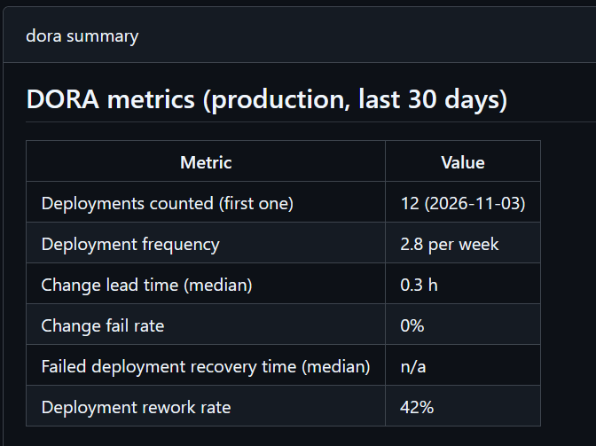

### 3.2 Pipeline d'intégration continue

| | Avant (27/10) | Après (06/11) |
| --- | --- | --- |
| Contrôles sur chaque PR | 4 tâches : tests et construction | **12 tâches en parallèle** : tests back et front, SonarQube, Trivy, hadolint, ShellCheck, gitleaks, tests des scripts, Terraform, Ansible, construction des 2 images |
| Durée | 4,67 min | **1,9 min** (médiane de 52 PR réussies) |
| Ce qui se passe après la fusion | rien | version, publication des images, déploiement dev puis staging, test d'intrusion ZAP, test de fumée k6, notification : **6,6 min** (exécution du 06/11, 17:01), puis production en 0,6 min après approbation |

La durée totale affichée par GitHub sur la capture ci-dessous
(12 min 33 s) comprend l'attente de l'approbation humaine avant la
production : les étapes automatiques, elles, durent 6,6 min puis 0,6 min.

**Précaution de lecture** : la mesure « avant » a été faite sur un poste,
cache vide ; la mesure « après » vient des runners de la CI, avec cache.
Le gain s'explique surtout par l'exécution en parallèle et le cache : la
chaîne contrôle **3 fois plus de choses en 2,5 fois moins de temps**.

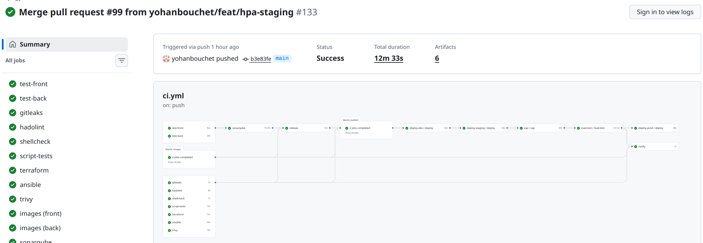

### 3.3 Releases

- **17 versions** publiées du 31/10 au 07/11 (v1.0.0 à v1.5.2). Le
  numéro est calculé automatiquement à partir des messages de commit
  (*Semantic Versioning*) ; chaque image porte sa version et son commit.
- **Retour arrière automatique** testé : un déploiement dont le test de
  fumée échoue revient seul à la version précédente, sans coupure (les
  anciens pods ne sont arrêtés qu'une fois les nouveaux prêts).
- **Sauvegarde et restauration** de la base testées ; temps de
  restauration mesuré : 0,6 s sur la base de test (7 Ko). Ce chiffre
  dépend de la taille de la base : il est à remesurer sur des données
  réelles.
- Les observations sur les déploiements et les releases sont
  regroupées en section 8.2.

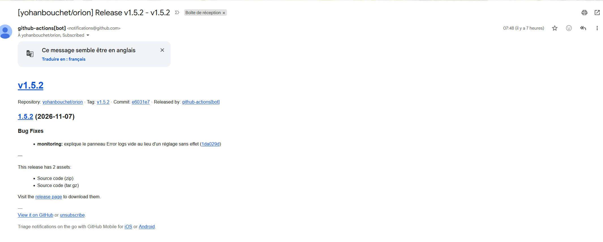

## 4. Tests et qualité du code

### 4.1 Tests

| Famille | Avant | Après | Quand ils tournent |
| --- | --- | --- | --- |
| Tests du back (JUnit) | 2 | 6 (dont l'intégration avec la base) | chaque PR |
| Tests du front | 8 | 8 | chaque PR |
| Tests des scripts d'exploitation (bashunit, pytest) | 0 | 71 + 28 | chaque PR |
| Tests de l'infrastructure (Terraform) | 0 | 6 | chaque PR |
| Test d'intrusion (OWASP ZAP) | 0 | 0 alerte bloquante sur 64 règles | chaque déploiement de staging |
| Test de fumée de charge (k6) | 0 | seuils respectés | chaque déploiement de staging, bloque la prod |
| Tests de charge complets (k6) | 0 | 3 profils mesurés (section 6) | à la demande |

### 4.2 Qualité et couverture (SonarQube)

| Indicateur | Avant (27/10) | Après (06/11) |
| --- | --- | --- |
| Couverture des tests | non mesurée (0 % affiché) | **39,7 %** (lignes 43,2 %, branches 17,2 %) |
| Quality Gate | « Passed » sans aucune condition | **3 conditions bloquantes** : nouveau code couvert à 80 %, 3 % de duplication au plus, 0 nouveau problème |
| Problèmes | 37 | 30 |
| Note de sécurité | C | **B** |
| Note de fiabilité | D | D (1 problème grave, hérité) |
| Note de maintenabilité | A | A |
| Duplication | 2,5 % | 0,0 % |

Notes lues dans l'interface de SonarQube (mode MQR, comme la photo
avant). L'API donne aussi l'ancienne échelle, où la fiabilité vaut C :
les deux échelles ne se comparent pas (vérifié le 07/11).

**Lecture** : le code ajouté depuis le projet respecte les règles (le
Quality Gate bloque sinon) ; les problèmes restants sont dans le code
d'origine. La couverture des **branches** (17 %) est le point faible :
beaucoup de cas (erreurs, données absentes) ne sont jamais testés.

**Où est la dette restante** (vue par qualité de SonarQube, 07/11) :

- **Fiabilité** : 29 problèmes, tous dans le front.
  - 1 seul de gravité haute, qui maintient la note D : un chargement de
    données lancé dans un constructeur (`person-details`, règle S7059) ;
  - **14 nuisent à l'accessibilité**, dont 8 rattachés au niveau A des
    règles WCAG 2 (le minimum) : champs et libellés de formulaire mal
    reliés (7 et 6) et un tableau sans en-têtes ; un lecteur d'écran ne
    sait pas annoncer ces champs ;
  - 12 promesses JavaScript dont l'erreur n'est pas traitée et 2
    conversions de nombre à moderniser (`Number.parseInt`).

  À traiter avec la mise à jour d'Angular (recommandation 1).
- **Sécurité** : 1 problème, de gravité faible : la feuille de style
  Bulma est chargée depuis un site externe (CDN) sans contrôle
  d'intégrité (règle Web:S5725). Déjà relevé par le test d'intrusion ZAP
  du 03/11, il reste à corriger par l'équipe Dev (recommandation 6).
  Aucun point sensible (*security hotspot*) à revoir : SonarQube 26.10
  abandonne cette notion, et l'ancien point sensible est justement ce
  problème Bulma (vérifié dans l'interface le 07/11).
- **Maintenabilité** : 3 problèmes.
- **Limite de l'analyse** : SonarQube signale qu'il ne reçoit pas les
  bibliothèques du back (réglage `sonar.java.libraries` absent) ;
  l'analyse du code Java est donc moins précise. Correction prévue dans
  la CI.
- Sur les 30 derniers jours, 13 problèmes ont été corrigés (3 de
  sécurité, 8 de fiabilité, 2 de maintenabilité). Une même règle peut
  compter dans deux qualités : ces totaux ne s'additionnent pas.

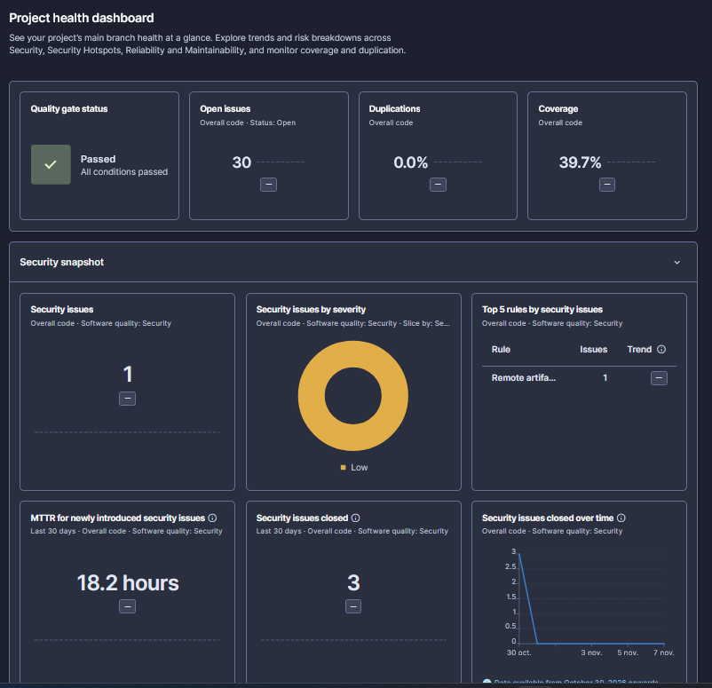

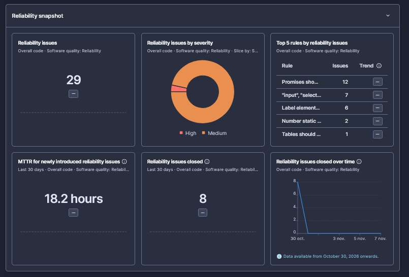

## 5. Sécurité

### 5.1 Gains

| Source | Avant (27-28/10) | Après (06-07/11) |
| --- | --- | --- |
| Trivy, image back | 95 failles : 8 critiques, 33 hautes | **0**, ni critique, ni haute, ni moyenne (v1.5.2, 07/11) |
| Trivy, image front | 10 failles : 2 hautes | **0**, ni critique, ni haute, ni moyenne (v1.5.2, 07/11) |
| npm audit, toutes les dépendances du front | 91 : 5 critiques, 52 hautes | 56 : 2 critiques, 17 hautes |
| npm audit, dépendances livrées au navigateur | non distingué | 8 : **4 hautes**, corrigées par Angular 22.2.4 |
| Test d'intrusion ZAP (en-têtes de sécurité) | 3 règles en échec | **0 échec**, 64 règles réussies |
| Secrets dans le dépôt (gitleaks) | non contrôlé | contrôlé à chaque PR, aucun trouvé |

Les 56 failles restantes de `npm audit` sont surtout dans les **outils de
construction** du front (compilateur, serveur de test) : ils ne sont pas
dans l'image livrée, qui ne contient que des fichiers statiques servis
par nginx. C'est pourquoi l'image front affiche 0 faille.

**Comment une faille est traitée** : Trivy bloque toute image qui
contient une faille critique ou haute corrigeable ; une exception doit
être écrite, justifiée et datée (expiration) ; Dependabot propose les
mises à jour, appliquées après un délai de 3 jours (protection contre
une version piégée), selon la règle du document 2 (section 2.7).

### 5.2 Supervision de la sécurité

Le tableau de bord **Orion - Security** suit les réponses en erreur
(4xx, 5xx), les accès refusés (401, 403) et les journaux d'erreurs ; les
alertes sont décrites en section 6.1.

**Défaut trouvé en préparant ce rapport (corrigé le 07/11, PR #100 et
#101)** : le panneau des journaux d'erreurs cherchait des mots entiers en
respectant la casse ; il ne trouvait ni `ERROR` (format de Spring) ni
`ConversionFailedException`. Avec une recherche insensible à la casse,
le staging passe de 190 à 236 lignes sur 3 jours, dont l'erreur 500 du
05/11. En prod, 0 ligne avant comme après : l'absence d'erreur y est
réelle. **Limite connue** : la recherche remonte aussi des lignes
inoffensives des outils de test (rapport ZAP « PASS: Application Error
Disclosure », journaux de k6) ; les exclure est une amélioration simple.

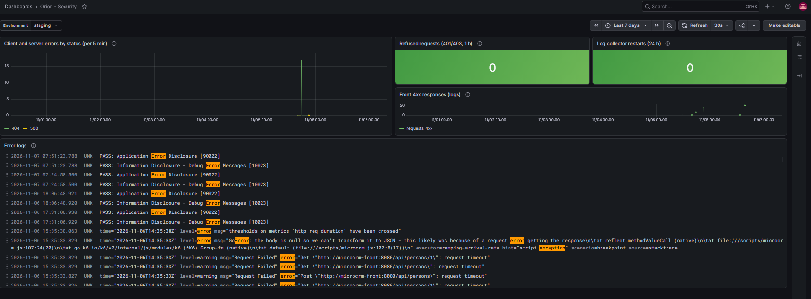

**Chaîne d'alerte vérifiée de bout en bout** le 07/11 par une alerte de
test (et non un incident) : e-mail « FIRING » à 08:02, puis
« RESOLVED » à 08:08, quand l'alerte a pris fin.

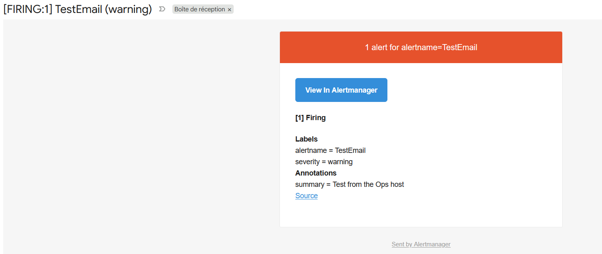

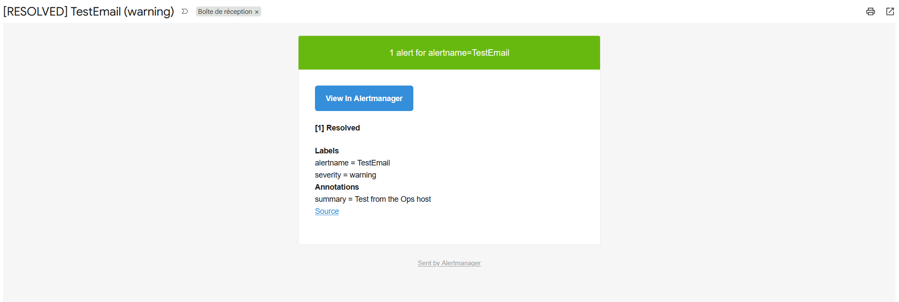

## 6. Supervision et performance

### 6.1 Ce qui est surveillé

Pile retenue : VictoriaMetrics (métriques), VictoriaLogs (journaux),
Grafana (tableaux de bord) et Alertmanager (e-mails), tous open source.
Choix justifié dans le document 1 (section 2.3.7).

| Tableau de bord | Question à laquelle il répond |
| --- | --- |
| Orion - Availability | MicroCRM est-il debout dans chaque environnement ? Pods prêts, redémarrages, disque, âge de la dernière sauvegarde, alertes en cours |
| Orion - Performance | Les 4 « signaux d'or » : trafic, temps de réponse (p50, p95, p99), erreurs, saturation (processeur, mémoire, autoscaling) |
| Orion - Security | Réponses en erreur, accès refusés, journaux d'erreurs |

| Alerte | Déclenchée quand | Couvre |
| --- | --- | --- |
| MicrocrmProdDown | aucun pod prêt en prod pendant 2 min | disponibilité |
| MicrocrmHighErrorRate | plus de 5 % d'erreurs serveur en prod pendant 5 min | disponibilité |
| MicrocrmSlowResponses | p95 au-dessus de 500 ms pendant 10 min | performance |
| PodRestartLoop | un conteneur redémarre plus de 3 fois en 30 min | stabilité |
| HostDiskAlmostFull | disque de la machine rempli à plus de 85 % | capacité |
| BackupTooOld | dernière sauvegarde de la prod il y a plus de 26 h | données |

Chaque alerte renvoie vers une fiche de premiers gestes
(`infra/monitoring/README.md`).

**Panneaux vides rendus lisibles (07/11)** : en prod, le trafic est
presque nul (13 requêtes en 2 jours) et plusieurs panneaux affichaient
« No data », ce qui ne distingue pas « rien à signaler » d'une panne de
la collecte. Ils affichent désormais leur sens (`no traffic`,
`no firing alert`) ; « No data » reste réservé aux cas anormaux. Le
panneau des répliques montrait aussi 3 séries en double après un
changement de pod du collecteur : il est regroupé (1 série).

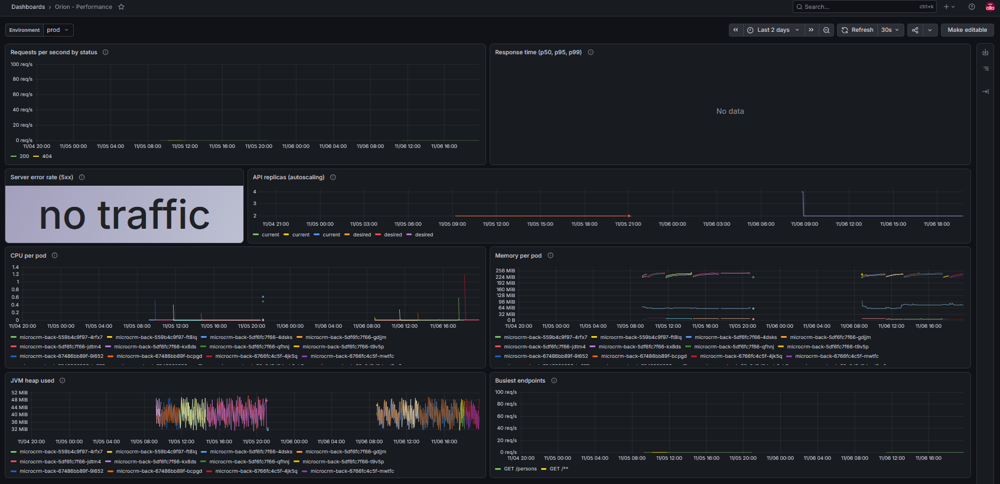

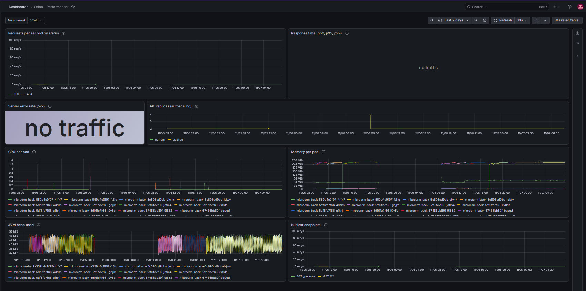

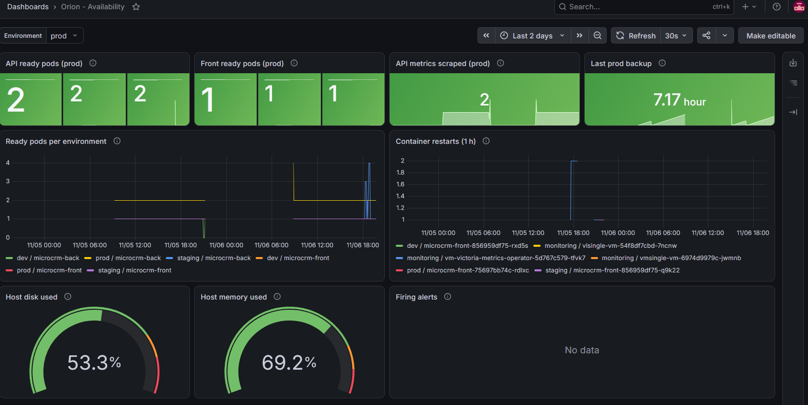

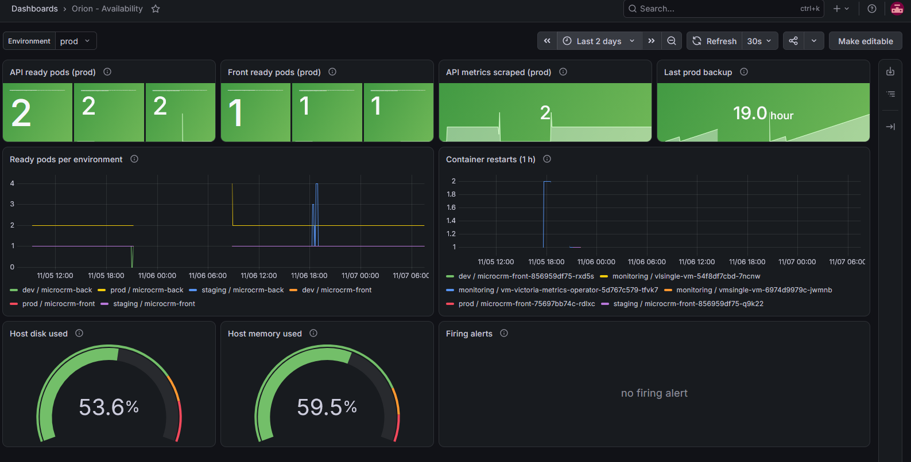

### 6.2 Tests de charge : méthode

- **Outil** : k6 (Grafana Labs, open source), scénario du parcours
  d'un utilisateur : accueil, liste des personnes et des organisations,
  fiche d'une personne, création puis suppression d'une personne.
- **Profils** (types de tests de la documentation k6) : *stress*
  (60 utilisateurs, 5 min), *pic* (0 à 100 utilisateurs en 10 s),
  *point de rupture* (charge croissante jusqu'à 100 parcours par
  seconde, environ 400 requêtes par seconde).
- **Seuils** : moins de 1 % d'erreurs, 95 % des requêtes en moins de
  500 ms (p95), 99 % en moins de 1,5 s.
- **Environnement** : staging, identique à la prod en plus petit, sur
  un poste unique (Minikube). Les tests de charge visent le staging. Une
  seule exception, avant ces règles : le 03/11, un test **en lecture
  seule** (40 utilisateurs, 3 min 50) a vérifié l'autoscaling de la prod
  avant son activation : 45 251 requêtes, 0 erreur, p95 de 401 ms (avant
  la correction du relais nginx, section 7.2), de 2 à 4 répliques.
  Depuis l'incident du 05/11 (section 7.1), la prod n'est plus jamais
  chargée : le scénario complet écrit des données.

### 6.3 Résultats avant et après

Trois états mesurés le 06/11, avec le même scénario :

1. **Avant** : 1 réplique du back, relais nginx d'origine ;
2. **Correctif** : 1 réplique, relais nginx corrigé (section 7.2) ;
3. **Autoscaling** : correctif + 1 à 4 répliques selon le processeur.

| Test | Indicateur | 1. Avant | 2. Correctif | 3. Autoscaling |
| --- | --- | --- | --- | --- |
| Stress | p95 / erreurs | 15 ms / 0 % | — | 17 ms / 0 % (1 → 3 pods) |
| Pic | p95 / erreurs | 16 ms / 0 % | — | 8,5 ms / 0 % (1 pod) |
| Point de rupture | p95 | **1,07 s** | **6,5 ms** | 7,1 ms |
| Point de rupture | erreurs | 0,04 % (attentes de 60 s) | 0 % | 0 % |
| Point de rupture | parcours réalisés | 28 191, et 4 798 abandonnés | 33 000 | 33 000 |
| Point de rupture | pods du back | 1 | 1 | 1 → 4 |

Les captures ci-dessous montrent le staging pendant chaque test de
rupture (heures de Paris).

**À noter sur la première capture** : avant correction, le temps de
réponse mesuré **par le back** reste sous 15 ms, alors que k6, côté
utilisateur, mesurait un p95 de 1,07 s. L'attente avait lieu **avant**
que la requête n'atteigne le back (section 7.2) : une supervision qui ne
mesure que l'application ne voit pas ce que vit l'utilisateur. D'où la
recommandation 5 (supervision synthétique).

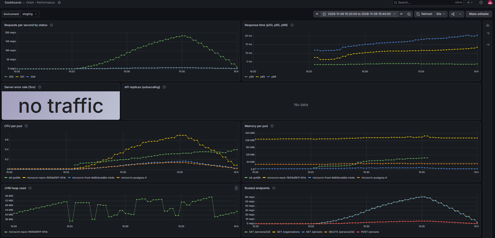

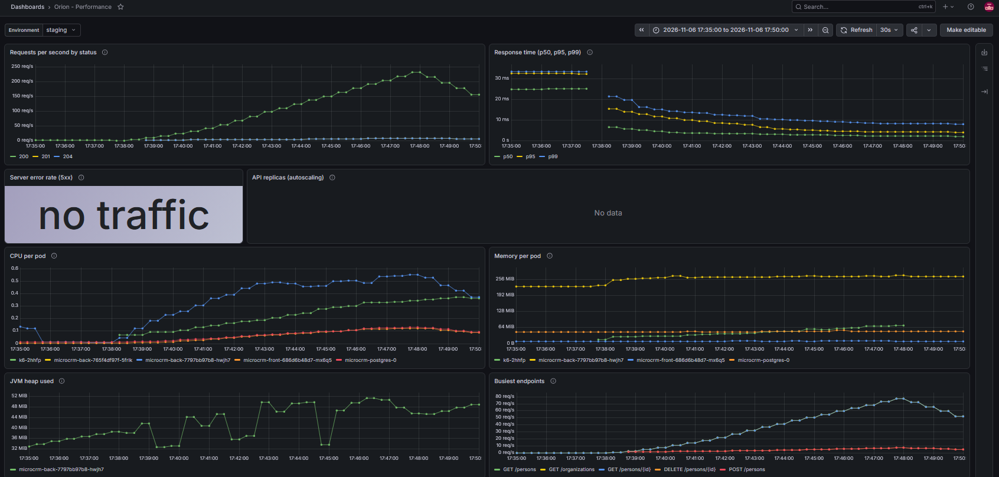

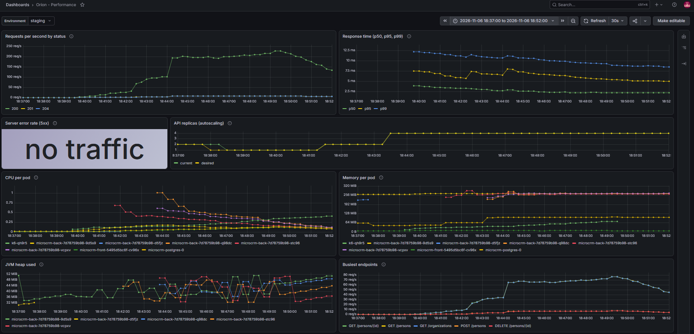

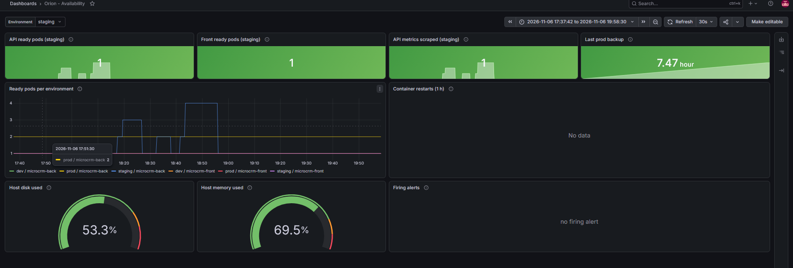

**Conclusions** :

- Le gain vient du **diagnostic**, pas de l'ajout de machines : une seule
  réplique tient désormais le plafond du test avec un p95 de 6,5 ms.
- L'**autoscaling** répartit bien la charge (chaque nouveau pod reçoit du
  trafic dès qu'il est prêt) et apporte de la marge, mais pas de vitesse
  à cette charge, pour environ 1 Go de mémoire en plus.
- L'autoscaling est **trop lent pour un pic court** : pendant le test
  de pic, le renfort est arrivé 20 s **après** la fin. Le processeur
  n'est mesuré que toutes les 60 s, et un nouveau pod Java a mis 40 s à
  1 min à recevoir ses premières requêtes sur un poste déjà chargé (11 s
  au repos, section 7.3). Un pic de moins de 2 minutes doit donc être
  absorbé par les pods déjà présents : c'est pourquoi la prod garde
  **2 répliques au minimum**.
- Le vrai point de rupture de l'application est **au-delà de ce que le
  poste de test permet de mesurer** (environ 400 requêtes par seconde).

## 7. Incidents et enseignements

### 7.1 05/11 : un test de charge a saturé le poste

- **Ce qui s'est passé** : le premier test de point de rupture, lancé à
  la main pendant un pipeline, a figé le poste : machine saturée, cluster
  injoignable, mesure perdue, 15 personnes de test restées en base.
- **Cause** (trouvée dans les métriques le 06/11) : la machine virtuelle
  du cluster était plafonnée à 7 Go de mémoire. Au repos, l'application,
  la supervision et SonarQube en utilisaient déjà 5,6 Go ; les jobs de la
  CI, qui tournent dans le même cluster, ont dépassé le plafond (pic du
  pipeline mesuré : 8,8 Go). La machine a alors utilisé le disque comme
  mémoire et tout a ralenti.
- **Corrections** : plafond porté à 10 Go (jamais atteint depuis) ;
  générateur de charge limité (1 cœur, 512 Mo) ; un seul test à la
  fois ; tests lourds lancés seulement par la CI, jamais pendant un autre
  pipeline ; arrêt automatique si les erreurs ou le temps de réponse
  dérivent ; charge plafonnée ; nettoyage automatique des données de test
  en fin de test.
- **Enseignement pour Orion** : la CI et l'application partageaient les
  mêmes ressources. En production cloud, elles doivent être séparées, et
  les machines doivent pouvoir s'ajouter automatiquement.

### 7.2 06/11 : le goulot d'étranglement était le relais nginx

- **Symptôme** : dès 120 requêtes par seconde, le temps de réponse
  montait par vagues jusqu'à 1 s, avec quelques attentes de 60 s.
- **Ce que l'application montrait** : rien d'anormal. Processeur à
  0,8 cœur, base de données sans attente, chaque requête traitée par
  Spring en moins de 0,1 s.
- **Cause** (compteurs réseau des pods) : le serveur web du front, qui
  relaie les appels vers l'API, ouvrait **une nouvelle connexion pour
  chaque requête** (100 338 connexions pour 118 314 requêtes) et 8,6 %
  de ces ouvertures devaient être recommencées, avec une attente de 1 s,
  puis 3 s, 7 s…
- **Correction** : le relais garde ses connexions ouvertes et les
  réutilise (réglage *keepalive* recommandé par la documentation de
  nginx). Résultat : 1 067 connexions, aucune ouverture recommencée,
  p95 de 1,07 s à 6,5 ms.
- **Enseignement** : mesurer avant d'ajouter des ressources. Ajouter des
  répliques du back n'aurait rien changé, le problème était devant lui.
- **Suivi** : ticket #97, critères vérifiés par un nouveau test de
  rupture.

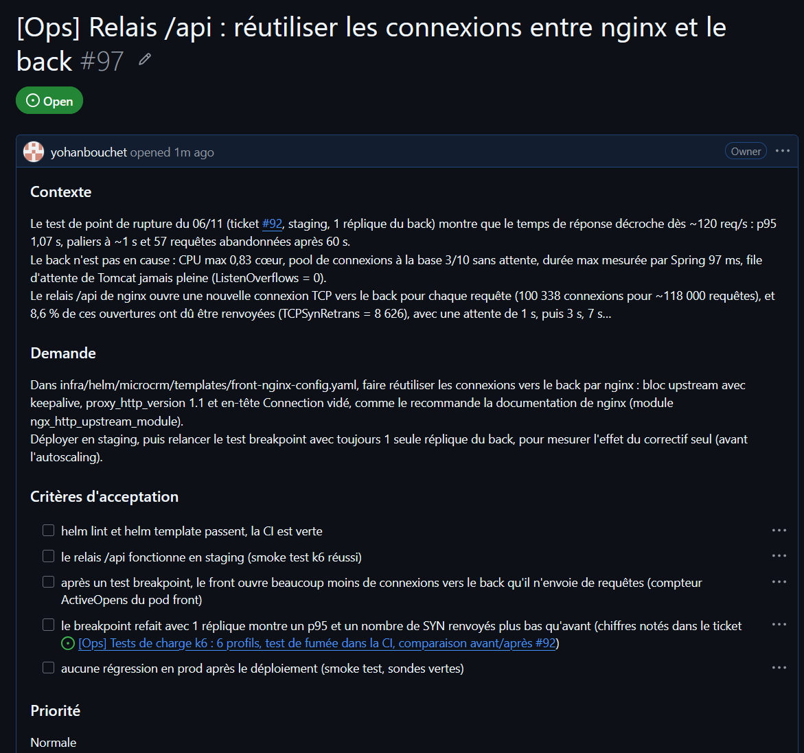

### 7.3 07/11 : exercice de panne volontaire en production

Exercice annoncé (ticket #103), **pas un incident** : il n'entre pas
dans les indicateurs DORA.

- **Question** : si l'un des 2 serveurs d'API de la prod tombe, les
  utilisateurs le voient-ils ?
- **Méthode** : suppression volontaire d'un des 2 pods du back à
  14:03:25 ; pendant ce temps, une sonde envoie une requête de lecture
  par seconde à travers le front, comme un utilisateur, et note chaque
  réponse. Le front (1 seul pod en prod) n'est pas touché.
- **Résultats** :
  - **274 réponses, toutes réussies** (14:01 à 14:06) ; le plus long
    écart entre deux réponses (1,78 s) est au niveau du bruit normal
    (1,74 s hors panne) ;
  - remplaçant créé aussitôt, **prêt en 11 s** ; un pod est resté prêt
    en permanence ;
  - arrêt propre de l'ancien pod : Spring Boot termine les requêtes en
    cours puis ferme ses connexions à la base (50 ms, d'après ses
    journaux) ;
  - **aucune alerte**, comme prévu : l'alerte de panne demande 0 pod
    prêt pendant 2 min.
- **Ce que la supervision n'a pas vu** : le panneau des pods prêts reste
  à 2, car les 11 s avec un seul pod tombent entre deux relevés. Une
  coupure courte ne se mesure qu'avec une **sonde côté utilisateur** :
  c'est le 2e constat en faveur de la recommandation 5.
- **Limite** : le statut « Error » affiché par l'ancien pod vient très
  probablement du code de sortie de Java après un signal d'arrêt (143),
  et non d'un plantage ; ce code n'a pas pu être lu, le pod ayant déjà
  disparu.

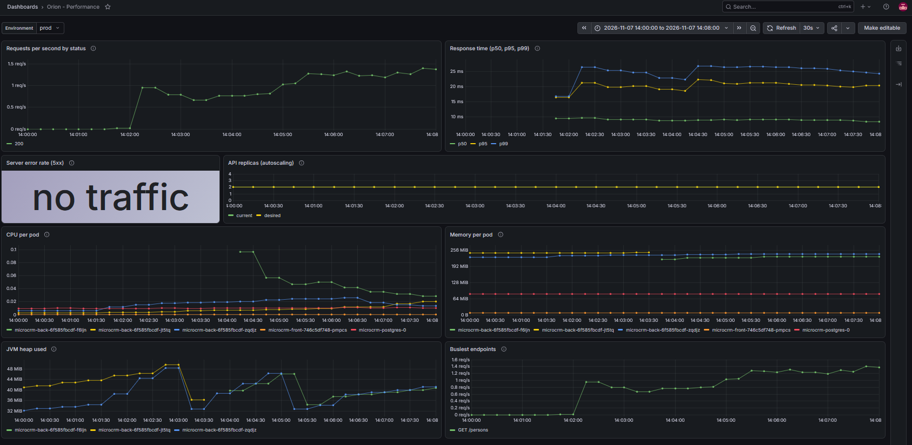

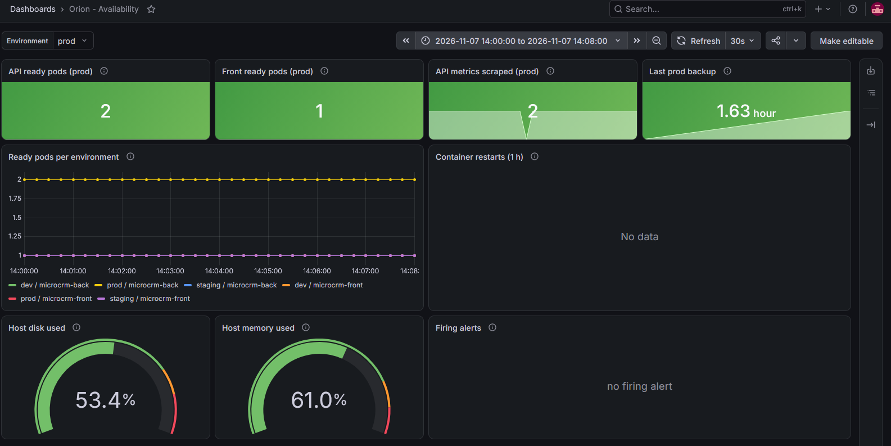

## 8. Gains obtenus et recommandations d'amélioration continue

### 8.1 Gains obtenus

| Domaine | Indicateur | Avant | Après | Détail |
| --- | --- | --- | --- | --- |
| Sécurité | Failles critiques et hautes dans les images livrées | 95 (back, dont 8 critiques) et 10 (front) | **0 et 0**, aucune faille moyenne non plus (v1.5.2) | 5.1 |
| Sécurité | En-têtes de sécurité vérifiés par le test d'intrusion | 3 règles en échec, aucun test | **0 échec**, 64 règles réussies ; un échec bloque la prod | 5.1 |
| Sécurité | Secrets dans le dépôt | non contrôlés | contrôlés à chaque PR, aucun trouvé | 5.1 |
| Qualité | Couverture des tests | non mesurée | **39,7 %**, mesurée à chaque PR | 4.2 |
| Qualité | Quality Gate | sans condition | **3 conditions bloquantes** | 4.2 |
| Qualité | Notes SonarQube (sécurité, fiabilité) | C et D | **B** et D (1 problème grave hérité) | 4.2 |
| Livraison | Contrôles automatiques sur chaque PR | 4 tâches, rien de bloquant | **12 tâches** | 3.2 |
| Livraison | Durée de ces contrôles | 4,67 min | **1,9 min** (médiane) | 3.2 |
| Livraison | Déploiement en production | manuel, non tracé | **automatique après approbation** : 2,8 par semaine, 0 % d'échec, 0,3 h après la fusion | 3.1 |
| Livraison | Versions | `0.0.1-SNAPSHOT`, aucune image | **17 versions** ; chaque image liée à sa version et à son commit | 3.3 |
| Disponibilité | Perte d'un serveur d'API en prod | jamais testée | **0 erreur**, remplacement prêt en 11 s | 7.3 |
| Disponibilité | Sauvegarde de la base | aucune | quotidienne, restauration vérifiée chaque semaine | 3.3 |
| Performance | p95 au point de rupture (1 réplique) | 1,07 s (06/11, avant correction) | **6,5 ms** | 6.3 |
| Supervision | Tableaux de bord et alertes | aucun | **3 tableaux de bord, 6 alertes** par e-mail, chaîne vérifiée | 5.2, 6.1 |

### 8.2 Observations sur les déploiements et les releases

- **11 des 17 versions sont des correctifs** (taux de reprise DORA de
  42 %) : la chaîne elle-même (tests de charge, supervision) a souvent
  été corrigée juste après sa première version. C'est attendu pendant
  la mise en place ; ce taux doit baisser quand l'outillage se stabilise.
- **Une seule étape est manuelle : l'approbation de la prod.** Elle est
  voulue (contrôle humain avant les clients), mais elle allonge le délai
  réel : environ 5 min d'attente sur l'exécution de la section 3.2
  (12 min 33 s au total, dont 7,2 min d'étapes automatiques).
- **Seules les versions numérotées vont en prod.** Une modification de
  documentation ou de CI ne crée pas de version : elle s'arrête au
  staging. La prod ne reçoit donc que des changements tracés et notés.
- **La supervision est appliquée à la main.** Tableaux de bord et
  alertes sont installés par Terraform, lancé par l'équipe Ops après la
  fusion. Le 07/11, une correction de tableau de bord fusionnée (PR #101)
  n'était toujours pas en service lors de la vérification : rien ne
  signale cet écart.
- **Les portes de qualité ont joué leur rôle** : le test d'intrusion a
  bloqué la prod tant que les en-têtes de sécurité manquaient (vérifié
  avant fusion), et un test de fumée raté remet la version précédente
  (3.3).
- **Les images des outils de la CI ne sont pas suivies par Dependabot**
  (Trivy, gitleaks, hadolint, ShellCheck) : Trivy 0.76.2, qui corrige
  des failles de l'outil lui-même, est sorti le 05/11 et n'a pas été
  proposé automatiquement (relevé lors de la vérification du 07/11).

### 8.3 Recommandations

Classées par priorité pour Orion ; chaque recommandation répond à un
constat de ce rapport.

| # | Recommandation | Constat | Effort | Équipe |
| --- | --- | --- | --- | --- |
| 1 | Mettre à jour le front vers Angular 22 (et passer les tests à Vitest) | 4 failles hautes dans le code livré au navigateur ; Angular 17 n'est plus maintenu | moyen | Dev |
| 2 | Augmenter la couverture des tests, en priorité les cas d'erreur, et ajouter des tests de bout en bout | branches couvertes à 17 % | moyen | Dev |
| 3 | En production cloud (ex. AWS EKS), séparer les machines de la CI de celles de l'application et activer la mise à l'échelle des machines (par Terraform) | incident du 05/11 ; autoscaling limité à 4 pods sur une seule machine | élevé | Ops |
| 4 | Passer le front à 2 répliques en prod, avec un budget de perturbation (*PodDisruptionBudget*) pour le front et le back | le front est seul dans son composant : sa perte couperait l'application, alors que celle d'un pod du back passe inaperçue (7.3) | faible | Ops |
| 5 | Ajouter une supervision synthétique : une sonde qui interroge l'application comme un utilisateur, toutes les quelques secondes (ex. Blackbox Exporter, open source), avec une alerte | la lenteur du relais nginx (6.3) et la coupure de 11 s de l'exercice (7.3) étaient invisibles côté back | faible | Ops |
| 6 | Installer Bulma avec npm, ou le charger avec un contrôle d'intégrité (SRI) | seul problème de sécurité relevé par SonarQube et par ZAP (4.2) | faible | Dev |
| 7 | Appliquer Terraform par la CI : plan affiché sur chaque PR, application après approbation | supervision appliquée à la main ; correction fusionnée restée hors service (8.2) | moyen | Ops |
| 8 | Faire suivre les images d'outils de la CI par Dependabot (fichier dédié) ; passer Trivy à 0.76.2 | mise à jour de sécurité de Trivy non proposée (8.2) | faible | Ops |
| 9 | Garder 2 répliques minimum en prod ; pour les pics prévisibles, ajouter des pods à l'avance ; étudier une mise à l'échelle sur le nombre de requêtes (KEDA) | renfort arrivé après la fin du pic (6.3) | faible à moyen | Ops |
| 10 | Annoter automatiquement les déploiements dans Grafana | relier une dégradation à une version d'un coup d'œil | faible | Ops |
| 11 | Fixer un objectif de disponibilité (ex. 99,5 %) et alerter sur son budget d'erreur ; envoyer les alertes aussi vers la messagerie d'équipe | alertes par e-mail seulement, pas d'objectif chiffré | faible | Ops et direction |
| 12 | Déclarer chaque incident de prod avec le formulaire prévu, pour mesurer le temps de rétablissement | indicateur DORA non mesurable | faible | Dev et Ops |
| 13 | Rejouer les tests de charge sur une machine dédiée, à chaque version majeure, avec le rapport HTML de k6 | point de rupture réel non atteint sur le poste | moyen | Ops |
| 14 | Exclure les pods de test (ZAP, k6) de la recherche des journaux d'erreurs | lignes inoffensives mêlées aux vraies erreurs (5.2) | faible | Ops |
| 15 | Mettre la base en haute disponibilité (service managé comme RDS Multi-AZ, ou opérateur CloudNativePG), avec restauration à un instant donné | une seule instance PostgreSQL ; jusqu'à 24 h de données perdues en cas de sinistre | moyen à élevé | Ops |

## 9. Conclusion

Les six objectifs mesurables fixés au départ sont atteints : aucune
faille connue dans les images livrées, qualité et couverture contrôlées à
chaque modification, pipeline plus complet et plus rapide, livraisons
versionnées, déploiement automatisé avec retour arrière, supervision avec
alertes. Les tests de charge ont surtout montré la valeur de la mesure :
le principal gain de performance (p95 divisé par 165) est venu d'un
diagnostic, pas de ressources supplémentaires. Les priorités suivantes
sont la mise à jour du front, la couverture des tests et, pour un
passage dans le cloud, la séparation de la CI et de l'application.

## Annexe A. Glossaire

| Terme | Signification |
| --- | --- |
| p95 | temps sous lequel répondent 95 % des requêtes : il montre ce que vivent presque tous les utilisateurs, sans être faussé par un cas isolé |
| Réplique, pod | exemplaire de l'application qui tourne ; plusieurs répliques se partagent le travail |
| Autoscaling (HPA) | ajout ou retrait automatique de répliques selon la charge du processeur |
| Quality Gate | ensemble de conditions de qualité qu'une modification doit remplir pour être acceptée |
| Couverture | part du code exécutée par les tests |
| Staging | environnement de recette, copie de la production en plus petit |
| Test de fumée | test court qui vérifie que l'essentiel fonctionne après un déploiement |

## Annexe B. Sources des mesures

| Mesure | Source | Date |
| --- | --- | --- |
| Mesures de départ | [docs/mesures-avant/](mesures-avant/README.md) | 27-28/10/2026 |
| DORA | `scripts/dora.py` sur l'API GitHub (déploiements de l'environnement production) | 06/11/2026 |
| Pipeline | API GitHub Actions : 100 dernières exécutions réussies du workflow CI | 06/11/2026 |
| Qualité, couverture | API SonarQube, projet `orion` | 06/11/2026 |
| Failles des images | Trivy 0.76.1 (version de la CI) sur les images publiées v1.5.2 | 07/11/2026 |
| Dépendances du front | `npm audit`, avec et sans les outils de développement | 06/11/2026 |
| Charge | k6 2.3.0 dans staging ; métriques VictoriaMetrics ; compteurs TCP des pods | 06/11/2026 |
| Tableaux de bord, recherche des journaux | requêtes rejouées sur VictoriaMetrics et VictoriaLogs | 07/11/2026 |
| Chaîne d'alerte | alerte de test envoyée à Alertmanager, e-mails reçus | 07/11/2026 |
| Exercice de panne | sonde (1 requête par seconde, codes HTTP horodatés), `kubectl get pods -w`, journaux du pod dans VictoriaLogs | 07/11/2026 |
