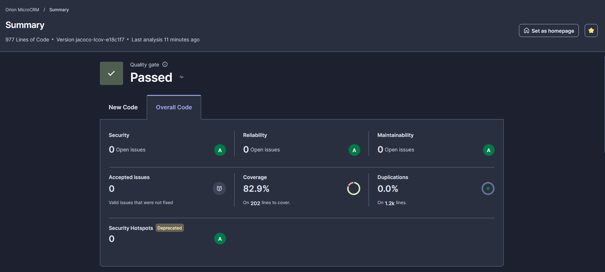
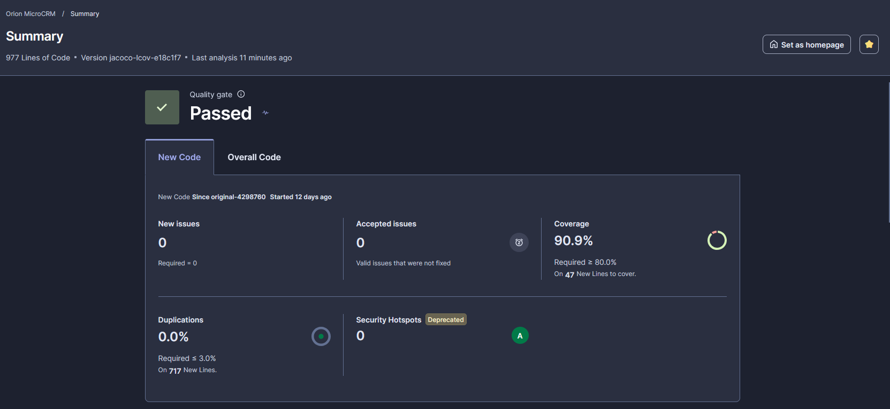
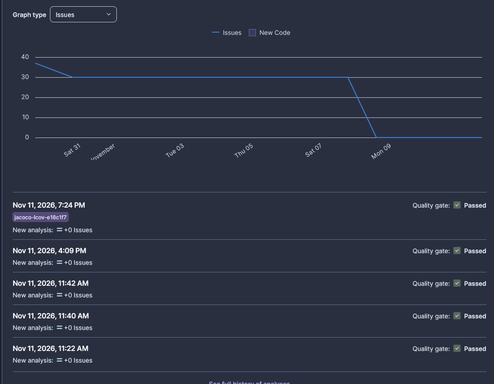
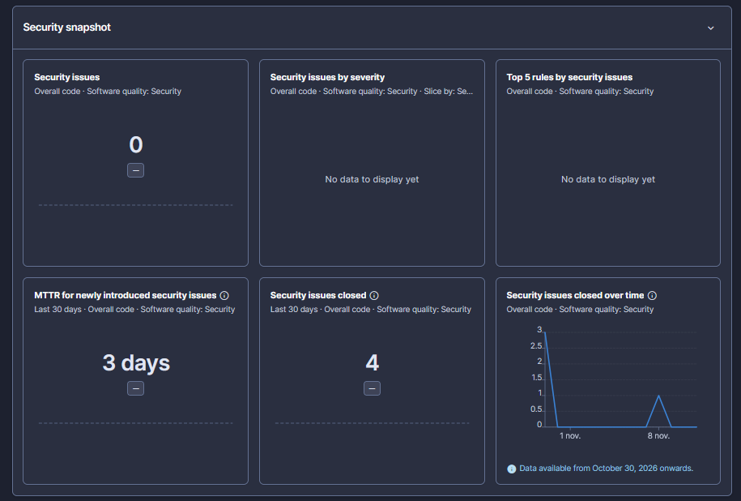
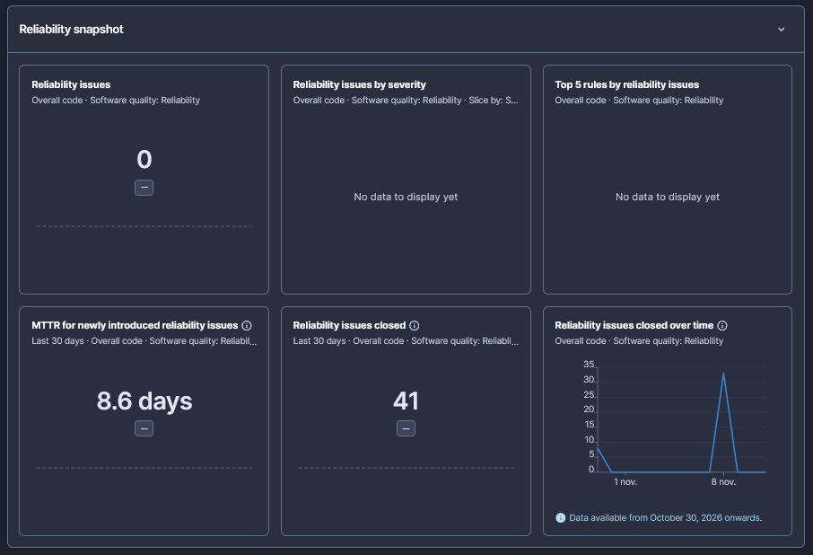
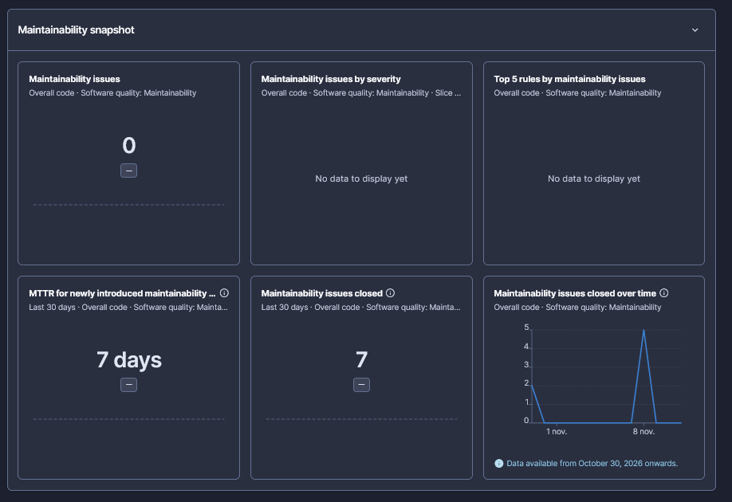
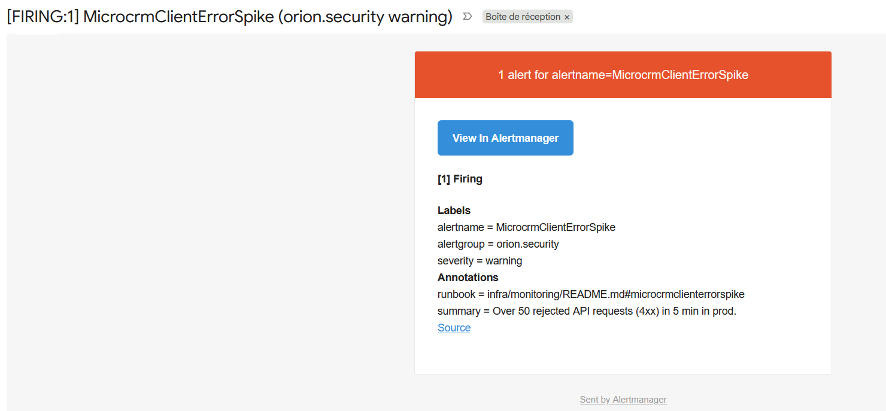
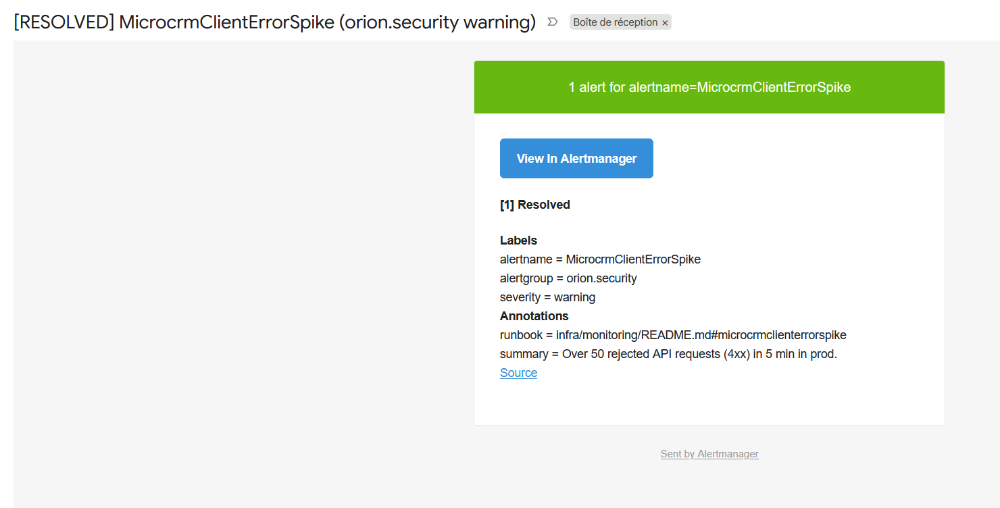
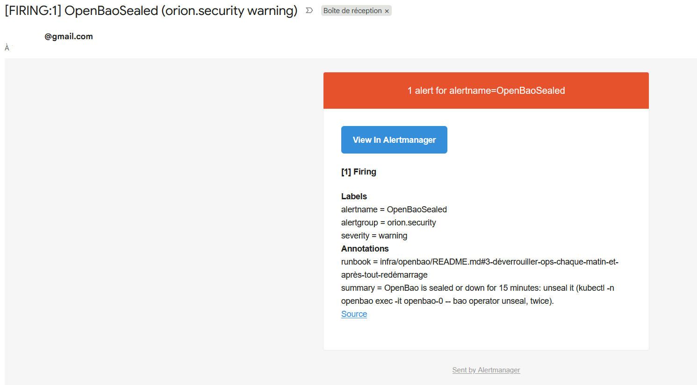
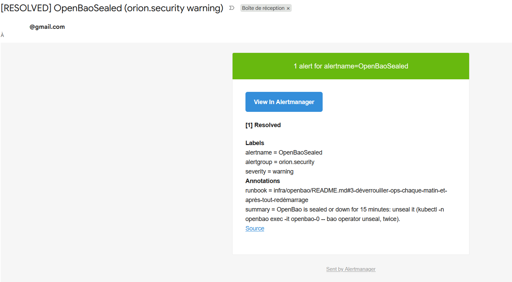

# Rapport de performance — MicroCRM

| Élément | Valeur |
| ------- | ------ |
| Projet  | Démarche DevOps pour l'application MicroCRM |
| Client  | Orion (destinataires : Maria, CTO, et les équipes Dev et Ops) |
| Auteur  | Yohan Bouchet |
| Version | 1.3 (recommandations 26 à 30, DORA dans Grafana, incident du 11/11 (7.8), sauvegarde d'OpenBao (reco 26 appliquée) ; 1.2 du 10/11, 1.1 du 09/11, 1.0 du 07/11) |
| Date    | 11/11/2026 : état de la production au 11/11 (v1.9.1, en production depuis le 11/11) ; mesures du 06/11 au 11/11 |

**Accessibilité** : titres hiérarchisés, tableaux avec ligne d'en-tête,
chaque capture d'écran munie d'un texte de remplacement qui décrit ce
qu'elle montre, aucune information portée par la couleur seule, sigles
développés à leur première apparition et dans le glossaire
([annexe A](#annexe-a-glossaire)).

## 1. Synthèse

**En une phrase** : en moins de deux semaines, MicroCRM est passé d'une
chaîne qui testait sans rien bloquer et se déployait à la main, à une
chaîne qui contrôle chaque modification, livre en production en
quelques minutes après une approbation humaine, et se surveille
elle-même.

| Ce qui compte pour Orion | Avant (27-28/10) | Après (06-10/11) |
| --- | --- | --- |
| Failles connues dans les images livrées | 95 dans l'image back, dont 8 critiques | **0**, toutes gravités confondues (v1.9.1, analysée le 11/11 ; voir 5.1) |
| Contrôles automatiques sur chaque modification | 4 tâches (tests et construction), rien de bloquant sur la qualité ou la sécurité | **12** (tests, qualité, failles, secrets, infrastructure) |
| Couverture du code par les tests | non mesurée | **82,9 %**, mesurée à chaque modification |
| Compte utilisé par l'API dans la base | superutilisateur | **compte limité** à la lecture et à l'écriture des lignes |
| Déploiement en production | manuel | **automatique après approbation**, retour arrière automatique |
| Secrets confiés à la plateforme de CI | sans objet (aucun déploiement automatisé) | **aucun** : chaque job reçoit un accès de 15 min, délivré par un coffre-fort (OpenBao) après vérification de son identité |
| Fréquence de livraison en production | non mesurable | **5,1 par semaine**, 0 % d'échec (22 mises en prod, dont 10 changements de l'application : voir 3.1) |
| Délai entre un commit et la production | non mesurable | **2,9 h** (médiane ; explication en 3.1) |
| Temps de réponse au test de rupture (p95) | 1,07 s (mesuré avant correction) | **6,5 ms**, 0 erreur |
| Requêtes perdues pendant une mise à jour | 22 échecs en 6 redémarrages (mesurés le 08/11, avant correction) | **0** en 8 redémarrages |
| Supervision | aucune | **4 tableaux de bord** (dont les indicateurs DORA), **11 alertes** (dont 3 de sécurité) envoyées par e-mail ; journaux au format JSON, recherchés par champ |
| Perte d'un serveur d'API en production (exercice du 07/11) | non testée | **0 erreur** pour l'utilisateur, remplacement prêt en 11 s |

**Trois recommandations prioritaires** (détail en section 8.3) :

1. Tester les cas d'erreur et ajouter des tests de bout en bout : 42 %
   des conditions du code ne sont pas testées (recommandation 2).
2. Garder une copie des outils et des bibliothèques téléchargés par la
   chaîne : une panne extérieure a retardé une livraison de plus de 6 h
   le 08/11 (recommandation 16, en partie appliquée le 09/11,
   section 7.6).
3. En production cloud, séparer les machines de la CI de celles de
   l'application et ajouter la mise à l'échelle des machines : c'est la
   leçon de l'incident du 05/11 (recommandation 3, section 7.1).

La première recommandation prioritaire du 07/11, la mise à jour du front
vers Angular 22, a été appliquée le 08/11 (v1.7.1) : elle a supprimé
les dernières failles connues du code livré au navigateur.

**Depuis la version 1.1 du rapport (09-10/11)** :

- la CI ne détient **plus aucun secret** : elle prouve son identité à
  un coffre-fort, OpenBao, qui lui délivre des accès de 15 min
  (section 5.3) ;
- les journaux de l'application sont écrits en **JSON** et recherchés
  par champ (section 5.2) ; une 9e alerte prévient si le coffre-fort
  reste fermé (section 5.3) ;
- une version n'est plus créée que pour un changement livré
  (recommandation 21, appliquée) ;
- les 5 rôles Ansible qui configurent le poste sont testés à chaque
  modification sur une machine jetable (Molecule, section 4.1) ;
- la recommandation 7 devient le passage au **GitOps** (section 8.3).

**Depuis la version 1.2 (11/11)** : relecture de cohérence de tout le
dépôt ; 5 recommandations ajoutées (26 à 30, section 8.3) : sauvegarde
et certificat du coffre-fort, chaîne d'approvisionnement des images,
runner local et SonarQube en OpenTofu, installation rejouée de zéro,
analyse quotidienne des images en service (2 failles hautes apparues
le 11/11 dans le front en prod, corrigées par la version suivante).
Les indicateurs DORA sont désormais aussi dans Grafana (tableau de
bord *Orion - Delivery*), et chaque déploiement est marqué sur les
courbes (recommandation 10, appliquée ; section 3.1).

## 2. Contexte et objectifs

L'audit du 29/10 ([document 1](01-veille-audit-recommandations.md))
avait relevé une chaîne de production qui ne protégeait ni la qualité ni
la sécurité. Le plan de mise en œuvre
([document 2](02-normalisation-plan-ci.md)) fixait des objectifs
**mesurables**, comparés aux mesures de départ
([docs/mesures-avant/](mesures-avant/README.md)) :

| Objectif | Mesure avant | Cible | Atteint ? |
| --- | --- | --- | --- |
| Aucune faille connue livrée sans décision | 95 failles dans l'image back (8 critiques) | 0 critique ou haute corrigeable dans une image publiée | **oui** : 0 (section 5) |
| Qualité contrôlée à chaque modification | Quality Gate sans condition | Quality Gate bloquant sur chaque PR | **oui** : 3 conditions (section 4.2) |
| Tests mesurés | couverture non mesurée | mesurée et publiée à chaque PR | **oui** : 82,9 % (section 4.2) |
| Pipeline plus rapide malgré plus de contrôles | 4,67 min, 4 tâches | durée suivie, gain mesuré | **oui** : 2,2 min, 12 contrôles (section 3.2) |
| Livraison traçable | aucune image, version `0.0.1-SNAPSHOT` | chaque image liée à une version et à un commit | **oui** : 25 versions, v1.0.0 à v1.9.0 |
| Déploiement sans action manuelle | déploiement manuel | déploiement et retour arrière automatisés | **oui**, avec approbation humaine avant la prod |

## 3. Livraison : indicateurs DORA et pipeline

### 3.1 Indicateurs DORA

Les indicateurs **DORA** (du programme de recherche *DevOps Research and
Assessment*, [dora.dev](https://dora.dev)) sont la mesure de référence
de la performance de livraison. Ils sont calculés chaque semaine par
`scripts/dora.py` à partir de l'historique des déploiements en
production (workflow *DORA metrics*).

| Indicateur | Ce qu'il mesure | Valeur (30 derniers jours) |
| --- | --- | --- |
| Fréquence de déploiement | combien de fois la production reçoit une nouvelle version | **5,1 par semaine** (22 déploiements du 03/11 au 09/11) |
| Délai de mise en production (médiane) | temps entre un commit et sa mise en production | **2,9 h** (0,3 h le 06/11, 2,5 h le 08/11) |
| Taux d'échec des changements | part des déploiements qui provoquent un incident | **0 %** |
| Temps de rétablissement (médiane) | temps pour revenir à la normale après un incident | **non mesurable** : aucun incident de production |
| Taux de reprise | part des déploiements qui ne livrent que des correctifs | **32 %** (42 % le 06/11, 37 % le 08/11) |

**Lecture** :

- Avant le projet, ces indicateurs n'étaient **pas mesurables** :
  aucune trace des déploiements, faits à la main.
- Orion livre désormais plusieurs fois par semaine.
- **10 des 22 mises en prod ont changé l'application** : le code
  (v1.1.1, v1.2.0, v1.7.1, v1.8.2, v1.8.3, v1.9.0) ou son chart Helm
  (v1.4.3, v1.7.0, v1.8.0, v1.8.1). Les 12 autres ont redéployé à
  l'identique : leur version avait été créée par un changement
  d'outillage, qui n'est pas livré avec l'application (supervision : 6 ;
  tests de charge : 2 ; Ansible, script DORA, script de déploiement,
  réglage du staging : 1 chacun). La fréquence et le taux de reprise en
  sont gonflés. **Corrigé le 09/11** (recommandation 21) : depuis, une
  version n'est créée que pour un changement du back, du front ou du
  chart ; les 3 mises en prod suivantes ont toutes changé l'application.
- **Le délai est passé de 0,3 h à 2,5 h, puis 2,9 h**, sans que la chaîne soit
  devenue plus lente. Il est mesuré pour chaque commit, de son écriture
  à sa mise en production : un commit écrit le matin dans une PR
  fusionnée le soir compte toute sa journée d'attente. Jusqu'au 07/11
  au matin, chaque version ne livrait qu'un commit (0,3 h à 1,4 h, de
  v1.4.2 à v1.5.2). Ensuite, des PR ont regroupé plusieurs changements :
  4,6 h pour v1.6.0 (6 commits), 5,5 h pour v1.7.0 (6 commits), 7,4 h
  pour v1.7.1 (13 commits, dont plus de 6 h perdues à cause d'une panne
  extérieure, section 7.6). Les deux versions suivantes, petites, ont mis
  0,2 h. Depuis le 09/11, un commit qui ne change pas l'application
  (documentation, CI) ne crée plus de version : il part en prod avec
  la version suivante, et le script compte son attente. Les 3 versions
  du 09/11 ont ainsi livré 9 commits (v1.8.2, médiane 2,5 h), 7 (v1.8.3,
  1,9 h) et 4 (v1.9.0, 1,5 h) ; ces 20 commits font monter la médiane
  de l'ensemble à 2,9 h. Pour le délai d'un **changement de
  l'application**, il faudrait ne compter que les commits livrés
  (amélioration du script). D'où aussi la recommandation 18 : des PR
  petites, fusionnées dès qu'elles sont prêtes.
- Le taux de reprise baisse (42 % le 06/11, 37 % le 08/11, 32 % le
  10/11) : les corrections de la chaîne elle-même (tests de charge,
  supervision), nombreuses au début, se font plus rares quand
  l'outillage se stabilise, et elles ne créent plus de version depuis
  le 09/11.
- **Défaut de mesure trouvé le 10/11 et corrigé** : après la
  suppression puis la recréation des environnements GitHub (section
  7.7), GitHub a marqué les 22 déploiements de prod « inactifs ». Le
  script ne lisait que le dernier état de chaque déploiement : il
  comptait **0 déploiement**. Il garde désormais le dernier état final
  (succès ou échec) ; ce cas est ajouté à ses tests. Les valeurs
  ci-dessus viennent du script corrigé.
- **Limites** : la période est courte (22 déploiements en 7 jours,
  depuis la première mise en production du 03/11). La fréquence est
  calculée sur une fenêtre fixe de 30 jours (réglage `DORA_DAYS`) : tant
  que la production a moins de 30 jours, elle sous-estime le rythme
  réel. Les valeurs deviendront fiables après quelques semaines.

**Dans Grafana depuis le 11/11** : le workflow importe aussi ces
valeurs dans VictoriaMetrics, chaque jour ouvré ; le tableau de bord
*Orion - Delivery* montre les 5 indicateurs et leur évolution, à côté
de la supervision (consigne de l'énoncé : données mesurées intégrées
à l'outil de visualisation). Le 11/11, après v1.9.1, le délai médian
est passé à **5,3 h** (23 déploiements, 5,4 par semaine, reprise
30 %) : v1.9.1 a livré d'un coup les commits de documentation de la
veille au soir, ce qui illustre le constat ci-dessus et la
recommandation 18. Les chiffres de ce rapport restent ceux du 10/11.

Les courbes ne comptent qu'un point par indicateur : l'import a
commencé le 11/11. Elles se rempliront à chaque exécution du workflow
(deux par jour ouvré).

### 3.2 Pipeline d'intégration continue

| | Avant (27/10) | Après (06/11) |
| --- | --- | --- |
| Contrôles sur chaque PR | 4 tâches : tests et construction | **12 tâches en parallèle** : tests back et front, SonarQube, Trivy, hadolint, ShellCheck, gitleaks, tests des scripts, OpenTofu (2 dossiers), Ansible (dont Molecule depuis le 10/11), construction des 2 images |
| Durée | 4,67 min | **2,2 min** (médiane de 47 PR réussies du 07 au 10/11 ; 1,9 min le 06/11) ; avec Molecule (10/11), 2,0 et 2,4 min sur les 2 premières PR : le job Ansible (1,8 à 1,9 min) est devenu le plus long |
| Ce qui se passe après la fusion | rien | version, publication des images, déploiement dev puis staging, test d'intrusion ZAP, test de fumée k6, notification : **6,7 min** (v1.9.1, 11/11 ; 6,6 min le 06/11), puis production en 0,8 min après approbation, par un accès court d'OpenBao |

La durée totale affichée par GitHub sur la capture ci-dessous
(8 min 25 s, version v1.9.1 du 11/11) comprend 0,8 min d'attente de
l'approbation humaine avant la production : les étapes automatiques,
elles, durent 6,7 min puis 0,8 min.

**Précaution de lecture** : la mesure « avant » a été faite sur un poste,
cache vide ; la mesure « après » vient des runners de la CI, avec cache.
Le gain s'explique surtout par l'exécution en parallèle et le cache : la
chaîne contrôle **3 fois plus de choses en 2 fois moins de temps**.

### 3.3 Releases

- **25 versions** publiées du 31/10 au 09/11 (v1.0.0 à v1.9.0). Le
  numéro est calculé automatiquement à partir des messages de commit
  (*Semantic Versioning*) ; chaque image porte sa version et son commit.
  Depuis le 09/11, seul un changement du back, du front ou du chart crée
  une version, et `helm history` affiche la version déployée (colonne
  *APP VERSION* : `1.8.2`, `1.8.3`, `1.9.0`, au lieu de `1.1.0` pour
  toutes).
- **Retour arrière automatique** testé : un déploiement dont le test de
  fumée échoue revient seul à la version précédente, sans coupure (les
  anciens pods ne sont arrêtés qu'une fois les nouveaux prêts).
- **Sauvegarde et restauration** de la base testées ; temps de
  restauration mesuré : 0,6 s sur la base de test (7 Ko). Ce chiffre
  dépend de la taille de la base : il est à remesurer sur des données
  réelles.
- Les observations sur les déploiements et les releases sont
  regroupées en section 8.2.

## 4. Tests et qualité du code

### 4.1 Tests

| Famille | Avant | Après | Quand ils tournent |
| --- | --- | --- | --- |
| Tests du back (JUnit) | 2 | 6 (dont l'intégration avec la base) | chaque PR |
| Tests du front | 8 (Karma) | 16 (Vitest, depuis le 08/11) | chaque PR |
| Tests des scripts d'exploitation (bashunit, pytest) | 0 | 87 + 30 | chaque PR |
| Tests de l'infrastructure (OpenTofu) | 0 | 15 (socle du cluster et configuration d'OpenBao, faux fournisseurs) | chaque PR |
| Test du poste Ops (Ansible, Molecule) | 0 | 5 rôles appliqués sur une machine jetable, rejoués sans aucun changement (idempotence), puis 6 contrôles (outils, sauvegardes planifiées, services, métriques, pare-feu, journaux Docker) | chaque PR (depuis le 10/11) |
| Test d'intrusion (OWASP ZAP) | 0 | 0 échec ; 19 règles bloquantes | chaque déploiement de staging |
| Test de fumée de charge (k6) | 0 | seuils respectés | chaque déploiement de staging, bloque la prod |
| Tests de charge complets (k6) | 0 | 3 profils mesurés (section 6) | à la demande |

### 4.2 Qualité et couverture (SonarQube)

| Indicateur | Avant (27/10) | 06/11 | Après (08/11) |
| --- | --- | --- | --- |
| Couverture des tests | non mesurée (0 % affiché) | 39,7 % | **82,9 %** (lignes 87,6 %, branches 57,9 %) |
| Quality Gate | « Passed » sans aucune condition | **3 conditions bloquantes** : nouveau code couvert à 80 %, 3 % de duplication au plus, 0 nouveau problème | idem (nouveau code couvert à 90,9 %) |
| Problèmes ouverts | 37 | 30 | **0** |
| Note de sécurité | C | B | **A** |
| Note de fiabilité | D | D | **A** |
| Note de maintenabilité | A | A | A |
| Duplication | 2,5 % | 0,0 % | 0,0 % |

Notes lues dans l'interface de SonarQube (mode MQR, comme la photo
avant) ; le 08/11, l'ancienne échelle, donnée par l'API, vaut aussi A
partout.

**Lecture** : le 07/11, les 30 problèmes restants étaient tous dans le
code d'origine du front. Ils ont été corrigés le 08/11 avec la mise à
jour vers Angular 22 (recommandation 1, PR #114) : composants réécrits,
formulaires accessibles (libellés reliés aux champs, en-têtes de
tableau), erreurs des appels à l'API traitées, feuille de style Bulma
servie par le site au lieu d'un site externe. Au total, SonarQube compte
**41 problèmes corrigés** depuis la première analyse, et **aucun n'a été
masqué** (0 problème « accepté » ou « faux positif »). Les tests du front
passent de 8 à 16 et couvrent les écrans principaux : la couverture
double.

**Point faible restant** : les **branches** (57,9 %). 16 des 38
conditions du code ne sont jamais testées (cas d'erreur, données
absentes) : c'est la recommandation 2.

La limite relevée le 07/11 (bibliothèques du back non fournies à
SonarQube, analyse du Java moins précise) est levée depuis le 08/11
(PR #112).

**État au 11/11** : inchangé depuis le 08/11. Les 5 analyses du 11/11
réussissent la Quality Gate sans nouveau problème. La courbe de
l'historique montre la baisse : 37 problèmes à la première analyse,
30 après les premières corrections, 0 depuis le 08/11. Les vues par
qualité indiquent, sur 30 jours, le nombre de problèmes fermés et le
délai moyen de correction (MTTR, *Mean Time To Repair*) : 3 jours pour
la sécurité, 8,6 jours pour la fiabilité, 7 jours pour la
maintenabilité. Un même problème peut relever de plusieurs qualités :
ces nombres ne s'additionnent pas.

## 5. Sécurité

### 5.1 Gains

| Source | Avant (27-28/10) | Après (08-11/11) |
| --- | --- | --- |
| Trivy, image back | 95 failles : 8 critiques, 33 hautes | **0**, toutes gravités confondues (v1.9.0, analysée le 10/11) |
| Trivy, image front | 10 failles : 2 hautes | **0**, toutes gravités confondues (v1.9.0, analysée le 10/11 ; le 11/11, 2 hautes publiées depuis dans libxslt, corrigées par v1.9.1, 0 faille) |
| npm audit, toutes les dépendances du front | 91 : 5 critiques, 52 hautes | **0** (56 le 07/11) |
| npm audit, dépendances livrées au navigateur | non distingué | **0** (8 le 07/11, dont 4 hautes) |
| Failles acceptées par exception (`.trivyignore`) | aucun contrôle | **0** (42 le 07/11 : Angular 17 et l'outil de publication des versions) |
| Test d'intrusion ZAP | 3 règles en échec | **0 échec** ; 19 règles bloquantes, dont la bibliothèque JavaScript vulnérable (10003) et le contrôle d'intégrité (90003), bloquantes depuis le 08/11 |
| Secrets dans le dépôt (gitleaks) | non contrôlé | contrôlé à chaque PR, aucun trouvé |
| Secrets rangés dans GitHub | sans objet (aucun déploiement automatisé) | **0** depuis le 10/11 (3 jetons du cluster sans expiration et le jeton SonarQube jusque-là) : section 5.3 |
| Sécurité des workflows (zizmor) | non contrôlée | **0 trouvaille** (10/11) : délai de 7 jours ajouté à Dependabot, 2 exceptions justifiées ; contrôle lancé sur le poste Ops, pas encore dans la CI (recommandation 25) |
| Compte de l'application dans la base | superutilisateur (réglage par défaut de l'image) | **compte limité** : lire et écrire des lignes, rien d'autre (v1.8.0) |

**Plus aucune faille connue ni acceptée** : la mise à jour vers
Angular 22 (08/11, PR #114) a supprimé toutes les failles de
`npm audit`, y compris dans les outils de construction, et une version
corrigée de l'outil de publication a permis de retirer les 42 exceptions
de `.trivyignore`.

**Une image saine ne le reste pas** : le 11/11, l'image du front en
production (v1.9.0, 0 faille le 10/11) avait 2 failles hautes dans
libxslt, publiées et corrigées par Alpine entre-temps. Un scan fait à
la main l'a montré ; la version v1.9.1, reconstruite le jour même,
est en production avec 0 faille (front et back). Rien ne l'aurait
signalé automatiquement : Trivy n'analyse une image qu'à sa
construction (recommandation 30).

**Moindre privilège dans la base** (08/11, PR #115) : l'API ne se
connecte plus avec le superutilisateur créé par l'image officielle, mais
avec un compte qui ne peut que lire et écrire des lignes. Une injection
SQL ne pourrait ni supprimer une table, ni créer un compte, ni lancer
une commande système (refus vérifiés). En prod : 20 connexions, toutes
avec ce compte. **Limite** : le mot de passe du superutilisateur reste
dans le pod de l'API, pour les migrations de schéma (recommandation 19).

**Comment une faille est traitée** : Trivy bloque toute image qui
contient une faille critique ou haute corrigeable ; une exception doit
être écrite, justifiée et datée (expiration) ; Dependabot propose les
mises à jour après un délai de 7 jours (14 pour une version majeure ;
protection contre une version piégée), selon la règle du document 2
(section 2.7).

### 5.2 Supervision de la sécurité

Le tableau de bord **Orion - Security** suit les réponses en erreur
(4xx, 5xx), les accès refusés (401, 403) et les journaux d'erreurs ; les
alertes sont décrites en section 6.1.

**Deux alertes de sécurité** (07/11, ticket #106), au titre de la
catégorie A09 de l'OWASP Top 10 2025, « Security Logging and Alerting
Failures » (une troisième, `OpenBaoSealed`, surveille le coffre-fort
depuis le 10/11 : section 5.3) :

- `MicrocrmClientErrorSpike` : plus de 50 réponses refusées (4xx) par
  l'API de la prod en 5 min, signe d'un balayage ou d'une tentative
  d'intrusion ; depuis le 05/11, il n'y en a jamais eu plus de 5 ;
- `LogIngestionStopped` : aucune ligne de journal reçue depuis 15 min ;
  sans journaux, une intrusion ne laisserait plus de trace, et un
  panneau « Error logs » vide ne voudrait plus dire « aucune erreur ».

Elles ont été testées sur des données simulées (`vmalert-tool`, outil
officiel de VictoriaMetrics) et rejouées sur l'historique depuis le
05/11 : aucune fausse alerte. Un **test réel annoncé** en prod (60
requêtes vers une adresse inexistante, rien d'écrit) a d'abord révélé
un défaut : les requêtes, tombées entre deux relevés, n'étaient pas
comptées (fonction `increase`). La formule a été corrigée
(`increase_pure`) et ce cas ajouté aux tests. Au second essai : e-mail
« FIRING » une minute après la rafale (18:58), « RESOLVED » 5 minutes
plus tard (19:03). `LogIngestionStopped` n'a été testée que sur des
données simulées : la déclencher pour de vrai demanderait de couper la
collecte des journaux 15 minutes. **Limite** : ces alertes détectent
une attaque sans la bloquer (limitation du débit ou pare-feu
applicatif : évolution).

**Défaut trouvé en préparant ce rapport (corrigé le 07/11, PR #100 et
#101)** : le panneau des journaux d'erreurs cherchait des mots entiers en
respectant la casse ; il ne trouvait ni `ERROR` (format de Spring) ni
`ConversionFailedException`. Avec une recherche insensible à la casse,
le staging passe de 190 à 236 lignes sur 3 jours, dont l'erreur 500 du
05/11. En prod, 0 ligne avant comme après : l'absence d'erreur y est
réelle. **Limite connue** : la recherche remonte aussi des lignes
inoffensives des outils de test (rapport ZAP « PASS: Application Error
Disclosure », journaux de k6) ; les exclure est une amélioration simple.

**Journaux structurés (09/11, v1.9.0)** : le back (format ECS de
Spring Boot) et le serveur web du front écrivent chaque ligne en JSON ;
la collecte la découpe en champs. Le tableau de bord cherche désormais
par champ (`log.level` ERROR ou WARN pour le back, `status` 4xx pour le
front), et non plus seulement par mots dans le texte. Choix de
sécurité, tirés de l'OWASP Logging Cheat Sheet :

- le chemin demandé est écrit **sans ses paramètres** (ce qui suit
  `?`) : une donnée passée dans l'adresse n'arrive pas dans les
  journaux (vérifié le 09/11 par une requête de test en dev) ;
- un client qui glisse des guillemets dans un en-tête ne peut pas
  fabriquer un faux champ (échappement JSON, testé) ;
- les sondes de Kubernetes ne sont plus écrites (bruit sans intérêt).

**Limite** : le motif sur le texte est gardé pour les lignes d'avant le
09/11 (7 jours de conservation) ; il remonte toujours les lignes
inoffensives de ZAP et de k6 (recommandation 14).

**Chaîne d'alerte vérifiée de bout en bout** le 07/11 par une alerte de
test (et non un incident) : e-mail « FIRING » à 08:02, puis
« RESOLVED » à 08:08, quand l'alerte a pris fin.

### 5.3 Secrets et identité de la CI (09-10/11)

**Constat** : pour déployer, la CI utilisait jusqu'au 10/11 des jetons
du cluster **sans date d'expiration**, un par environnement, rangés dans
les secrets de GitHub, ainsi que le jeton d'analyse de SonarQube. Un
jeton volé (journal mal masqué, workflow piégé, compte GitHub
compromis) donnait un accès durable au cluster. C'est le risque
CICD-SEC-6, « Insufficient Credential Hygiene », du Top 10 des risques
CI/CD de l'OWASP.

**Ce qui a été mis en place** (PR #130 à #138) :

- **OpenBao** (licence MPL-2.0, fondation Linux, successeur open source
  de HashiCorp Vault), installé dans le cluster par OpenTofu : un
  serveur, données chiffrées, échanges en TLS 1.3, conteneur verrouillé,
  pare-feu (seuls les runners de la CI l'atteignent), **journal d'audit**
  de chaque demande envoyé dans VictoriaLogs (secrets et valeurs des
  demandes remplacés par une empreinte) ;
- chaque job qui touche au cluster présente son **badge OIDC**, signé par
  GitHub (dépôt, branche, environnement, workflow), valable quelques
  minutes ; OpenBao vérifie chaque élément, puis demande à Kubernetes un
  jeton du compte de déploiement de **ce seul environnement**, valable
  **15 min** (45 min pour les tests de staging) ;
- le jeton SonarQube, qui ne peut pas être de courte durée, est rangé
  dans OpenBao et lu par le seul job d'analyse ;
- résultat : **plus aucun secret dans GitHub**, seulement le certificat
  public d'OpenBao. Pour l'accès au cluster, une branche, une PR, un
  autre workflow ou un autre dépôt sont refusés ; un job sans l'environnement `production` (donc
  sans l'approbation) ne peut pas obtenir d'accès à la prod.

**Vérifié dans le journal d'audit** (10/11, de 10:33 à 17:19) : 45
connexions de la CI, chacune suivie d'un seul accès (8 en dev, 24 en
staging, 13 lectures du jeton SonarQube) ; aucune en production, faute de
nouvelle version depuis. **Limite** : le chemin de la production n'a donc
pas encore servi ; il sera vérifié à la prochaine version.

**Coût d'exploitation** : un OpenBao redémarré est **scellé** (il a ses
données, pas la clé pour les lire) ; l'équipe Ops le déverrouille avec
2 clés sur 3, chaque matin (le poste est éteint la nuit). Si elle
oublie, la CI ne peut plus déployer, mais l'application continue de
tourner. L'alerte `OpenBaoSealed` envoie un e-mail après 15 min : elle a
été vérifiée **en réel** le 10/11 au matin, avant le déverrouillage.
L'évolution est le déverrouillage automatique (recommandation 23).

## 6. Supervision et performance

### 6.1 Ce qui est surveillé

Pile retenue : VictoriaMetrics (métriques), VictoriaLogs (journaux),
Grafana (tableaux de bord) et Alertmanager (e-mails), tous open source.
Choix justifié dans le document 1 (section 2.3.7).

| Tableau de bord | Question à laquelle il répond |
| --- | --- |
| Orion - Availability | MicroCRM est-il debout dans chaque environnement ? Pods prêts, redémarrages, disque, âge de la dernière sauvegarde, alertes en cours |
| Orion - Performance | Les 4 « signaux d'or » : trafic, temps de réponse (p50, p95, p99), erreurs, saturation (processeur, mémoire, autoscaling) |
| Orion - Security | Réponses en erreur, accès refusés, journaux d'erreurs |
| Orion - Delivery | Les 5 indicateurs DORA de la prod et leur évolution (depuis le 11/11, section 3.1) |

| Alerte | Déclenchée quand | Couvre |
| --- | --- | --- |
| MicrocrmProdDown | aucun pod prêt en prod pendant 2 min | disponibilité |
| MicrocrmHighErrorRate | plus de 5 % d'erreurs serveur en prod pendant 5 min | disponibilité |
| MicrocrmSlowResponses | p95 au-dessus de 500 ms pendant 10 min | performance |
| PodRestartLoop | un conteneur redémarre plus de 3 fois en 30 min | stabilité |
| HostDiskAlmostFull | disque de la machine rempli à plus de 85 % | capacité |
| BackupTooOld | dernière sauvegarde de la prod il y a plus de 26 h | données |
| OpenBaoBackupTooOld | dernier instantané du coffre OpenBao il y a plus de 74 h | données (secrets de la CI) |
| OpenBaoCertExpiringSoon | certificat TLS du coffre expiré dans moins de 30 jours | accès de la CI |
| MicrocrmClientErrorSpike | plus de 50 réponses 4xx de l'API en prod en 5 min | sécurité |
| LogIngestionStopped | aucune ligne de journal reçue depuis 15 min | sécurité |
| OpenBaoSealed | coffre-fort scellé ou arrêté depuis 15 min : la CI ne peut plus déployer | sécurité (accès de la CI) |

Chaque alerte renvoie vers une fiche de premiers gestes
(`infra/monitoring/README.md`).

**Panneaux vides rendus lisibles (07/11)** : en prod, le trafic est
presque nul (13 requêtes en 2 jours) et plusieurs panneaux affichaient
« No data », ce qui ne distingue pas « rien à signaler » d'une panne de
la collecte. Ils affichent désormais leur sens (`no traffic`,
`no firing alert`) ; « No data » reste réservé aux cas anormaux. Le
panneau des répliques montrait aussi 3 séries en double après un
changement de pod du collecteur : il est regroupé (1 série).

### 6.2 Tests de charge : méthode

- **Outil** : k6 (Grafana Labs, open source), scénario du parcours
  d'un utilisateur : accueil, liste des personnes et des organisations,
  fiche d'une personne, création puis suppression d'une personne.
- **Profils** (types de tests de la documentation k6) : *stress*
  (60 utilisateurs, 5 min), *pic* (0 à 100 utilisateurs en 10 s),
  *point de rupture* (charge croissante jusqu'à 100 parcours par
  seconde, environ 400 requêtes par seconde).
- **Seuils** : moins de 1 % d'erreurs, 95 % des requêtes en moins de
  500 ms (p95), 99 % en moins de 1,5 s.
- **Environnement** : staging, identique à la prod en plus petit, sur
  un poste unique (Minikube). Les tests de charge visent le staging. Une
  seule exception, avant ces règles : le 03/11, un test **en lecture
  seule** (40 utilisateurs, 3 min 50) a vérifié l'autoscaling de la prod
  avant son activation : 45 251 requêtes, 0 erreur, p95 de 401 ms (avant
  la correction du relais nginx, section 7.2), de 2 à 4 répliques.
  Depuis l'incident du 05/11 (section 7.1), la prod n'est plus jamais
  chargée : le scénario complet écrit des données.

### 6.3 Résultats avant et après

Trois états mesurés le 06/11, avec le même scénario :

1. **Avant** : 1 réplique du back, relais nginx d'origine ;
2. **Correctif** : 1 réplique, relais nginx corrigé (section 7.2) ;
3. **Autoscaling** : correctif + 1 à 4 répliques selon le processeur.

| Test | Indicateur | 1. Avant | 2. Correctif | 3. Autoscaling |
| --- | --- | --- | --- | --- |
| Stress | p95 / erreurs | 15 ms / 0 % | — | 17 ms / 0 % (1 → 3 pods) |
| Pic | p95 / erreurs | 16 ms / 0 % | — | 8,5 ms / 0 % (1 pod) |
| Point de rupture | p95 | **1,07 s** | **6,5 ms** | 7,1 ms |
| Point de rupture | erreurs | 0,04 % (attentes de 60 s) | 0 % | 0 % |
| Point de rupture | parcours réalisés | 28 191, et 4 798 abandonnés | 33 000 | 33 000 |
| Point de rupture | pods du back | 1 | 1 | 1 → 4 |

Les captures ci-dessous montrent le staging pendant chaque test de
rupture (heures de Paris).

**À noter sur la première capture** : avant correction, le temps de
réponse mesuré **par le back** reste sous 15 ms, alors que k6, côté
utilisateur, mesurait un p95 de 1,07 s. L'attente avait lieu **avant**
que la requête n'atteigne le back (section 7.2) : une supervision qui ne
mesure que l'application ne voit pas ce que vit l'utilisateur. D'où la
recommandation 5 (supervision synthétique).

**Conclusions** :

- Le gain vient du **diagnostic**, pas de l'ajout de machines : une seule
  réplique tient désormais le plafond du test avec un p95 de 6,5 ms.
- L'**autoscaling** répartit bien la charge (chaque nouveau pod reçoit du
  trafic dès qu'il est prêt) et apporte de la marge, mais pas de vitesse
  à cette charge, pour environ 1 Go de mémoire en plus.
- L'autoscaling est **trop lent pour un pic court** : pendant le test
  de pic, le renfort est arrivé 20 s **après** la fin. Le processeur
  n'est mesuré que toutes les 60 s, et un nouveau pod Java a mis 40 s à
  1 min à recevoir ses premières requêtes sur un poste déjà chargé (11 s
  au repos, section 7.3). Un pic de moins de 2 minutes doit donc être
  absorbé par les pods déjà présents : c'est pourquoi la prod garde
  **2 répliques au minimum**.
- Le vrai point de rupture de l'application est **au-delà de ce que le
  poste de test permet de mesurer** (environ 400 requêtes par seconde).

## 7. Incidents et enseignements

### 7.1 05/11 : un test de charge a saturé le poste

- **Ce qui s'est passé** : le premier test de point de rupture, lancé à
  la main pendant un pipeline, a figé le poste : machine saturée, cluster
  injoignable, mesure perdue, 15 personnes de test restées en base.
- **Cause** (trouvée dans les métriques le 06/11) : la machine virtuelle
  du cluster était plafonnée à 7 Go de mémoire. Au repos, l'application,
  la supervision et SonarQube en utilisaient déjà 5,6 Go ; les jobs de la
  CI, qui tournent dans le même cluster, ont dépassé le plafond (pic du
  pipeline mesuré : 8,8 Go). La machine a alors utilisé le disque comme
  mémoire et tout a ralenti.
- **Corrections** : plafond porté à 10 Go (jamais atteint depuis) ;
  générateur de charge limité (1 cœur, 512 Mo) ; un seul test à la
  fois ; tests lourds lancés seulement par la CI, jamais pendant un autre
  pipeline ; arrêt automatique si les erreurs ou le temps de réponse
  dérivent ; charge plafonnée ; nettoyage automatique des données de test
  en fin de test.
- **Enseignement pour Orion** : la CI et l'application partageaient les
  mêmes ressources. En production cloud, elles doivent être séparées, et
  les machines doivent pouvoir s'ajouter automatiquement.

### 7.2 06/11 : le goulot d'étranglement était le relais nginx

- **Symptôme** : dès 120 requêtes par seconde, le temps de réponse
  montait par vagues jusqu'à 1 s, avec quelques attentes de 60 s.
- **Ce que l'application montrait** : rien d'anormal. Processeur à
  0,8 cœur, base de données sans attente, chaque requête traitée par
  Spring en moins de 0,1 s.
- **Cause** (compteurs réseau des pods) : le serveur web du front, qui
  relaie les appels vers l'API, ouvrait **une nouvelle connexion pour
  chaque requête** (100 338 connexions pour 118 314 requêtes) et 8,6 %
  de ces ouvertures devaient être recommencées, avec une attente de 1 s,
  puis 3 s, 7 s…
- **Correction** : le relais garde ses connexions ouvertes et les
  réutilise (réglage *keepalive* recommandé par la documentation de
  nginx). Résultat : 1 067 connexions, aucune ouverture recommencée,
  p95 de 1,07 s à 6,5 ms.
- **Enseignement** : mesurer avant d'ajouter des ressources. Ajouter des
  répliques du back n'aurait rien changé, le problème était devant lui.
- **Suivi** : ticket #97, critères vérifiés par un nouveau test de
  rupture.

### 7.3 07/11 : exercice de panne volontaire en production

Exercice annoncé (ticket #103), **pas un incident** : il n'entre pas
dans les indicateurs DORA.

- **Question** : si l'un des 2 serveurs d'API de la prod tombe, les
  utilisateurs le voient-ils ?
- **Méthode** : suppression volontaire d'un des 2 pods du back à
  14:03:25 ; pendant ce temps, une sonde envoie une requête de lecture
  par seconde à travers le front, comme un utilisateur, et note chaque
  réponse. Le front (1 seul pod en prod) n'est pas touché.
- **Résultats** :
  - **274 réponses, toutes réussies** (14:01 à 14:06) ; le plus long
    écart entre deux réponses (1,78 s) est au niveau du bruit normal
    (1,74 s hors panne) ;
  - remplaçant créé aussitôt, **prêt en 11 s** ; un pod est resté prêt
    en permanence ;
  - arrêt propre de l'ancien pod : Spring Boot termine les requêtes en
    cours puis ferme ses connexions à la base (50 ms, d'après ses
    journaux) ;
  - **aucune alerte**, comme prévu : l'alerte de panne demande 0 pod
    prêt pendant 2 min.
- **Ce que la supervision n'a pas vu** : le panneau des pods prêts reste
  à 2, car les 11 s avec un seul pod tombent entre deux relevés. Une
  coupure courte ne se mesure qu'avec une **sonde côté utilisateur** :
  c'est le 2e constat en faveur de la recommandation 5.
- **Limite** : le statut « Error » affiché par l'ancien pod vient très
  probablement du code de sortie de Java après un signal d'arrêt (143),
  et non d'un plantage ; ce code n'a pas pu être lu, le pod ayant déjà
  disparu.

### 7.4 07/11 : SonarQube arrêté par manque de mémoire (incident de la CI)

Incident de l'outillage, **pas de la production** : il n'entre pas dans
les indicateurs DORA.

- **Symptôme** : à 21:19, la CI de `main` a échoué sur le contrôle
  SonarQube (connexion refusée pendant l'attente du Quality Gate). Le
  ticket #109 a été ouvert automatiquement et l'équipe prévenue par
  e-mail, comme prévu.
- **Cause** (événements Kubernetes, mémoire du conteneur dans
  VictoriaMetrics) : Kubernetes a arrêté SonarQube, qui dépassait sa
  limite de 3 Gio (*OOMKilled*, pic à 3 071 Mio). Sa mémoire montait à
  chaque analyse sans redescendre : 1 646 Mio le 06/11 à 11 h, puis
  2 709 Mio le 07/11 à 20 h, après 37 h sans redémarrage. Par défaut, les
  3 programmes Java de SonarQube 26.10 peuvent occuper ensemble 3,25 Gio
  (1 Gio, 1,5 Gio, 0,75 Gio), soit plus que la limite.
- **Rétablissement** : Kubernetes a redémarré SonarQube seul ; la CI de
  `main` est repassée au vert à la fusion suivante, qui a fermé #109
  automatiquement : **18 min** d'interruption.
- **Correction** : mémoire maximale de chaque programme Java fixée à
  512 Mio, soit 2,7 Gio au plus pour l'ensemble. Vérifiée après le
  redéploiement : 1 278 Mio au démarrage. Le comportement sur plusieurs
  jours d'analyses reste à confirmer.
- **Enseignement** : pour une application Java, la limite mémoire de
  Kubernetes ne suffit pas. Il faut aussi plafonner la mémoire de chaque
  programme, sinon elle grossit jusqu'à la limite et le conteneur est
  arrêté. Aucune alerte n'a signalé cette hausse pendant 37 h.

### 7.5 08/11 : requêtes perdues à chaque mise à jour (constat et correction)

Constat fait **hors production**, en testant le compte de base de
données limité (v1.8.0) : il n'entre pas dans les indicateurs DORA.

- **Symptôme** : pendant un redémarrage du back, 1 à 2 requêtes sur 120
  échouaient, toujours à l'instant où l'ancien pod s'arrête.
- **Mesure** (namespace de test jetable, une réplique de chaque,
  10 requêtes par seconde à travers le front, dont une sur cinq en
  écriture, pendant chaque redémarrage) :

| Redémarrage | Sans pause | Avec une pause de 10 s |
| --- | --- | --- |
| Back | **6 échecs** en 3 redémarrages : erreurs 502, et 2 requêtes bloquées 30 s | **0** en 5 redémarrages |
| Front | **16 échecs** en 3 redémarrages, **tous des enregistrements** | **0** en 3 redémarrages |

- **Cause** : une course connue de Kubernetes. L'ordre d'arrêt est
  envoyé au conteneur en même temps que le pod est retiré des
  destinataires du Service ; pendant un court instant, des requêtes
  arrivent encore sur un serveur qui n'accepte plus de connexions. Le
  client relance seul une lecture échouée (un navigateur aussi), pas un
  enregistrement : ce sont donc les **saisies des utilisateurs** qui se
  perdaient, à chaque version, puisque chaque version redémarre le front
  et le back.
- **Pourquoi l'exercice du 07/11 (7.3) ne l'avait pas vu** : sa sonde
  n'envoyait que des lectures, à une requête par seconde.
- **Correction** (v1.8.1) : pause de 10 s avant l'arrêt (`preStop`,
  action intégrée à Kubernetes) sur le front et le back. Le pod continue
  de servir pendant que le trafic est détourné vers les autres, puis
  s'arrête en douceur. Coût : environ 10 s de plus par pod à chaque mise
  à jour, sans effet pour l'utilisateur.
- **Enseignement** : « sans coupure » se vérifie sous charge et avec des
  écritures. Une sonde côté utilisateur (recommandation 5) doit donc
  aussi écrire, et à un rythme suffisant.

### 7.6 08/11 : panne extérieure, construction bloquée (incident de la CI)

Incident de l'outillage, **pas de la production** : il n'entre pas dans
les indicateurs DORA. Heures de Paris.

- **Symptôme** : de 9:53 à 11:29, quatre essais de la CI de la PR #114
  (mise à jour Angular 22) ont échoué au même endroit : la construction
  de l'image du back, au téléchargement de l'outil de construction
  Gradle sur `services.gradle.org`, qui répondait « HTTP 504 ».
- **Cause** : 504 (« Gateway Timeout ») veut dire que le serveur frontal
  du site (le réseau Cloudflare) n'obtenait pas de réponse du serveur
  d'origine, vu depuis les machines de GitHub (région Azure
  « centralus »). Depuis le poste de l'équipe Ops, à Paris, le même
  téléchargement fonctionnait, et l'image se construisait : ni le code
  ni la version de Gradle n'étaient en cause. La page d'état de Gradle
  n'annonçait aucun incident.
- **Pourquoi ce seul contrôle** : les tests du back gardent Gradle en
  cache d'une exécution à l'autre ; la construction de l'image, elle, le
  télécharge à chaque fois.
- **Rétablissement** : le 5e essai, relancé à 16:03, a réussi ; la PR a
  été fusionnée à 16:10, et la version v1.7.1 était en production à
  16:18. Relancer tout de suite ne servait à rien : la panne a duré au
  moins 1 h 36, bien plus que ce que couvrent des nouvelles tentatives
  automatiques.
- **Effet** : la livraison a attendu plus de 6 h ; les commits de cette
  version ont mis 7,4 h à atteindre la production, ce qui pèse sur le
  délai de mise en production (3.1).
- **Enseignement** : chaque construction dépend de services extérieurs
  (Gradle, registres npm et Maven, images de base). Un **dépôt
  d'artefacts mandataire**, qui garde une copie de tout ce qui est
  téléchargé, ou une construction qui réutilise le résultat des tests au
  lieu de tout retélécharger, rendrait la chaîne indépendante de ces
  pannes (recommandation 16).
- **Suite (09/11, PR #123)** : l'image du back est désormais construite
  à partir du programme déjà compilé et testé par la CI ; elle ne
  télécharge plus Gradle. Les autres dépendances extérieures restent
  (recommandation 16, en partie appliquée).

### 7.7 09-10/11 : passage aux accès courts de la CI (incident de la CI)

Incident de l'outillage, **pas de la production** : il n'entre pas dans
les indicateurs DORA. Aucune version n'est partie en production pendant
ces changements (la dernière, v1.9.0, date du 09/11 à 17:32).

- **Symptôme** : après la fusion de la PR #133 (accès par OpenBao), le
  déploiement de dev a échoué à chaque exécution (staging et prod ne
  partent qu'après lui) : deux causes, dont une invisible au départ.
- **Causes et corrections** :
  1. la PR a été fusionnée **avant** que la variable `OPENBAO_CA`
     (certificat public d'OpenBao) soit créée dans GitHub : la connexion
     était refusée (erreur 77 de curl). Variable créée ; le job vérifie
     maintenant sa présence et le dit clairement ;
  2. OpenBao refusait le badge avec une simple « erreur 400 », sans
     raison visible : le job affiche maintenant le message d'OpenBao
     (jamais la réponse entière, qui contient le jeton) (PR #135) ;
  3. ce message a montré la vraie cause : le dépôt utilise le format
     « immuable » de GitHub pour l'identité du job (avec les numéros du
     propriétaire et du dépôt), différent de celui de la documentation
     générale. Règle corrigée (PR #136) : elle protège en plus contre un
     dépôt recréé sous le même nom.
- **Effet secondaire, le 10/11** : les environnements GitHub ont été
  supprimés puis recréés à la main. Leurs réglages ont disparu avec
  eux : approbation obligatoire avant la prod, branche autorisée,
  adresse de SonarQube (l'analyse a échoué jusqu'à sa recréation). Ils
  ont été refaits, puis **vérifiés par l'API de GitHub**. GitHub a aussi marqué tout
  l'historique des déploiements « inactif », ce qui a mis le script
  DORA à 0 (corrigé, section 3.1).
- **Enseignements** :
  - un changement d'accès se prépare **avant** la fusion (variables,
    règles) et se vérifie sur un environnement (dev) avant les autres ;
  - un refus doit toujours dire **pourquoi**, sans montrer de secret ;
  - les réglages de GitHub (environnements, protections, variables) ne
    sont pas décrits dans le code : une suppression les efface sans
    trace. D'où la recommandation 24.

### 7.8 11/11 : miroirs Ubuntu introuvables, fusion bloquée (incident de la CI)

Incident de l'outillage, **pas de la production** : il n'entre pas dans
les indicateurs DORA (la PR concernée ne créait pas de version). Heures
de Paris.

- **Symptôme** : de 16:06 à 17:44, trois essais de la CI de la PR #147
  (indicateurs DORA dans Grafana) ont échoué au même contrôle, le test
  des rôles Ansible (Molecule). La tâche qui installe les outils de
  sécurité (rôle `hardening`) n'arrivait pas à mettre à jour la liste
  des paquets : 5 tentatives d'environ 3 min 30 chacune, soit 17 min
  avant l'échec, au lieu d'une minute en temps normal.
- **Diagnostic** : la PR ne modifiait aucun fichier Ansible, et le même
  test passait sur `main` à 11:40. Les 5 outils téléchargés par les
  rôles ont été retéléchargés depuis le poste de l'équipe Ops, empreintes
  SHA-256 comprises : tous corrects. Les miroirs Ubuntu répondaient
  depuis ce poste en moins d'une demi-seconde.
- **Cause** : une panne des machines de GitHub. Depuis 15:00 environ,
  elles ne trouvaient plus les miroirs Ubuntu par leur nom (DNS), sur
  Ubuntu 22.04, 24.04 et 26.04. D'autres projets l'ont signalée
  (tickets 15296 et 15297 du dépôt `actions/runner-images`, avec les
  mêmes 3 min 30 par tentative). La page d'état de GitHub n'annonçait
  rien.
- **Rétablissement** : le 4e essai, à 17:45, a réussi ; la PR a été
  fusionnée à 19:21. Le contrôle étant obligatoire, aucune fusion n'a eu
  lieu sans lui.
- **Enseignements** :
  - deuxième panne extérieure en 4 jours (7.6) : la chaîne dépend
    aussi des paquets du système, pas seulement de Gradle, npm et des
    images. D'où l'élargissement de la recommandation 16 ;
  - une panne de ce genre doit **échouer vite** : un délai court sur
    la mise à jour des paquets aurait signalé le problème en une minute
    au lieu de 17 ;
  - un contrôle obligatoire qui bloque est le comportement attendu : il
    vaut mieux attendre que fusionner sans vérification.

## 8. Gains obtenus et recommandations d'amélioration continue

### 8.1 Gains obtenus

| Domaine | Indicateur | Avant | Après | Détail |
| --- | --- | --- | --- | --- |
| Sécurité | Failles critiques et hautes dans les images livrées | 95 (back, dont 8 critiques) et 10 (front) | **0 et 0**, aucune faille d'aucune gravité (v1.9.1, 11/11) | 5.1 |
| Sécurité | En-têtes de sécurité vérifiés par le test d'intrusion | 3 règles en échec, aucun test | **0 échec** ; 19 règles bloquantes : un échec bloque la prod | 5.1 |
| Sécurité | Secrets dans le dépôt | non contrôlés | contrôlés à chaque PR, aucun trouvé | 5.1 |
| Sécurité | Compte utilisé par l'API dans la base | superutilisateur | **compte limité** à la lecture et à l'écriture des lignes ; refus testés | 5.1 |
| Sécurité | Secrets confiés à GitHub ; durée de l'accès de la CI au cluster | sans objet (aucun déploiement automatisé) | **0 secret** ; accès de **15 min** par environnement, chaque demande tracée | 5.3 |
| Qualité | Couverture des tests | non mesurée | **82,9 %** (branches : 57,9 %), mesurée à chaque PR | 4.2 |
| Qualité | Quality Gate | sans condition | **3 conditions bloquantes** | 4.2 |
| Qualité | Notes SonarQube (sécurité, fiabilité) | C et D | **A et A**, 0 problème ouvert | 4.2 |
| Livraison | Contrôles automatiques sur chaque PR | 4 tâches, rien de bloquant | **12 tâches** | 3.2 |
| Livraison | Durée de ces contrôles | 4,67 min | **2,2 min** (médiane) | 3.2 |
| Livraison | Déploiement en production | manuel, non tracé | **automatique après approbation** : 5,1 par semaine, 0 % d'échec, 2,9 h entre un commit et la prod (médiane) | 3.1 |
| Livraison | Versions | `0.0.1-SNAPSHOT`, aucune image | **25 versions** ; chaque image liée à sa version et à son commit ; une version seulement pour un changement livré | 3.3 |
| Qualité | Tests de l'infrastructure | aucun | **15 tests OpenTofu** ; poste Ops testé par Molecule (5 rôles, idempotence, 6 contrôles) | 4.1 |
| Disponibilité | Perte d'un serveur d'API en prod | jamais testée | **0 erreur**, remplacement prêt en 11 s | 7.3 |
| Disponibilité | Requêtes perdues pendant une mise à jour | 22 échecs en 6 redémarrages (08/11, avant correction) | **0** en 8 redémarrages | 7.5 |
| Disponibilité | Sauvegarde de la base | aucune | quotidienne, restauration vérifiée chaque semaine | 3.3 |
| Performance | p95 au point de rupture (1 réplique) | 1,07 s (06/11, avant correction) | **6,5 ms** | 6.3 |
| Supervision | Tableaux de bord et alertes | aucun | **4 tableaux de bord, 11 alertes** (dont 3 de sécurité) par e-mail, chaîne vérifiée ; déploiements marqués sur les courbes | 5.2, 5.3, 6.1 |
| Supervision | Journaux | texte libre | **JSON**, recherche par champ, sans les paramètres des adresses | 5.2 |

### 8.2 Observations sur les déploiements et les releases

- **15 des 25 versions sont des correctifs** (dernier chiffre du
  numéro augmenté, comme v1.8.1) : la chaîne elle-même (tests de charge,
  supervision) a souvent été corrigée juste après sa première version.
  C'est attendu pendant la mise en place. Le taux de reprise DORA, plus
  strict, ne compte que les déploiements qui ne livrent **que** des
  correctifs : 42 % le 06/11, 37 % le 08/11, 32 % le 10/11 (3.1).
- **Des versions ont été créées sans changer l'application** :
  semantic-release crée une version pour tout commit `feat` ou `fix`,
  quel que soit le dossier. 12 des 19 mises en prod ont ainsi reconstruit
  des images identiques et redémarré la prod, chacune avec une
  approbation (3.1). Par ailleurs, `helm history` affichait `1.1.0`
  pour toutes les versions. Les versions publiées ne sont pas
  renumérotées (une version publiée ne se modifie plus), mais la règle
  est **corrigée depuis le 09/11** (recommandation 21) : depuis, 3
  versions, toutes avec un changement livré, chacune affichée sous son
  numéro dans `helm history`.
- **Les PR qui regroupent plusieurs changements retardent tout le
  lot** : le délai médian entre un commit et la prod est passé de 0,3 h
  à 2,5 h quand des PR ont réuni 6 à 13 commits, puis à 2,9 h (3.1).
- **Une seule étape est manuelle : l'approbation de la prod.** Elle est
  voulue (contrôle humain avant les clients), mais elle allonge le délai
  réel : 0,8 min d'attente sur l'exécution de la section 3.2 (8 min
  25 s au total, dont 7,5 min d'étapes automatiques), environ 5 min le
  06/11.
- **Seules les versions numérotées vont en prod.** Une modification de
  documentation, de CI ou d'infrastructure ne crée pas de version : elle
  s'arrête au staging. La prod ne reçoit donc que des changements tracés
  et notés.
- **L'infrastructure est appliquée à la main.** Supervision, coffre-fort
  et réglages du cluster sont décrits en OpenTofu, vérifiés et testés
  par la CI, puis appliqués par l'équipe Ops après la fusion (choix du
  10/11 : documentation CI/CD, section 5.8). Le 07/11, une correction de
  tableau de bord fusionnée (PR #101) n'était toujours pas en service
  lors de la vérification ; le 09/11, 2 règles réseau de SonarQube
  modifiées hors du dépôt ont été constatées : rien ne signale ces
  écarts (recommandation 7).
- **Les réglages de GitHub ne sont pas dans le code** : environnements,
  approbation de la prod, variables. Leur suppression le 10/11 les a
  effacés sans trace ; ils ont été refaits à la main (7.7,
  recommandation 24).
- **Deux briques restent hors du code d'infrastructure** : le runner
  local (ARC) et SonarQube sont installés à la main (`helm install`,
  `deploy-sonarqube.sh`), pas par OpenTofu ; les 2 règles réseau
  modifiées hors du dépôt le 09/11 étaient celles de SonarQube
  (recommandation 28). Le coffre OpenBao, lui, est dans OpenTofu, mais
  il n'est pas sauvegardé automatiquement, et son certificat (1 an)
  n'est renouvelé que si quelqu'un lance `tofu plan`
  (recommandation 26).
- **Les portes de qualité ont joué leur rôle** : le test d'intrusion a
  bloqué la prod tant que les en-têtes de sécurité manquaient (vérifié
  avant fusion), et un test de fumée raté remet la version précédente
  (3.3).
- **Les images des outils de la CI ne sont pas suivies par Dependabot**
  (Trivy, gitleaks, hadolint, ShellCheck) : Trivy 0.76.2, qui corrige
  des failles de l'outil lui-même, est sorti le 05/11 et n'a pas été
  proposé automatiquement (relevé lors de la vérification du 07/11).

### 8.3 Recommandations

Chaque recommandation répond à un constat de ce rapport. Les
recommandations 1 à 15 sont classées par priorité (version du 07/11) ;
les recommandations 16 à 21, ajoutées les 08 et 09/11, 22 à 25,
ajoutées le 10/11, puis 26 à 30, ajoutées le 11/11 (relecture de
cohérence), viennent ensuite, pour que les numéros cités dans les
sections précédentes restent valables. Les trois priorités du moment
sont rappelées dans la synthèse (section 1). La colonne « État » montre
où en est chacune le 12/11 : 5 sont appliquées, 5 le sont en partie.

| # | Recommandation | Constat | Effort | Équipe | État au 11/11 |
| --- | --- | --- | --- | --- | --- |
| 1 | Mettre à jour le front vers Angular 22 (et passer les tests à Vitest) | 4 failles hautes dans le code livré au navigateur ; Angular 17 n'est plus maintenu | moyen | Dev | **Appliquée** (v1.7.1) : 0 faille, 0 problème SonarQube (4.2, 5.1) |
| 2 | Augmenter la couverture des tests, en priorité les cas d'erreur, et ajouter des tests de bout en bout | branches couvertes à 17 % le 06/11, 57,9 % le 08/11 ; aucun test de bout en bout | moyen | Dev | À faire ; couverture passée de 39,7 % à 82,9 % avec Angular 22 |
| 3 | En production cloud (ex. AWS EKS), séparer les machines de la CI de celles de l'application et activer la mise à l'échelle des machines (par OpenTofu) | incident du 05/11 ; autoscaling limité à 4 pods sur une seule machine | élevé | Ops | À faire (cible décrite dans la documentation CI/CD, 5.2.1) |
| 4 | Passer le front à 2 répliques en prod, avec un budget de perturbation (*PodDisruptionBudget*) pour le front et le back | le front est seul dans son composant : sa perte couperait l'application, alors que celle d'un pod du back passe inaperçue (7.3) | faible | Ops | **Partielle** : front à 2 répliques en prod (v1.7.0) ; budget de perturbation prévu dans la cible cloud seulement |
| 5 | Ajouter une supervision synthétique : une sonde qui interroge l'application comme un utilisateur, en lecture **et en écriture**, toutes les quelques secondes (ex. Blackbox Exporter, open source), avec une alerte | la lenteur du relais nginx (6.3), la coupure de 11 s de l'exercice (7.3) et les enregistrements perdus aux mises à jour (7.5) étaient invisibles côté back | faible | Ops | À faire |
| 6 | Installer Bulma avec npm, ou le charger avec un contrôle d'intégrité (SRI) | seul problème de sécurité relevé par SonarQube et par ZAP (4.2) | faible | Dev | **Appliquée** (v1.7.1) : Bulma installé par npm et servi par le site |
| 7 | Passer au **GitOps** (Flux ou Argo CD, Apache 2.0, projets CNCF) : le cluster lit lui-même Git, applique l'application et l'infrastructure (OpenTofu par un contrôleur), et corrige tout écart ; la CI n'a plus aucun accès au cluster | infrastructure appliquée à la main ; correction fusionnée restée hors service, règles modifiées hors du dépôt non détectées (8.2) | moyen à élevé | Ops | À faire. Réécrite le 10/11 : l'étape intermédiaire (la CI applique OpenTofu) est écartée, car elle demande à la CI des droits presque administrateur, et OpenBao, qui délivre ses accès, est lui-même installé par OpenTofu (documentation CI/CD, 5.8) |
| 8 | Faire suivre les images d'outils de la CI par Dependabot (fichier dédié) ; passer Trivy à 0.76.2 | mise à jour de sécurité de Trivy non proposée (8.2) | faible | Ops | **Partielle** : Trivy 0.76.2 (v1.7.0) ; images d'outils encore mises à jour à la main |
| 9 | Garder 2 répliques minimum en prod ; pour les pics prévisibles, ajouter des pods à l'avance ; étudier une mise à l'échelle sur le nombre de requêtes (KEDA) | renfort arrivé après la fin du pic (6.3) | faible à moyen | Ops | **Partielle** : 2 répliques minimum en place ; le reste à faire |
| 10 | Annoter automatiquement les déploiements dans Grafana | relier une dégradation à une version d'un coup d'œil | faible | Ops | **Appliquée** (11/11) : chaque nouvelle image marquée sur les 4 tableaux de bord ; indicateurs DORA dans Grafana |
| 11 | Fixer un objectif de disponibilité (ex. 99,5 %) et alerter sur son budget d'erreur ; envoyer les alertes aussi vers la messagerie d'équipe ; faire surveiller l'alerte de contrôle `Watchdog` par un service externe | alertes par e-mail seulement, pas d'objectif chiffré ; personne n'est prévenu si la supervision elle-même s'arrête | faible | Ops et direction | À faire |
| 12 | Déclarer chaque incident de prod avec le formulaire prévu, pour mesurer le temps de rétablissement | indicateur DORA non mesurable | faible | Dev et Ops | Formulaire « Incident » prêt ; aucun incident de prod à déclarer à ce jour |
| 13 | Rejouer les tests de charge sur une machine dédiée, à chaque version majeure, avec le rapport HTML de k6 | point de rupture réel non atteint sur le poste | moyen | Ops | À faire |
| 14 | Exclure les pods de test (ZAP, k6) de la recherche des journaux d'erreurs | lignes inoffensives mêlées aux vraies erreurs (5.2) | faible | Ops | À faire |
| 15 | Mettre la base en haute disponibilité (service managé comme RDS Multi-AZ, ou opérateur CloudNativePG), avec restauration à un instant donné | une seule instance PostgreSQL ; jusqu'à 24 h de données perdues en cas de sinistre | moyen à élevé | Ops | À faire |
| 16 | Mettre en place un dépôt d'artefacts mandataire, qui garde une copie de Gradle, des bibliothèques, des paquets du système et des images de base (Harbor en cache d'images, Apache 2.0, déjà envisagé ; Pulp, GPL, pour les paquets apt, npm et Maven ; dans la cible AWS : CodeArtifact et le cache d'images d'ECR), ou construire l'image du back à partir du résultat des tests ; donner un délai court aux téléchargements pour qu'une panne échoue vite | pannes extérieures du 08/11 (livraison retardée de plus de 6 h, 7.6) et du 11/11 (fusion bloquée près de 2 h, 7.8) | moyen | Ops | **Partielle** : image du back construite à partir du programme testé (PR #123, 09/11) ; dépôt mandataire à faire |
| 17 | Alerter quand un conteneur dépasse 90 % de sa limite de mémoire pendant 15 min | hausse de la mémoire de SonarQube restée invisible 37 h, jusqu'à son arrêt (7.4) | faible | Ops | À faire |
| 18 | Garder des PR petites (un seul changement), fusionnées dès qu'elles sont prêtes | délai médian de mise en production passé de 0,3 h à 2,5 h ; 4,6 h à 7,4 h pour les versions qui ont regroupé 6 à 13 commits (3.1) | faible | Dev et Ops | À faire |
| 19 | Lancer les migrations de schéma (Flyway) dans une tâche séparée, avant le déploiement, pour que l'API n'ait plus le mot de passe du superutilisateur de la base | limite du compte limité de l'application (5.1) | moyen | Dev et Ops | À faire |
| 20 | Sauvegarder aussi la base de SonarQube | historique de la qualité perdu si son disque est perdu ; seules les bases de MicroCRM sont sauvegardées | faible | Ops | À faire |
| 21 | Ne créer une version que pour un changement de ce qui est livré (back, front, chart), et donner au chart déployé le numéro de cette version | 12 des 19 mises en prod sans changement de l'application ; chart toujours affiché en `1.1.0` (3.1, 8.2) | faible | Dev et Ops | **Appliquée** (PR #124, v1.8.2, 09/11) |
| 22 | Tester aussi les 3 rôles Ansible liés au cluster (Minikube, images, metrics-server) : scénario Molecule chaque semaine sur une machine virtuelle avec Minikube | Molecule ne teste que les 5 rôles du poste (4.1) | moyen | Ops | À faire |
| 23 | Déverrouiller OpenBao automatiquement (AWS KMS dans la cible cloud ; sur site : KMS d'un hébergeur européen, boîtier HSM ou second OpenBao) et passer à 3 serveurs | geste manuel chaque matin ; tant qu'il manque, la CI ne peut plus déployer (5.3) | moyen | Ops | À faire ; comparatif des solutions (avantages, inconvénients, niveau de coût) dans `infra/openbao/README.md` |
| 24 | Décrire les réglages du dépôt GitHub (environnements, approbations, branches autorisées, variables) en OpenTofu (fournisseur `integrations/github`) | réglages effacés sans trace par la suppression des environnements le 10/11 (7.7) | faible | Ops | À faire |
| 25 | Lancer zizmor et actionlint (sécurité et syntaxe des workflows) dans la CI | contrôles lancés seulement sur le poste Ops (5.1) | faible | Ops | À faire |
| 26 | Sauvegarder le coffre OpenBao chaque jour (instantané Raft planifié, jeton limité à cette action, copie hors site) et alerter 30 jours avant l'expiration de son certificat TLS (09/11/2027) | seule la base de prod est sauvegardée ; le renouvellement du certificat dépend d'un `tofu plan` que rien n'impose (8.2) | faible | Ops | **Appliquée** (11/11) : instantané chaque jour à 11 h 50 (`backup-openbao.sh`, jeton limité à l'instantané, copie hors site), alertes `OpenBaoBackupTooOld` et `OpenBaoCertExpiringSoon` |
| 27 | Sécuriser la chaîne d'approvisionnement des images : déployer par empreinte plutôt que par étiquette, signer les images dans la CI (cosign, Sigstore) et publier leur SBOM, puis refuser dans le cluster toute image non signée ou hors GHCR (ValidatingAdmissionPolicy ou Kyverno) | une étiquette peut être réécrite sur le registre ; le cluster n'exige aucun registre de confiance (constat Trivy KSV-0125 du 09/11) | moyen | Ops | **Partielle** (12/11) : images signées à la publication (cosign, sans clé) avec leur SBOM signé, signature vérifiée avant chaque déploiement ; reste : déploiement par empreinte, politique d'admission |
| 28 | Décrire le runner local (ARC) et SonarQube en OpenTofu, avec le reste du socle, et suivre le chart SonarQube (2026.5.1004 disponible, base sauvegardée avant la montée de version) | deux briques installées à la main, écarts non détectés (8.2) | faible | Ops | À faire ; le GitOps (recommandation 7) les couvrirait aussi |
| 29 | Rejouer l'installation complète de zéro (`minikube delete`, puis le README), temps mesuré, écarts corrigés | la procédure d'installation est décrite, jamais rejouée d'un bloc : reproductibilité non prouvée | faible | Ops | À faire |
| 30 | Analyser chaque jour les images en service (workflow planifié ou Trivy Operator), avec un ticket ouvert d'office | le 11/11, le front v1.9.0 en prod avait 2 failles hautes (libxslt), publiées après sa construction et trouvées à la main | faible | Ops | À faire |

## 9. Conclusion

Les six objectifs mesurables fixés au départ sont atteints : aucune
faille connue dans les images livrées, qualité et couverture contrôlées à
chaque modification, pipeline plus complet et plus rapide, livraisons
versionnées, déploiement automatisé avec retour arrière. S'y ajoutent
une supervision avec alertes, un accès à la base réduit au strict
nécessaire et, depuis le 10/11, une CI qui ne détient plus aucun
secret : chaque accès au cluster dure 15 min et passe par un
coffre-fort qui trace chaque demande.

Les mesures ont surtout montré leur valeur là où rien ne semblait
anormal : le principal gain de performance (p95 divisé par 165) est venu
d'un diagnostic, pas de ressources supplémentaires ; une sonde lancée
pendant les mises à jour a révélé des requêtes perdues, corrigées le
jour même. Les priorités suivantes sont les tests des cas d'erreur,
l'indépendance de la chaîne vis-à-vis des services extérieurs et, pour
un passage dans le cloud, la séparation de la CI et de l'application.
À plus long terme, le GitOps retirerait à la CI tout accès au cluster
et détecterait les modifications faites hors du dépôt.

## Annexe A. Glossaire

| Terme | Signification |
| --- | --- |
| p95 | temps sous lequel répondent 95 % des requêtes : il montre ce que vivent presque tous les utilisateurs, sans être faussé par un cas isolé |
| Réplique, pod | exemplaire de l'application qui tourne ; plusieurs répliques se partagent le travail |
| Autoscaling (HPA) | ajout ou retrait automatique de répliques selon la charge du processeur |
| Quality Gate | ensemble de conditions de qualité qu'une modification doit remplir pour être acceptée |
| Couverture | part du code exécutée par les tests |
| Staging | environnement de recette, copie de la production en plus petit |
| Test de fumée | test court qui vérifie que l'essentiel fonctionne après un déploiement |
| Moindre privilège | chaque compte ne reçoit que les droits dont il a besoin : l'API peut lire et écrire des lignes, pas modifier les tables |
| Correctif (version « patch ») | version qui ne fait que corriger, sans nouvelle fonctionnalité : seul le dernier chiffre augmente (v1.8.0 → v1.8.1) |
| Dépôt d'artefacts mandataire | serveur qui garde une copie de tout ce que la chaîne télécharge (outils, bibliothèques, images) et la resert si la source est en panne |
| Coffre-fort de secrets (OpenBao) | service qui garde les secrets chiffrés, ne les délivre qu'à une identité vérifiée, et trace chaque demande |
| Scellé, déverrouillage | un coffre-fort redémarré est scellé : il garde ses données, mais ne peut pas les lire tant qu'on ne lui a pas redonné sa clé |
| Badge OIDC | jeton signé par GitHub qui décrit le job (dépôt, branche, environnement, workflow) ; il prouve son identité sans aucun mot de passe |
| Journaux structurés (JSON) | chaque ligne de journal est un objet à champs nommés (niveau, code HTTP, chemin…), qu'une recherche vise directement |
| Idempotence | rejouer une configuration déjà appliquée ne change rien |
| GitOps | le cluster lit lui-même Git et s'aligne dessus, au lieu de recevoir les changements de la CI |

## Annexe B. Sources des mesures

| Mesure | Source | Date |
| --- | --- | --- |
| Mesures de départ | [docs/mesures-avant/](mesures-avant/README.md) | 27-28/10/2026 |
| DORA | `scripts/dora.py` sur l'API GitHub (déploiements de l'environnement production ; script corrigé le 10/11) ; délais par version recalculés avec git et l'historique Helm de la prod | 06/11/2026, 09/11/2026, 10/11/2026 |
| Pipeline | API GitHub Actions : exécutions réussies du workflow CI sur les PR, durée de chaque job ; exécution complète de v1.9.1 jusqu'à la prod | 06/11/2026, 10/11/2026, 11/11/2026 |
| Qualité, couverture | API SonarQube, projet `orion` | 06/11/2026, 08/11/2026 |
| Failles des images | Trivy (version de la CI) sur les images publiées : 0.76.1 sur v1.5.2, 0.76.2 sur v1.8.0, v1.9.0 et v1.9.1 | 07/11/2026, 08/11/2026, 10/11/2026, 11/11/2026 |
| Tests | bashunit 0.52.0 (dans un conteneur) et pytest ; `tofu test` ; Molecule (CI de la PR #141) | 10/11/2026 |
| Dépendances du front | `npm audit`, avec et sans les outils de développement | 06/11/2026, 08/11/2026 |
| Charge | k6 2.3.0 dans staging ; métriques VictoriaMetrics ; compteurs TCP des pods | 06/11/2026 |
| Tableaux de bord, recherche des journaux | requêtes rejouées sur VictoriaMetrics et VictoriaLogs | 07/11/2026 |
| Chaîne d'alerte | alerte de test envoyée à Alertmanager, e-mails reçus | 07/11/2026 |
| Alertes de sécurité | `vmalert -dryRun` et `vmalert-tool unittest` 1.155.0 ; conditions rejouées sur VictoriaMetrics depuis le 05/11 ; test annoncé en prod | 07/11/2026 |
| Exercice de panne | sonde (1 requête par seconde, codes HTTP horodatés), `kubectl get pods -w`, journaux du pod dans VictoriaLogs | 07/11/2026 |
| Incident SonarQube | état et événements du pod (`kubectl`), journaux du conteneur arrêté, mémoire du conteneur dans VictoriaMetrics, réglages Java par défaut lus dans l'image 26.10 | 07/11/2026 |
| Requêtes perdues aux redémarrages | namespace de test jetable (chart v1.8.0) ; sonde Python et k6 2.3.0 (10 requêtes par seconde, codes et erreurs horodatés) pendant des `kubectl rollout restart`, avant et après la pause `preStop` | 08/11/2026 |
| Panne extérieure de la CI | journaux des 5 exécutions de la CI de la PR #114 ; téléchargement rejoué depuis le poste ; historique Helm de la prod | 08/11/2026 |
| Miroirs Ubuntu introuvables | journaux des 4 essais de la CI de la PR #147 (API de GitHub) ; 5 téléchargements et empreintes rejoués depuis le poste ; tickets 15296 et 15297 de `actions/runner-images` | 11/11/2026 |
| Journaux JSON | requête de test en dev (chemin sans paramètres) ; recherche par champ dans VictoriaLogs | 09/11/2026 |
| Identité de la CI | journal d'audit d'OpenBao dans VictoriaLogs (connexions et accès par chemin) ; réglages des environnements lus par l'API de GitHub | 10/11/2026 |
| Alerte OpenBaoSealed | e-mails « FIRING » et « RESOLVED » reçus, coffre-fort scellé le matin | 10/11/2026 |
