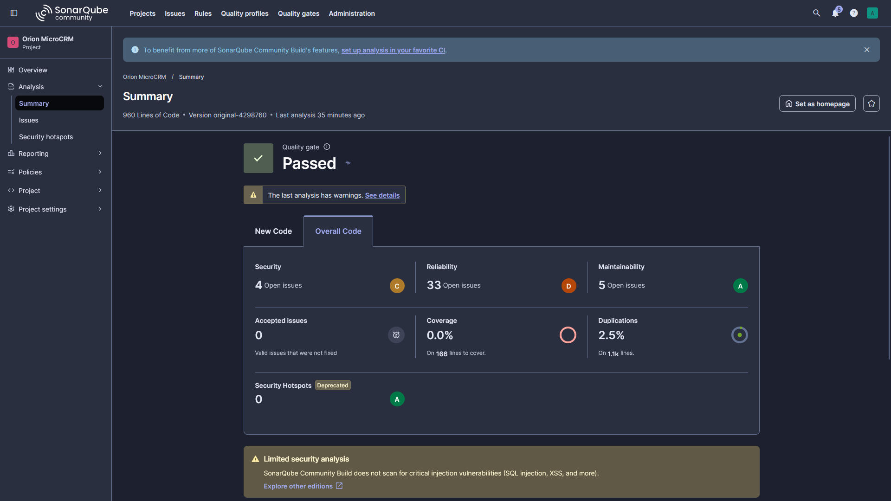
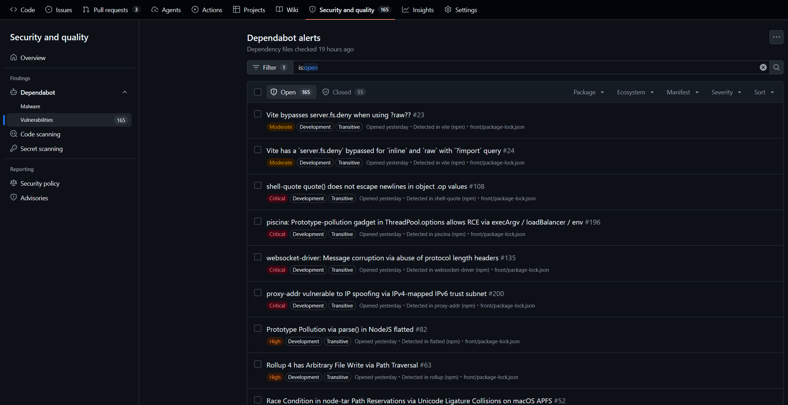

# Mesures de départ (« photo avant »)

Relevés réalisés les 27 et 28/10/2026 sur le code d'origine de MicroCRM
(commit `4298760`), **sans aucune modification de l'application**. Ils servent
de référence au rapport de performance : chaque gain sera comparé à ces
valeurs. Analyse détaillée : [audit, section 3](../01-veille-audit-recommandations.md#3-audit).

## Pipeline d'origine

Exécuté en local avec gitlab-ci-local 4.77.0, cache froid.

| Tâche         | Durée    | Résultat |
| ------------- | -------- | -------- |
| `test-front`  | 3,43 min | réussie (8 tests sur 8) |
| `test-back`   | 2,37 min | réussie (2 tests)       |
| `build-front` | 57 s     | réussie  |
| `build-back`  | 1,23 min | réussie  |
| **Pipeline**  | **4,67 min** | **4 tâches sur 4** |

## Qualité du code (SonarQube Community Build 26.10)

| Indicateur        | Valeur                          |
| ----------------- | ------------------------------- |
| Lignes de code    | 960 (Java 226, TypeScript 332, HTML 401) |
| Problèmes         | 37 (fiabilité 33, sécurité 4, maintenabilité 5) |
| Notes             | sécurité C, fiabilité D, maintenabilité A |
| Couverture        | 0,0 % sur 166 lignes à couvrir  |
| Duplication       | 2,5 %                           |
| Dette technique   | 49 min (voir l'audit, 3.3.3)    |
| Quality Gate      | « Passed », sans condition vérifiée |

## Sécurité

| Source                          | Résultat                              |
| ------------------------------- | ------------------------------------- |
| Trivy, image `back`             | 95 failles : 8 critiques, 33 hautes   |
| Trivy, image `standalone`       | 95 failles : 8 critiques, 33 hautes   |
| Trivy, image `front`            | 10 failles : 2 hautes                 |
| npm audit (front)               | 91 failles : 5 critiques, 52 hautes   |
| hadolint (`Dockerfile`)         | 9 remarques : 6 avertissements, 3 informations |
| GitHub Dependabot               | 165 alertes ouvertes                  |

